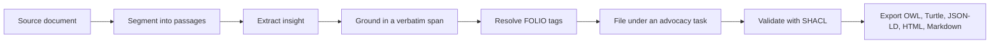

# FOLIO Insights

Turn legal sources into a queryable knowledge base mapped to the [FOLIO legal ontology](https://github.com/alea-institute/FOLIO).

FOLIO Insights reads judicial opinions, briefs, statutes, treatises, journal articles, and practitioner know-how. It pulls out **insights**: the propositions a lawyer would underline, such as a rule's elements, a procedural deadline, or a tip like "ask open-ended questions on direct." Each insight carries a type, an advocacy task, the verbatim source span it rests on, and tags drawn from 18,000+ FOLIO concepts. You get one SHACL-validated OWL module, plus Turtle, JSON-LD, HTML, and Markdown.

The pipeline extracts; it does not generate. It records what a source says, never judges legal merit, and never rewrites the text. Ideas, not expressions.



## Contents

- [Anatomy of an insight](#anatomy-of-an-insight)
- [Examples by source type](#examples-by-source-type)
- [Who it's for](#who-its-for)
- [What you get](#what-you-get)
- [Try it](#try-it)
- [Review viewer](#review-viewer)
- [How it works](#how-it-works)
- [Status](#status)
- [More commands](#more-commands)
- [Contributing](#contributing)

## Anatomy of an insight

Every insight answers five questions: what does the source say, what kind of statement is it, which advocacy task does it serve, where exactly does it come from, and which FOLIO concepts does it touch. The pipeline sorts insights into five types, from the `KnowledgeType` enum in [`knowledge_unit.py`](src/folio_insights/models/knowledge_unit.py):

| Type | Captures | Example |
|---|---|---|
| `advice` | What a practitioner should do | "Ask open-ended questions on direct." |
| `principle` | A rule, standard, or element test | "Breach of contract requires formation, performance, and breach." |
| `procedural_rule` | A deadline, burden, or required step | "Notify affected residents within 45 days of discovery." |
| `citation` | An authority a source relies on | *Ostrander v. Pell Manufacturing Co.* (synthetic) |
| `pitfall` | A mistake that loses ground | "Arguing with the expert at deposition educates her for trial." |

### One insight, end to end

Take one sentence from a firm's practice guide (synthetic; see Example 3 below):

> On direct, ask open-ended questions and let your expert teach; jurors trust the witness, not the lawyer.

`folio-insights extract` turns it into a knowledge unit. The field names come from the `KnowledgeUnit`, `Span`, and `ConceptTag` models; the values illustrate, and lineage is trimmed:

```json
{
  "text": "Ask open-ended questions on direct and let your expert teach.",
  "unit_type": "advice",
  "source_file": "field-guide-ch7.md",
  "source_section": ["Chapter 7: Expert Witnesses", "Direct Examination"],
  "original_span": {"source_file": "field-guide-ch7.md", "start": 0, "end": 61},
  "source_snippet": "On direct, ask open-ended questions and let your expert teach",
  "anchor_verified": true,
  "anchor_score": 1.0,
  "confidence": 0.91,
  "folio_tags": [
    {
      "label": "Direct-Examination of Witness",
      "iri": "https://folio.openlegalstandard.org/RDGR7PTYD8TltxEq0F8NGIR",
      "confidence": 0.94,
      "extraction_path": "entity_ruler"
    },
    {
      "label": "Testifying Expert Witness",
      "iri": "https://folio.openlegalstandard.org/R7lbqYoeuZitiUJsrh5lYIB",
      "confidence": 0.88,
      "extraction_path": "llm"
    }
  ]
}
```

The unit may paraphrase, but `source_snippet` holds the exact source substring at `original_span`, and `anchor_verified` records whether the match cleared the 0.85 threshold. A deterministic resolver turns tag labels into FOLIO IRIs; no model ever writes an IRI.

`folio-insights discover` then files the unit under a task, and `folio-insights export` writes it into the per-task JSON-LD chunk that [`jsonld_builder.py`](src/folio_insights/services/jsonld_builder.py) builds. The `R…` values stand in for minted task and unit IRIs:

```json
{
  "@context": "./context.jsonld",
  "@id": "https://folio.openlegalstandard.org/R…",
  "@type": "owl:Class",
  "rdfs:label": "Direct Examination of Experts",
  "fi:isProcedural": false,
  "fi:units": [
    {
      "@id": "https://folio.openlegalstandard.org/R…",
      "@type": "owl:NamedIndividual",
      "rdfs:label": "Ask open-ended questions on direct and let your expert teach.",
      "skos:note": "Ask open-ended questions on direct and let your expert teach.",
      "fi:unitType": "advice",
      "fi:confidence": 0.91,
      "dc:source": "field-guide-ch7.md"
    }
  ]
}
```

## Examples by source type

> **Synthetic examples. Excerpts are invented for illustration.** Every case, party, docket, firm, journal, and statute below is fictional. The FOLIO tags are real: each links to its live class, checked against the 18,323-class FOLIO release.

Each table shows the insights a run should pull from the excerpt above it. The **Span** column quotes the excerpt verbatim; that quote anchors the insight.

<details open>
<summary><strong>1. Judicial opinion</strong>: elements of breach of contract and the summary-judgment standard</summary>

> *Harlow v. Brightwater Logistics, Inc.*, No. 24-cv-0117 (D. Minn. 2025) (synthetic)
>
> To prevail on a breach-of-contract claim, a plaintiff must prove (1) the formation of a contract, (2) the plaintiff's performance of any conditions precedent, and (3) the defendant's breach. Brightwater argues that Harlow cannot show damages, but nominal damages remain available for any proven breach. Summary judgment is appropriate only when no genuine dispute of material fact exists and the movant is entitled to judgment as a matter of law. Here, the parties dispute whether the March 2023 email modified the delivery schedule, and that dispute is material. A party that relies on an oral modification must point to evidence of mutual assent, not merely one side's understanding. The motion is DENIED.

| Insight | Type | Task | Span | FOLIO tags |
|---|---|---|---|---|
| Breach of contract requires (1) a contract, (2) the plaintiff's performance of conditions precedent, and (3) the defendant's breach. | `principle` | Pleading a Contract Claim | "a plaintiff must prove (1) the formation of a contract" | [Breach of Contract](https://folio.openlegalstandard.org/RC2fjcpsEbrVvVymvt4oASx), [Contract Law](https://folio.openlegalstandard.org/RCIPwpgRpMs1eVz4vPid0pV) |
| A proven breach supports nominal damages even without proof of actual loss. | `principle` | Proving Contract Damages | "nominal damages remain available for any proven breach" | [Damages](https://folio.openlegalstandard.org/RCCv5YLoHUOm5AlqcCBzqGf), [Plaintiff](https://folio.openlegalstandard.org/R9tyJmIM3Lx7OItGji5zPXN) |
| Courts grant summary judgment only when no genuine dispute of material fact exists and the movant wins as a matter of law. | `procedural_rule` | Opposing Summary Judgment | "no genuine dispute of material fact exists" | [Summary Judgment](https://folio.openlegalstandard.org/R8K6VFq9c39kbQouame6Onf), [Judicial Opinion](https://folio.openlegalstandard.org/RDNaE3PFsXDfIudTq7w3ace), [Minnesota](https://folio.openlegalstandard.org/RDB9ffc13Cb117D7caa05f07) |
| A party claiming an oral modification loses without evidence of mutual assent; one side's understanding falls short. | `pitfall` | Opposing Summary Judgment | "must point to evidence of mutual assent, not merely one side's understanding" | [Breach of Contract](https://folio.openlegalstandard.org/RC2fjcpsEbrVvVymvt4oASx), [Evidence](https://folio.openlegalstandard.org/R9HuNkpWm24qMFuntuug6RB) |

</details>

<details>
<summary><strong>2. Brief</strong>: a motion to dismiss for lack of personal jurisdiction</summary>

> Defendant's Memorandum in Support of Motion to Dismiss, *Osterberg Outdoor Supply Co. v. Quillfeather Ceramics GmbH*, No. 25-cv-2290 (D. Minn.) (synthetic)
>
> Plaintiff bears the burden of making a prima facie showing of personal jurisdiction over each defendant. Quillfeather has no office, employees, or bank accounts in Minnesota, and it shipped no product here; a distributor resold the mugs without Quillfeather's direction. The mere foreseeability that a product may reach the forum state does not establish purposeful availment. *Ostrander v. Pell Manufacturing Co.*, No. 22-cv-0940 (D. Minn. 2023). Quillfeather supports this motion with a sworn declaration, which shifts the burden to Plaintiff to come forward with evidence, not allegations.

| Insight | Type | Task | Span | FOLIO tags |
|---|---|---|---|---|
| The plaintiff must make a prima facie showing of personal jurisdiction over each defendant. | `procedural_rule` | Challenging Personal Jurisdiction | "Plaintiff bears the burden of making a prima facie showing of personal jurisdiction" | [Personal Jurisdiction](https://folio.openlegalstandard.org/RinqHf65TtUhr762WKqN6R), [Litigation Burdens of Proof](https://folio.openlegalstandard.org/RDV74m3ydS2I72hZ88Mf1RX) |
| Foreseeability that a product reaches the forum does not establish purposeful availment. | `principle` | Challenging Personal Jurisdiction | "foreseeability that a product may reach the forum state does not establish purposeful availment" | [Personal Jurisdiction](https://folio.openlegalstandard.org/RinqHf65TtUhr762WKqN6R), [Defendant](https://folio.openlegalstandard.org/RijIqw1HEfQF4ctjWUlgnq) |
| *Ostrander v. Pell Manufacturing Co.*, No. 22-cv-0940 (D. Minn. 2023), for the foreseeability rule. | `citation` | Challenging Personal Jurisdiction | "Ostrander v. Pell Manufacturing Co., No. 22-cv-0940 (D. Minn. 2023)" | [Brief / Memorandum of Law](https://folio.openlegalstandard.org/R8wEzsnWA30YRmdfZKRkFuH) |
| Back a jurisdictional motion with a sworn declaration; it forces the plaintiff to answer with evidence, not allegations. | `advice` | Motion Practice | "supports this motion with a sworn declaration, which shifts the burden to Plaintiff" | [Motion to Dismiss](https://folio.openlegalstandard.org/R9Xkp4FqX83NG5ZI0CDfQ1k), [Evidence](https://folio.openlegalstandard.org/R9HuNkpWm24qMFuntuug6RB) |

</details>

<details>
<summary><strong>3. Law-firm know-how</strong>: a practice guide on expert witnesses</summary>

> *Trial Practice Field Guide*, ch. 7, "Expert Witnesses" (Lindqvist & Ober LLP internal know-how, 2025) (synthetic)
>
> On direct, ask open-ended questions and let your expert teach; jurors trust the witness, not the lawyer. Save leading questions for cross. At the opposing expert's deposition, lock in every opinion she plans to offer and every document she relied on. Do not argue with the expert at deposition; you will only educate her for trial. Close each topic by asking, "Have you now told me all the bases for that opinion?"

| Insight | Type | Task | Span | FOLIO tags |
|---|---|---|---|---|
| Ask open-ended questions on direct and let your expert teach. | `advice` | Direct Examination of Experts | "On direct, ask open-ended questions and let your expert teach" | [Direct-Examination of Witness](https://folio.openlegalstandard.org/RDGR7PTYD8TltxEq0F8NGIR), [Testifying Expert Witness](https://folio.openlegalstandard.org/R7lbqYoeuZitiUJsrh5lYIB) |
| At the opposing expert's deposition, lock in every opinion and every document relied on. | `advice` | Expert Depositions | "lock in every opinion she plans to offer and every document she relied on" | [Expert Witness Deposition](https://folio.openlegalstandard.org/RDvL7Pxoo5G3sPWI7IpBRgM) |
| Arguing with the opposing expert at deposition educates her for trial. | `pitfall` | Expert Depositions | "Do not argue with the expert at deposition; you will only educate her for trial" | [Expert Witness Deposition](https://folio.openlegalstandard.org/RDvL7Pxoo5G3sPWI7IpBRgM), [Cross-Examination of Witness](https://folio.openlegalstandard.org/RCz1SYWoNDDTDvPr0kSJBq) |
| Close each deposition topic with an exhaustion question. | `advice` | Expert Depositions | "Have you now told me all the bases for that opinion?" | [Deposition](https://folio.openlegalstandard.org/RCnTNVCQ1VndGxskbMoaLr8), [Witness](https://folio.openlegalstandard.org/R9tZFXPrXQJWHbqSgtCQxJF) |

</details>

<details>
<summary><strong>4. Journal article</strong>: noncompetes, consideration, and promissory estoppel</summary>

> *Reliance Without a Bargain: Promissory Estoppel and the Mid-Employment Noncompete*, 41 Northland L. Rev. 233 (2025) (synthetic)
>
> Courts increasingly decline to enforce a noncompete agreement that an employee signed after starting work unless the employer supplied fresh consideration. A raise, a promotion, or access to new confidential information can serve; continued at-will employment often cannot. When the agreement fails for want of consideration, some employers turn to promissory estoppel, but that doctrine protects reliance on a promise, not an employer's expectation of restraint. This Article argues that courts should reject the estoppel route outright.

| Insight | Type | Task | Span | FOLIO tags |
|---|---|---|---|---|
| A noncompete signed mid-employment needs fresh consideration; continued at-will employment often falls short. | `principle` | Challenging Restrictive Covenants | "continued at-will employment often cannot" | [Noncompete Agreement](https://folio.openlegalstandard.org/RuTiqSJ76kL8qUWS8cae3Z), [Employment Law](https://folio.openlegalstandard.org/R7H5z7e67YZSVmjrNJ0r6rm) |
| To support a mid-employment noncompete, give a raise, a promotion, or access to new confidential information. | `advice` | Drafting Restrictive Covenants | "A raise, a promotion, or access to new confidential information can serve" | [Noncompete Agreement](https://folio.openlegalstandard.org/RuTiqSJ76kL8qUWS8cae3Z), [Employer](https://folio.openlegalstandard.org/RsZxhuNFK33sHecLQ7WJdp) |
| Promissory estoppel protects reliance on a promise, not an employer's expectation of restraint. | `principle` | Challenging Restrictive Covenants | "protects reliance on a promise, not an employer's expectation of restraint" | [Promissory Estoppel](https://folio.openlegalstandard.org/RDoqFy7w8Dr7R9MC1LSxNgv), [Law Review Article](https://folio.openlegalstandard.org/RBg7sRYxsZKH1clvAIAQWhO) |

The article's closing thesis ("courts should reject the estoppel route") stays out of the table: it argues for a change in the law rather than stating the law, and the pipeline never judges which side wins.

</details>

<details>
<summary><strong>5. Statute</strong>: a data-breach notification law</summary>

> Northland Consumer Data Breach Notification Act, Nland. Stat. § 325X.04 (2025) (synthetic)
>
> (a) A business that discovers a data breach shall notify each affected resident within 45 days after discovery. (b) The notice must describe the categories of personal information involved and the steps the resident can take to protect against identity theft. (c) A business that delays notice at the written request of a law enforcement agency does not violate subdivision (a). (d) An action under this section must be commenced within two years after the resident receives notice.

| Insight | Type | Task | Span | FOLIO tags |
|---|---|---|---|---|
| Notify each affected resident within 45 days after discovering a breach. | `procedural_rule` | Data Breach Response | "shall notify each affected resident within 45 days after discovery" | [Data Breach](https://folio.openlegalstandard.org/Raw03V8d0o2ILRa4VEpq4t), [Notice](https://folio.openlegalstandard.org/RB3FT9lFNQIjRnFIueLgCa7) |
| The notice must name the categories of personal information involved and the protective steps open to residents. | `procedural_rule` | Data Breach Response | "describe the categories of personal information involved" | [Notice](https://folio.openlegalstandard.org/RB3FT9lFNQIjRnFIueLgCa7), [Privacy Law](https://folio.openlegalstandard.org/R8hJCf4Ih6iuFXsxeK7e6zU) |
| A written law-enforcement request excuses delayed notice. | `principle` | Data Breach Response | "at the written request of a law enforcement agency does not violate subdivision (a)" | [Data Breach](https://folio.openlegalstandard.org/Raw03V8d0o2ILRa4VEpq4t), [Statutes](https://folio.openlegalstandard.org/RHagFJXtPsCCn5dbENWLNR) |
| Suits under the section expire two years after the resident receives notice. | `procedural_rule` | Litigating Breach-Notice Claims | "must be commenced within two years after the resident receives notice" | [Statute of Limitations](https://folio.openlegalstandard.org/RDKJ7nEqeDxNDRxI2Wqil1N) |

</details>

<details>
<summary><strong>6. Jury instruction</strong>: negligence and direct cause</summary>

> Northland Civil Jury Instruction Guide, CIVJIG 25.10, "Negligence: Definition and Direct Cause" (synthetic)
>
> Negligence is the failure to use reasonable care. Reasonable care is the care a reasonable person would use in the same or similar circumstances. The plaintiff must prove by the greater weight of the evidence that the defendant was negligent and that the negligence was a direct cause of the harm. A direct cause is a cause that had a substantial part in bringing about the harm.

| Insight | Type | Task | Span | FOLIO tags |
|---|---|---|---|---|
| Negligence means failing to use the care a reasonable person would use in the same or similar circumstances. | `principle` | Proving Negligence at Trial | "Negligence is the failure to use reasonable care" | [Negligence](https://folio.openlegalstandard.org/R7nqxxlAfhYqqSA2UQ5UxpX), [Jury Instructions](https://folio.openlegalstandard.org/RCaZrUbTpgbGRrwYk2keJES) |
| The plaintiff proves negligence and causation by the greater weight of the evidence. | `procedural_rule` | Proving Negligence at Trial | "must prove by the greater weight of the evidence" | [Preponderance of Evidence](https://folio.openlegalstandard.org/Ro7NzBFiq6eW3vKMpqpufQ), [Plaintiff](https://folio.openlegalstandard.org/R9tyJmIM3Lx7OItGji5zPXN) |
| A direct cause played a substantial part in bringing about the harm. | `principle` | Proving Causation | "had a substantial part in bringing about the harm" | [Proximate Cause](https://folio.openlegalstandard.org/R9urhXjf5qj2wZs4fVFCl7A), [Jury Trial](https://folio.openlegalstandard.org/R9TOzhWvuxDJlWPJfg2UmhF) |

</details>

<details>
<summary><strong>7. Contract playbook</strong>: negotiating a vendor SaaS agreement</summary>

> *Vendor SaaS Agreement Negotiation Playbook*, § 4, "Liability" (Fernhollow Analytics in-house legal team, 2025) (synthetic)
>
> Never accept a limitation of liability clause that caps the vendor's exposure below twelve months of fees. Carve out data breaches, confidentiality breaches, and indemnification obligations from the cap. If the vendor insists on mutual caps, ask for a separate, higher super-cap for data incidents. A force majeure clause should not excuse the vendor's obligation to maintain backups and restore service.

| Insight | Type | Task | Span | FOLIO tags |
|---|---|---|---|---|
| Reject any liability cap below twelve months of fees. | `advice` | Negotiating Vendor Agreements | "caps the vendor's exposure below twelve months of fees" | [Limitation of Liability Clause](https://folio.openlegalstandard.org/RBukB9MGGdY4Kwx3b6itiwi) |
| Carve data breaches, confidentiality breaches, and indemnities out of the cap. | `advice` | Negotiating Vendor Agreements | "Carve out data breaches, confidentiality breaches, and indemnification obligations from the cap" | [Indemnification Clause](https://folio.openlegalstandard.org/R9oz08cWJcI23x0nYU1h0it), [Data Breach Clause](https://folio.openlegalstandard.org/R8IQg7EUvdgPRcmPx8Sz8Au) |
| Trade a mutual cap for a separate, higher super-cap on data incidents. | `advice` | Negotiating Vendor Agreements | "ask for a separate, higher super-cap for data incidents" | [Mutual Limitation of Liability Clause](https://folio.openlegalstandard.org/RCTDgda7nF6Jjm41aGQOlbG) |
| A force majeure clause that excuses backups and restoration leaves the customer exposed. | `pitfall` | Negotiating Vendor Agreements | "should not excuse the vendor's obligation to maintain backups" | [Force Majeure](https://folio.openlegalstandard.org/RCp6PzHvkRv1l3pXC9E4Mse) |

</details>

<details>
<summary><strong>8. CLE outline</strong>: taking a corporate-representative deposition</summary>

> "Organizational Depositions in Practice," Northland CLE Litigation Institute, session outline, part II (synthetic)
>
> Serve the deposition notice at least 30 days before the deposition so the organization can prepare its designee. Describe each topic with reasonable particularity; vague topics invite a designee who knows nothing. The designee testifies for the organization, so an "I don't know" can bind it at trial. Meet and confer on the topics before the deposition, and confirm the agreed scope in writing.

| Insight | Type | Task | Span | FOLIO tags |
|---|---|---|---|---|
| Serve the notice at least 30 days ahead so the organization can prepare its designee. | `advice` | Corporate Representative Depositions | "Serve the deposition notice at least 30 days before the deposition" | [Deposition](https://folio.openlegalstandard.org/RCnTNVCQ1VndGxskbMoaLr8), [Notice](https://folio.openlegalstandard.org/RB3FT9lFNQIjRnFIueLgCa7) |
| Vague topics produce a designee who knows nothing. | `pitfall` | Corporate Representative Depositions | "vague topics invite a designee who knows nothing" | [Corporate Representative Deposition Practice](https://folio.openlegalstandard.org/R3MdX1jnLm0lwZoaOurqTG) |
| The designee speaks for the organization, so an "I don't know" can bind it at trial. | `principle` | Corporate Representative Depositions | "The designee testifies for the organization" | [Corporate Representative Deposition Practice](https://folio.openlegalstandard.org/R3MdX1jnLm0lwZoaOurqTG), [Witness](https://folio.openlegalstandard.org/R9tZFXPrXQJWHbqSgtCQxJF) |

</details>

Across all eight, the tags reach into FOLIO's areas of law (Contract Law, Employment Law, Privacy Law), legal events (Deposition, Summary Judgment, Cross-Examination of Witness), document types (Judicial Opinion, Brief / Memorandum of Law, Law Review Article, Jury Instructions), contract clauses (Force Majeure, Indemnification Clause), actors (Plaintiff, Defendant, Employer, Witness), and jurisdictions (Minnesota).

## Who it's for

- **Ontologists and researchers** building FOLIO-aligned legal knowledge bases.
- **Application developers** who want a task-indexed corpus of advocacy knowledge.
- **AI engineers** wiring legal retrieval into RAG pipelines or agents; the JSON-LD export fits chunked retrieval.
- **Practitioners and educators** exploring how advocacy concepts connect.

## What you get

| Output | Use it for |
|---|---|
| OWL (RDF/XML), SHACL-validated | Reasoners, ontology editors, FOLIO alignment |
| Turtle | SPARQL stores, diffs, version control |
| JSON-LD | LLM retrieval and RAG chunking |
| HTML | Browsing the task tree in a browser |
| Markdown | Reading and sharing an outline |

One `export` command writes all five.

## Try it

**Demo.** A dev deployment serves a small synthetic corpus: <https://folio-insights.dev.openlegalstandard.org>.

**Requirements.** Python 3.11 or 3.12; Node.js 20+ only to rebuild the viewer (built assets ship with the repo); your own API key for an LLM provider (Anthropic, OpenAI, Google, or Ollama). The server never holds a shared key. Runs default to Google's `gemini-2.5-flash-lite`; pick another provider with `--llm-provider` or `FOLIO_INSIGHTS_LLM_PROVIDER`.

**Install.** FOLIO Insights still loads document ingestion and tabular mapping from two sibling repos, so clone all three side by side:

```bash
git clone https://github.com/alea-institute/folio-enrich.git
git clone https://github.com/alea-institute/folio-mapper.git
git clone https://github.com/alea-institute/folio-insights.git
cd folio-insights
python -m venv .venv && source .venv/bin/activate
pip install -e ".[dev]"
cp .env.example .env    # add your key, e.g. GOOGLE_API_KEY or ANTHROPIC_API_KEY
folio-insights --version
```

**Run.**

```bash
folio-insights extract ./my-sources --corpus advocacy --output ./output   # split, ground, and tag
folio-insights discover advocacy --output ./output                         # build the task tree
folio-insights export advocacy --format owl,ttl,jsonld,html,md            # write all five formats
folio-insights serve --port 8742                                          # open the review viewer
```

`extract` and `discover` accept `--llm-provider`, `--llm-model`, and `--max-spend-usd`. Every command resumes from its last checkpoint. Run `folio-insights <command> --help` for thresholds and options.

## Review viewer

`folio-insights serve` opens a SvelteKit app backed by FastAPI. It walks one corpus through five steps: **Upload** (deduplicated by content hash), **Process** (live progress), **Discover** (task tree and flagged contradictions), **Review** (approve units, edit labels, re-parent tasks, resolve contradictions), and **Export**. The viewer runs the same pipeline code as the CLI.

## How it works

1. **Ingest and tag.** Structural heuristics split a document into units; an LLM refines ambiguous paragraphs. The pinned [folio-resolve](https://github.com/damienriehl/folio-resolve) library turns labels into FOLIO IRIs deterministically. An LLM judge may reject or downgrade a tag, but no model ever writes an IRI.
2. **Discover tasks.** An LLM proposes advocacy tasks and sub-tasks, merges them across sources, and flags contradictions between sources.
3. **Map to OWL.** Units become RDF with FOLIO links and provenance.
4. **Validate and export.** SHACL checks the graph before export.

## Status

**v1.0 (2026-04-04)** shipped the pipeline, CLI, and viewer above.

**v2.0, "shards as axioms" (in progress),** turns each unit into a signed, versioned *shard* that a community can review, cite, fork, and supersede. Landed on `master`: a pyoxigraph store with SHACL checks on every write; content hashing and stable IRIs; `did:key`, `did:web`, and `did:plc` reviewer identities with signed attestations; a governance lifecycle; valid-time supersession; a provider-neutral LLM layer with a spend cap; a durable job queue; a seed kernel of Latin legal maxims; and a gated shard minter. [`PHILOSOPHY.md`](PHILOSOPHY.md) explains the design; [`PRD-v2.0-draft-2.md`](PRD-v2.0-draft-2.md) specifies it.

**Extraction quality: not yet validated on a real corpus.** The examples above show the target, not measured output. In July 2026, a test run on a legal treatise found invented units and about 90% of 2,226 FOLIO tags pointing at the wrong concept. Two fixes have landed since: deterministic IRI resolution (July 2026) and a shard minter that refuses any unit whose text it cannot anchor in the source (October 2026). No real corpus has yet cleared the publishing bar (a 0.80 score on the extraction-quality rubric). Until one does, treat every shard as a hypothesis.

**Planned.** An annotation workbench will show source text with FOLIO tags overlaid, so reviewers can mark each tag correct, weak, or wrong and flag concepts the tagger missed. Mockups live in [`docs/design/review-ui/`](docs/design/review-ui/).

## More commands

Beyond the core four: `verify-iris` re-mints every stored shard IRI and reports drift, and v2.0 adds the groups `mint`, `rubric`, `kernel`, `graph`, `query`, `validate`, `framework`, `bfo`, `polysemy`, `did`, `governance`, `corpus`, `storage`, `proposals`, `bench`, `api`, `bridge-ingest`, and `bridge-status`. Each group loads its heavy dependencies lazily.

## Deploy

The dev site runs `Dockerfile.web` on Coolify: one FastAPI service that also serves the built viewer, with `/health` as its healthcheck. LLM features take each user's own key. Details: [`docs/deploying.md`](docs/deploying.md).

## Project layout

```
src/folio_insights/   pipeline, CLI, and the v2.0 modules (shards, governance, identity, storage, minting, ...)
api/                  FastAPI backend for the viewer
viewer/               SvelteKit review viewer
docs/                 plans, evidence packs, rubrics, design mockups, handoffs
tests/                pytest suite
.planning/            legacy GSD planning record
```

## Contributing

Open an issue before large changes; send small fixes and doc edits as pull requests. Run the fast suite (about 3,500 tests) with `pytest -m "not slow and not gate5"`; integration tests need folio-enrich checked out. The repo has no GitHub Actions yet, so attach your local test results to each PR. Changes to confidence thresholds, gating, or tagging paths need a written rationale, because downstream consumers depend on them.

## Out of scope

FOLIO Insights does not offer legal advice, judge legal merit, run in real time, rewrite source text, or process non-English source text.

## License

MIT; see [LICENSE](LICENSE). Third-party licenses: [THIRD-PARTY.md](THIRD-PARTY.md). FOLIO and BFO carry CC-BY 4.0.

Copyright © Damien Riehl and ALEA Institute.
