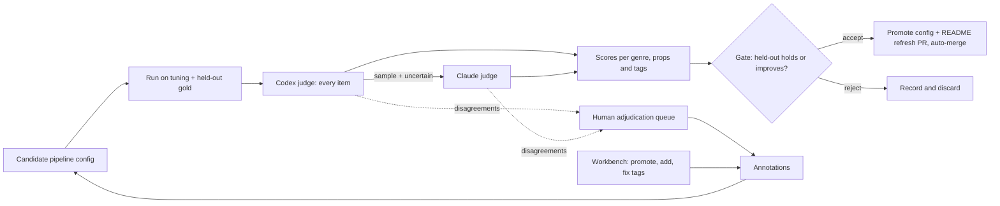
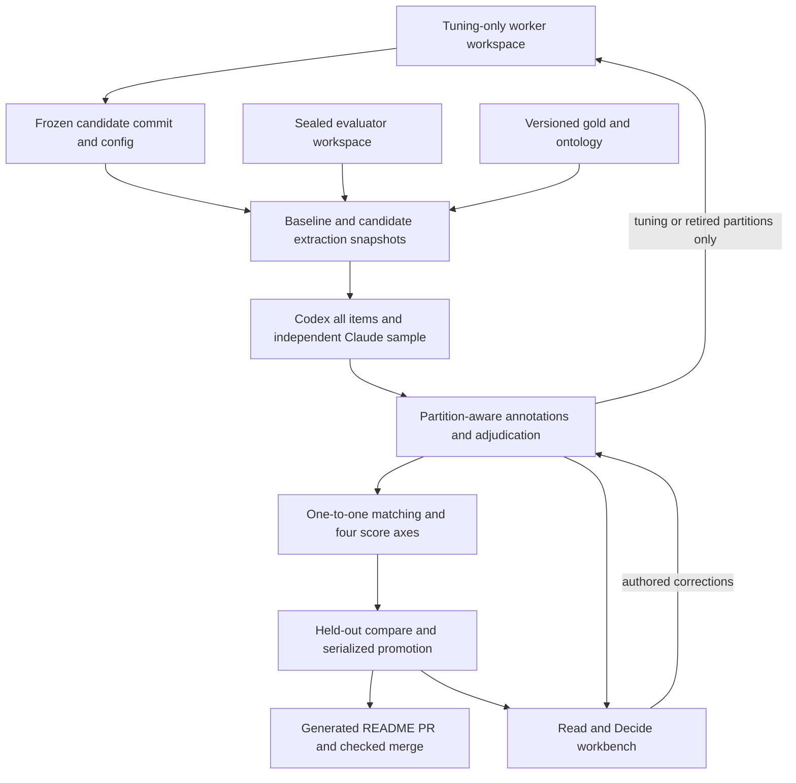
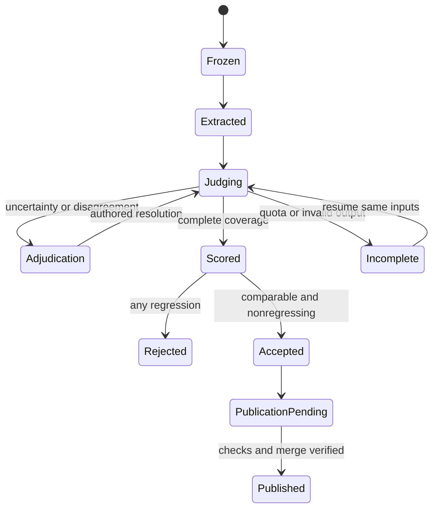

# Measured Propositions and Review Workbench - Plan

## Goal Capsule

- **Objective:** Every claim the README makes about FOLIO Insights' output carries a measured score, and that output keeps getting better between human reviews. The output is flat, source-grounded propositions tagged by meaning across many FOLIO branches, in opinions, statutes and regulations, briefs, and know-how.
- **Means:** Build the measuring loop first: gold suites, LLM judges, and a held-out gate. Then land each pipeline change through that gate. Lawyers audit the loop in a workbench that overlays propositions on the source text.
- **Product authority:** Damien Riehl, in the 2026-10-25/26 brainstorm session. This plan supersedes the build order in `docs/plans/2026-10-20-1830-feat-review-ui-rescope-plan.md` wherever the two conflict, and it retires the `elaborates` hierarchy (KD3).
- **Open blockers:** None for planning. One input is still to come from Damien: the location of his own know-how and article materials (R11). Synthetic examples carry that genre until he provides it.

---

## Product Contract

### Summary

The plan builds an instrument that scores FOLIO Insights' propositions and tags against gold answers. Codex and Claude judges review every run, and a held-out gate accepts only changes that improve the scores. The pipeline then gets rebuilt one measured change at a time: atomic propositions with typed links, multi-tag minting, tagging by meaning (including deontic concepts and areas of law), four source genres, and exports that carry tags and spans. A workbench lets lawyers see what the pipeline missed and correct it over the source text.

### Problem Frame

On 2026-10-25 the README was rewritten to describe the intended product. It describes flat propositions, each grounded in a verbatim span and tagged with as many of FOLIO's 18,000+ concepts as apply. Those concepts cover who owes what duty, what is permitted or prohibited, the exceptions, the penalties, the area of law, the forum, and the actors. A gap scan against master `72d1b91` found the code delivers little of that:

- **Exports:** the OWL and JSON-LD exports carry no tags or spans, and export refuses to run without approved tasks.
- **Distillation:** the pipeline compresses each chunk of up to 600 characters into one "core insight," using an advocacy-specific prompt.
- **Tagging:** "Area of Law" is excluded from deterministic tagging, and no code maps "shall", "may", or "unless" to FOLIO's Deontic Specification concepts.
- **Minting:** the minter keeps only the top tag. It refuses procedural rules and citations, the units statutes produce most.
- **Measurement:** no precision or recall number exists for any real corpus. All runs so far used one trial-advocacy treatise. In July 2026 a review found about 90% of 2,226 tags wrong.

Without a measuring instrument, nobody can tell whether a pipeline change helped. The July results showed how easily output that looks right hides systematic error.

Damien reviews by expert reading. He can tell where a source states a proposition the pipeline missed (a recall miss) and where an extracted proposition is wrong (a precision error). His time is scarce: he will be at a conference the week of 2026-10-26, and Codex credits on his plan expire around 2026-10-28. The loop must therefore run mostly without him, and it must say plainly how far its scores can be trusted.

### Key Decisions

- **Instrument first, then measured pipeline changes.** Each pipeline change lands only as a gate-accepted improvement. (session-settled: user-directed — chosen over rebuilding the pipeline first and over making the LLM judges the extractors: measurement must exist before changes can be judged; a judges-as-extractors pipeline may compete later as one more candidate on the same gate.) Governs R1–R8.
- **Auto-tune is the primary use of annotations.** Annotations also feed scoring, corrected output, and an improvement queue. (session-settled: user-directed — chosen over gold-set-first, fix-output-first, and improvement-queue-first.) Governs R6, R7.
- **Flat propositions with typed links; no hierarchy.** The `elaborates`/Tractarian structure planned in `docs/plans/2026-10-09-0650-feat-shards-axioms-drain-plan.md` and `docs/plans/2026-10-05-0308-feat-phase9-design-principles-plan.md` is retired for units. (session-settled: user-directed — chosen over strictly flat and over keeping the hierarchy underneath: a lawyer must be able to ask which rule an exception modifies.) Governs R9, R10.
- **Atomicity: a rule plus one proposition per element.** (session-settled: user-directed — chosen over one proposition with the elements inside, and over following the source's structure.) Governs R9.
- **The bar is P 0.95 / R 0.90, measured separately for propositions and for tags.** (session-settled: user-directed — chosen over 0.90/0.80 and 0.80/0.70.) Governs R4.
- **LLM judges first; a small human anchor keeps the scores honest.** (session-settled: user-directed — chosen over reviewing disagreements only and over fully autonomous judging.) Governs R3, R5.
- **Codex judges first and Claude judges lightly.** (session-settled: user-approved — chosen over equal dual judging and over Codex-only: protects Damien's interactive Claude Max use while Codex credits last.) Governs R3.
- **The workbench combines pipeline-flagged misses with highlight-to-add.** (session-settled: user-directed — chosen over a select-only view, a flag-only view, and a source-beside-ledger view.) Governs R20–R24.
- **The README stays true by regeneration.** Accepted improvements open and merge a README refresh automatically. (session-settled: user-approved — chosen over waiting for Damien to merge, and over manual regeneration.) Governs R8.
- **The real-corpus scope covers four genres and seven jurisdictions.** The genres: opinions, statutes and regulations, briefs, and know-how and articles. The jurisdictions: federal, Minnesota, Texas, California, New York, Florida, and Illinois. (session-settled: user-directed — chosen over federal-only and federal-plus-Minnesota.) Governs R11.

### Actors

- A1. **Pipeline:** extracts propositions, links them, and tags them, under the current configuration.
- A2. **Codex judge:** reviews every proposition and tag in a run, marking each correct, wrong, or uncertain. It also proposes missed propositions.
- A3. **Claude judge:** independently reviews a sample of each run, plus every item the Codex judge marked uncertain.
- A4. **Human reviewers:** Damien plus a few lawyers. They audit and correct in the workbench, and they adjudicate items where the judges disagree.
- A5. **Gate:** compares a candidate configuration against the current one on held-out gold. It accepts or rejects the change, and on acceptance it triggers the README refresh.

### Requirements

**Measuring loop**

- R1. A gold suite encodes the README's eight synthetic examples under the atomicity rule (R9). Every pipeline run scores against it.
- R2. A real-corpus gold set exists for each genre in R11. The set is drafted by workers and cross-checked by the judges, and it is split into tuning and held-out portions. Tuning never sees the held-out portion.
- R3. Every run is judged by A2 on every item and by A3 on a sample plus every item A2 marked uncertain. Items where the judges disagree go to a human adjudication queue.
- R4. Scores report precision and recall separately for propositions and for tags, by genre and by source. The pass bar is P ≥ 0.95 and R ≥ 0.90.
- R5. A human anchor set, verified by Damien per genre, measures each judge's accuracy. Until it exists, every reported score is labelled "judge agreement, unanchored."
- R6. Every annotation, from a judge or a human, is stored with its author, its verdict, and its reason, and is available as tuning data.
- R7. The gate (A5) accepts a candidate configuration only if held-out scores hold or improve on every measured axis. Every accept or reject leaves a before-and-after record.
- R8. Each accepted change regenerates the README's example tables and scores from real pipeline output, then opens and merges that refresh once checks pass.

**Propositions and tags**

- R9. Extraction emits atomic propositions. A rule with elements becomes the rule plus one proposition per element.
- R10. Propositions carry typed links to other propositions: exception-to, penalty-for, condition-of, cites, and contradicts. No tree or parent hierarchy exists.
- R11. The pipeline handles four genres: judicial opinions, statutes and regulations, briefs, motions and pleadings, and know-how and articles. Real corpora come from federal law plus MN, TX, CA, NY, FL, and IL. Know-how comes from Damien's own materials.
- R12. Each proposition carries every FOLIO tag that applies, across branches. Branch labels name the real FOLIO ancestor, including sub-branches such as Deontic Specification.
- R13. Deontic tagging runs in two passes. A deterministic pass maps modal language ("shall", "must", "may", "may not", "unless", "except") and FOLIO's own labels and alternate labels to deontic concepts. A probabilistic pass catches phrasing the deterministic pass misses.
- R14. Area of Law is assigned deterministically when the source names an area nearly verbatim, and probabilistically otherwise.
- R15. A model may select concepts, but only the deterministic resolver turns a selection into a FOLIO IRI. No model ever writes an IRI.
- R16. Every proposition stays grounded in a verbatim source span, and grounding is checked at extraction as well as at minting.
- R17. Minting keeps every tag on a shard. Minting accepts procedural rules and citations.

**Exports**

- R18. Every export format (OWL, Turtle, JSON-LD, HTML, Markdown) carries each proposition's tags, their branches, its span, and its typed links.
- R19. Export works on extracted propositions directly, without first requiring task discovery or approval.

**Workbench**

- R20. The workbench renders a source document with each proposition's span overlaid on the text.
- R21. Sentences that produced no proposition are shaded. Candidates the pipeline dropped are marked, along with the reason each was dropped.
- R22. A reviewer can promote a dropped candidate, confirm the drop, or highlight any passage to add a missed proposition. Every one of those actions becomes an annotation (R6).
- R23. Selecting a proposition shows its tags grouped by branch. A reviewer can confirm a tag, reject it, or add a missing one.
- R24. The workbench shows judge verdicts, judge disagreements, and gate history, so a reviewer can audit what ran unattended.

### Key Flows



- F1. Unattended improvement cycle
  - **Trigger:** A worker proposes a pipeline change, or the annotations since the last cycle cross a refresh threshold.
  - **Actors:** A1, A2, A3, A5
  - **Steps:** Run the candidate on the tuning and held-out gold. Judge every item. Score the run. Gate the change.
  - **Outcome:** The change is accepted and the README refreshed, or rejected with a record.
  - **Covered by:** R1–R8
- F2. Reviewer audit
  - **Trigger:** A reviewer opens a source in the workbench.
  - **Actors:** A4
  - **Steps:** Scan the shaded gaps and dropped candidates. Promote, confirm, or highlight to add. Fix tags. Adjudicate queued disagreements.
  - **Outcome:** New annotations feed the next F1 cycle.
  - **Covered by:** R20–R24, R6

### Acceptance Examples

- AE1. **Covers R9, R10.** **Given** the opinion excerpt "a plaintiff must prove (1) the formation of a contract, (2) the plaintiff's performance…, and (3) the defendant's breach," **then** extraction yields four propositions: the rule and three elements. Each element links to the rule by condition-of.
- AE2. **Covers R13, R10.** **Given** "(b) A business need not notify if law enforcement requests a delay in writing," **then** the proposition is tagged Permission and Exception (Deontic Specification) and links exception-to the duty in subdivision (a).
- AE3. **Covers R14.** **Given** a statute passage that never names its area of law, **when** the probabilistic pass selects "Privacy Law" from candidates, **then** the resolver supplies the IRI and the tag records a probabilistic origin.
- AE4. **Covers R7.** **Given** a candidate that raises proposition recall but drops held-out tag precision from 0.93 to 0.91, **then** the gate rejects it, records the before-and-after, and leaves the README untouched.
- AE5. **Covers R5.** **Given** no human anchor exists yet for statutes, **then** every statute score displays as "judge agreement, unanchored," even when it clears 0.95/0.90.
- AE6. **Covers R21, R22.** **Given** the pipeline dropped a candidate whose anchor score was 0.78, **then** the workbench shows it dashed with that reason. Promoting it stores an annotation that names the reviewer.

### Success Criteria

- All eight README examples reproduce from real pipeline output at P ≥ 0.95 and R ≥ 0.90 for propositions and for tags, and the README tables are generated rather than hand-written.
- Each genre in R11 clears the same bar on its held-out real corpus. Each genre's numbers count as anchored only once Damien has verified that genre's anchor set.
- At least one full F1 cycle runs end to end without a human and produces an accept or a reject with its record.

### Scope Boundaries

- **Deferred for later:**
  - **Reviewer roles:** roles, permissions, and quality weighting beyond recording each annotation's author.
  - **Other surfaces:** the Phase 15 wizards (polysemy fork, contest, retract/supersede), the shard timeline, and the SPARQL explorer.
  - **Advocacy tasks:** task discovery and grouping stay in the code as a secondary view, and this plan does not improve them.
- **Outside this work:**
  - **Generation:** writing or evaluating legal merit. The pipeline extracts and never generates.
  - **Model-minted IRIs:** no model writes an IRI on any path (R15).

### Dependencies / Assumptions

- **Codex credits:** Codex capacity on Damien's plan is available through about 2026-10-28. After that, the work continues on the regular Codex allotment or on Claude workers.
- **Coordination:** this lane shares worker admission limits with the concurrent Codex drain the Chief session runs (`agent-admit`, at most 3 workers).
- **Anchors:** Damien verifies the human anchor sets after the conference. Until then, R5 labelling applies.
- **Public corpora:** opinions, statutes, regulations, and briefs come from public sources. Know-how waits on Damien's materials (R11).

### Outstanding Questions

**Deferred to Planning**

- The held-out split ratio and each gold set's size per genre and jurisdiction.
- The A3 sample rate (about 20% proposed) and the agreement threshold that routes an item to the human queue.
- How the workbench relates to the existing Read/Decide modes and tokens in `docs/plans/2026-10-20-1830-feat-review-ui-rescope-plan.md`. That plan's open look-and-workflow questions remain Damien's.
- The source and licensing check for each public corpus.

### Sources / Research

- README claims this plan must make true: `README.md` at `72d1b91`.
- The prior review-UI plan and mockups: `docs/plans/2026-10-20-1830-feat-review-ui-rescope-plan.md`, `docs/design/review-ui/`.
- Code facts from the gap scan:
  - **Exports:** no tags in `src/folio_insights/services/jsonld_builder.py` or `owl_serializer.py`, and the approved-task requirement in `cli.py:477-502`.
  - **Area of Law exclusion:** `services/folio_ontology.py:94-99`.
  - **Minting limits:** supported unit types in `minting/eligibility.py:138-142`, and the single top tag in `minting/mapper.py:21-23`.
  - **Distillation:** the 600-character cap in `config.py:65`, and the prompt in `services/prompts/distillation.py:3`.
  - **Existing judge:** the off-by-default judge in `pipeline/stages/folio_tagger.py:1-23,76-77`.
- The FOLIO Deontic Specification class (`RClhbl4E1TJp9LygIXewIhn`) and its children: Obligation (alternate labels Duty, Legal Obligation, Responsibility), Permission, Prohibition, Exception, Right, Waiver, Violation, Compliance, and Authority.
- The Codex drain pattern: cockpit `docs/plans/2026-10-09-1840-ops-midnight-drain-plan.md`.

---

## Planning Contract

**Product Contract unchanged.** Everything above this section remains byte-for-byte identical to `origin/master` at `6e7b156`. This section defines HOW to deliver R1–R24; the Product Contract remains the authority on WHAT.

### Execution boundary and sequencing

This is an implementation plan, not evidence that extraction accuracy has already improved. New paths and commands below are planned additions unless identified as existing. Each U-ID is one worker assignment, normally one focused commit. The orchestrator admits at most three workers in a wave, waits for their receipts, and integrates prerequisite commits before starting the next wave. The wave schedule below is deliberately conservative about shared-file edits. Never dispatch two units owning the same file together.

U1–U9 build and exercise the instrument against the current pipeline. U10–U32 establish the public real-corpus gold and its first sealed baseline. U33–U50 and U60 may be built in parallel with the instrument, but an output-changing unit merges only after a live gate accepts it (KTD15): first against U9's sealed synthetic holdout, and also against the real held-out corpus once U32 seals it. U51–U57 implement the workbench in the existing SvelteKit app. U59 makes annotation-driven tuning automatic; U58 proves the complete loop. A failed quality gate leaves a candidate unpromoted; it does not prevent keeping a reviewed implementation behind an inactive configuration. Neither a mocked test nor an unpublished fixture score counts as a live gate run.

Workers use the main checkout's existing Python venv read-only, with `PYTHONPATH=src` to import this worktree and `PYTHONDONTWRITEBYTECODE=1`. In commands, `FOLIO_PYTHON` is the orchestrator-provided path to that interpreter. Do not install into it. All document paths are repo-relative. Network flags follow KTD15: they describe who executes each part of an assignment, and a Codex build assignment never needs a network.

### Key Technical Decisions

- KTD1. **Version the evaluation inputs independently of pipeline output.** Add `src/folio_insights/measurement/` alongside the existing `rubric/`; reuse its fixture/CLI conventions without relabelling RUB-EXTRACT as precision/recall. An evaluation run pins source snapshots, gold revision, split manifest, ontology digest, scorer/matcher version, baseline/candidate commit and configuration hashes, extraction prompt hashes, judge prompts, CLI/model identities and deterministic sampling seed. Store per-item checkpoints and content hashes under `output/measurement/`; publish sanitized aggregate receipts under `data/measurement/receipts/` (not `docs/evidence/`, which `scripts/check_exclusions.py` treats as an excluded prefix for new commits). Raw held-out labels and judge rationales never enter worker-visible evidence commits. This implements R1–R7.
- KTD2. **Score exhaustive gold, including omissions.** For R4, gold enumerates atomic propositions, spans, typed links and complete tag sets; a model's failure to propose an omission cannot erase a gold item. Deterministic one-to-one matching uses exact grounded spans and independently adjudicated semantic equivalence edges when text differs. A compound claim cannot match several atomic gold claims. Freeze matching policy before evaluating candidates. Count unmatched predictions as proposition FP, unmatched gold as FN, and matched atomic equivalents as TP. Tag TP/FP/FN are proposition-scoped resolver identities: tags on unmatched predictions are FP; tags on missed gold propositions are FN. Deduplicate identical tags within a proposition, but duplicate proposition predictions incur FP. Report P and R independently for propositions and tags by genre and by source, with numerator/denominator counts and micro totals. Zero denominators are explicitly unmeasurable, never 1.0. Distinguish a fully evaluated empty prediction set over nonempty gold from missing gold, sources or judgments; the former has known recall zero and undefined precision, with the recovery transition in KTD7. Report branch/link/grounding diagnostics separately without substituting them for R4's axes. Complete tag sets come from pooled adjudication, because nobody can enumerate every applicable concept out of 18,000+ unaided. For each gold proposition, the candidate pool is the union of tags from the gold author, every evaluated pipeline configuration, both judges' missing-tag proposals, and the resolver's top candidates per branch. Each pooled tag is adjudicated, and the surviving set is the gold tag set. A tag that a later candidate proposes outside the existing pool enters adjudication before scoring; it is never an automatic false positive. To estimate how much the pool itself misses, each run asks the Claude sample of KTD4 to name missing tags against the pooled set. That pool-miss rate is reported beside tag recall, and an uncorrected pool-miss rate above 5% for a genre labels that genre's tag recall "pool-limited."
- KTD3. **Use subscription CLIs through one evaluation-judge port.** Implement Codex (`codex exec`) and Claude (`claude -p`) adapters returning the same strict verdict schema: correct/wrong/uncertain, reason, item ID, optional source-grounded omission and opaque concept-selection IDs. The model sees quoted source, candidate items and a candidate catalog with opaque IDs/labels; output schemas prohibit IRI fields and reject IRI strings. Deterministic code alone expands IDs to FOLIO IRIs (R15). Invoke argument arrays without a shell, feed prompts through stdin, isolate the working directory and tools, and validate exact item coverage. Use Codex read-only/ephemeral execution and structured schema output; use Claude structured JSON, disabled tools and session persistence. Capability-check flags against the installed CLI help. In the subprocess environment, remove API-key, custom-base-URL and cloud-provider overrides, including `ANTHROPIC_API_KEY` and `ANTHROPIC_BASE_URL`; never set either. No HTTP SDK or API-key fallback exists. Missing subscription auth, quota, timeout, cancellation, invalid output or nonzero exit leaves an incomplete checkpointed run. A retry processes only missing items under the same input hashes. Preserve the current pipeline branch judge's separate provenance checks; this port does not forge those checks or their template identities (R3, R15).
- KTD4. **Claude reviews independently and lightly.** For each run, take a reproducible 20% sample, rounded up with at least one item from every nonempty genre/source/item-kind stratum, then union every Codex-uncertain item. Items include predictions, gold/omission coverage decisions and proposed missing tags. Record the denominator and realized coverage, which may exceed 20% on small suites. Claude receives no Codex verdict or rationale. Any verdict difference, incompatible omission assessment or unresolved uncertainty creates an adjudication item. Preserve both original judgments and append the human resolution. Pending uncertainty/disagreement cannot be silently removed from score denominators or accepted by a gate. R5 labels apply until Damien verifies the relevant genre's anchor; an anchor reports each judge's correctness against human labels and never certifies itself (R3–R6).
- KTD5. **One append-only annotation service, partition-aware.** Add annotation tables through the existing `persistence/review_db.py` additive migration seam and a `measurement/annotations.py` service shared by CLI and API. Each record identifies source snapshot, run/item/tag, author kind and authenticated identity, verdict/action, reason, time, partition and superseded annotation ID. Judge corrections, promoted/confirmed drops, highlights and tag edits all use it (R6, R22, R23). Keep review annotations separate from the shard governance journal and the single proposed-class approval ledger. Expose a `tag_verdicts` compatibility view over annotations rather than create a competing write store. Map legacy UI “weak” to uncertain explicitly. Tuning exports include tuning and retired-split annotations, never an active held-out partition. Idempotency prevents duplicate retry annotations; a correction appends history rather than rewriting the author's original reason.
- KTD6. **Separate evaluation custody from tuning.** The sealed evaluator alone receives held-out source snapshots, labels and detailed judgments. Tuning workers receive tuning data and aggregate accept/reject receipts only. Group related documents before splitting: same case/docket, amended statute section, duplicate text and related briefs/opinion share a group. Split by group, not proposition. Synthetic README examples are public tuning/regression fixtures; they cannot provide an honest secret holdout. U1 adds separate synthetic evaluation groups so U9 can exercise a genuine sealed synthetic holdout before real collection. Corpus/annotation workers may author held-out gold, but then are excluded from candidate-tuning context for that split. Freeze baseline and candidate before evaluation. Candidate pipeline subprocesses receive source snapshots only; expected labels, scorer decisions and judge rationale stay in a separate evaluator process/storage boundary, never mounted into candidate execution. An operator-authenticated POST exposure operation records the operator and retires the split before granting human workbench access to held-out details. That split cannot serve future acceptance decisions; annotations become available for tuning only after retirement, and acceptance resumes on a newly sealed split. Never claim that hiding a path in a shared readable worktree provides isolation: the orchestrator runs the evaluator in a separate restricted workspace and distributes only the permitted dataset (R2, R6, R7).
- KTD7. **Acceptance and the absolute target are distinct.** R7 compares all four R4 axes for every measurable source and genre on an identical held-out manifest. Every axis must hold or improve; equality is allowed. Applicable mint/export fidelity and grounding conformance must also pass, so unchanged extraction scores cannot hide a dropped persisted tag or link. AE4 rejects despite a recall gain. R4's absolute bar determines the displayed target/pass status and final success, not whether an intermediate improvement below target can be recorded as an accepted step. For fully evaluated nonempty gold with zero baseline predictions, keep the baseline precision undefined and permit a newly measurable candidate axis only when that candidate meets R4’s absolute target and every already-measurable axis holds or improves. Log this as a newly measurable transition with the original null and denominator, never a fabricated numeric improvement. Candidate axes that become unmeasurable cannot pass. Missing coverage, changed denominators caused by dropped sources, incomplete judgments, unresolved adjudication or incomparable gold/scorer/ontology versions cannot produce acceptance. Record completed comparisons as accepted/rejected; record unavailable comparisons as incomplete with the missing evidence, never a fabricated rejection score. Run current baseline again when evaluator inputs change. Serialize promotion with a baseline compare-and-swap so two candidates cannot promote against stale baselines. Every decision retains before/after counts, scores, hashes, reason and artifact references (R4, R7).
- KTD8. **Generate README material from measured artifacts, then publish idempotently.** A renderer emits all eight example tables, real spans/tags/branches/links, achieved scores, per-genre anchor labels and run provenance from immutable extraction and scoring outputs (R8). It never copies the gold expectations into output tables. Preserve source excerpts and prose outside generated blocks. A publication service keys each refresh to the accepted run and generated-content hash, opens or reuses its PR, waits for required checks and enables the authorized merge. Track generation, PR/check and merge SHA separately from gate acceptance; retry publication without re-judging. A rejected/incomplete run changes no README. A stale promotion or generator failure prevents reporting the cycle as published. Never bypass protections. U8 implements this behavior but does not authorize a planning worker to publish this plan.
- KTD9. **Make flat links explicit and keep logical dependencies distinct.** Add a closed extraction link type with exactly `exception-to`, `penalty-for`, `condition-of`, `cites`, `contradicts`. Models refer only to run-local proposition IDs; deterministic code validates endpoints and creates persisted references. Resolve links after the whole document has stable proposition IDs. Cross-document citation targets may remain explicit unresolved citation records until deterministically resolved; do not mint a fictitious target or silently drop the citation. R10 removes the active `elaborates` tree and Tractarian hierarchy. Existing logical `depends_on_*` DAG/cascade rules remain separate: citations and reciprocal contradictions are not logical dependencies and must not fail DAG cycle validation.
- KTD10. **Version identity to prevent same-span collisions.** Existing `shards/minting.py` hashes source URI and span only; existing minter deduplication and `already_present` would collapse distinct atomic claims. Leave that legacy recipe unchanged. For new atomic records, stamp an `atomic-v1` recipe and freeze a deterministic proposition key derived from NFC atomic text, exact character offsets and the source snapshot digest. Include that key with normalized source URI and verbatim span in deterministic shard identity and collision-registry checks. Tags and links do not enter the key. Duplicate text at the same location deduplicates; distinct atomic statements on the same span and equal text at different locations remain distinct. A review edit retains its frozen key through the audited revision path; a fresh extraction of a different statement is a new hypothesis. Models supply neither keys nor IRIs. Legacy records remain addressable and verifiable under their original recipe (R9, R15–R17).
- KTD11. **Migrate bytes without rewriting history.** Introduce a new envelope schema version through `shards/records.py`, with explicit recipe/key, full tags, typed links and historical legacy-hierarchy compatibility. Preserve original signed bytes and original source schema for verification/exports; migrated views do not inherit verified-signature flags. Do not infer `condition-of` from old `elaborates`. Archive it only as historical metadata, outside active propositions and navigation. New extraction models read old JSON with empty new fields; new canonical outputs have no active parent field. The minter's existing-IRI path reconciles additions through audited content edits where allowed. A changed protected triple requires a new shard and governed supersession rather than overwriting identity or transplanting a signature. Destructive replacement of legacy content is outside this plan (R9–R10, R17).
- KTD12. **Retain all minter safeguards while extending meaning.** Before implementing U39/U40, re-read every module in `src/folio_insights/minting/`. Preserve source-visibility, framework, BFO, substantive-content, support, template, oracle, signing, extractor authorization and journal refusal contracts. Keep all validated tags in dedicated fields even if a compatibility triple retains one primary subject. Add procedural-rule and citation subtype routing. For R13/R14 implicit tags, separate deterministic candidate resolution/existence/ancestry from semantic evidence: a concept's own label is not evidence, and lexical matching alone cannot veto every implicit-area selection. Record the new origin and semantic verdict explicitly, and register it in minter eligibility. Actual ontology ancestry supplies branch labels including Deontic Specification. Preserve unresolved proposals as review data with no valid-IRI vote (R12–R17).
- KTD13. **Use one proposition export payload on both export stacks.** Direct extraction exports and journal/projection exports preserve the full tag, branch, span and link set (R18). Both `cli.py` and `api/routes/export.py` currently require tasks. Make propositions the default export source, with task discovery/approval an optional secondary view (R19); preserve operator authorization for writes. OWL/Turtle/JSON-LD serialize declared predicates and retain original signed-record metadata on the journal path. HTML/Markdown escape source text and render the same payload. No format may silently select just the primary tag.
- KTD14. **Extend Read/Decide inside the existing static viewer.** Reuse `docs/design/review-ui/tokens.css` and the read/inbox mockups, existing operator identity, corpus selector, `SourceContext`, `FolioTree` and keyboard conventions. `AnnotatedText` uses offset boundary-sweep rendering with safe text nodes, supports overlapping spans and maps DOM UTF-16 selection offsets back to canonical source character offsets. Coverage uses all validated proposition spans; sentence gaps and explicit drop markers are distinct. Confirm/reject/add/promote actions call the shared annotation API. Read and CLI actions have matching domain effects. The Decide audit shows judgments, disagreements and gate receipts, not a second approval ledger. Keep adapter-static and FastAPI content negotiation (R20–R24).
- KTD15. **Codex builds offline; live runs belong to the orchestrator; output changes merge behind the gate.** Codex workers run in a `workspace-write` sandbox with no network. Every Codex build assignment therefore implements and unit-tests its code against recorded fixtures and fake judge executables, and never calls `codex exec`, `claude -p`, or a remote source. Three kinds of work need a network, and the orchestrator owns them:
  - **Live runs (U9, U32, U58):** the orchestrator executes them with subscription CLIs after their prerequisites merge.
  - **Corpus fetching (U11–U31):** a Claude subagent with network access fetches and snapshots the public sources first, with license or public-domain receipts. Codex then drafts gold from the committed snapshots offline. Live judge cross-checks of drafted gold run as orchestrator live runs.
  - **Merge gates:** a unit marked **Merge gate** changes extraction, tagging, minting, or export output. Its branch merges only after the orchestrator runs a live gate on that branch's configuration and the gate accepts under KTD7. Before U32, the gate runs on U9's sealed synthetic holdout. After U32, it also runs on the real held-out corpus. A rejected or incomplete gate leaves the branch unmerged, with its receipt.

  Units that change no output (contracts, migrations, storage, viewer, APIs) merge on passing tests and code review alone. This keeps the build inside the Codex sandbox and starts pipeline work in parallel with the instrument, without letting an unmeasured output change land.

### Assumptions and bounded choices

These are technical defaults for this plan, not changes to the Product Contract. They are visible because this enrichment runs without interactive confirmation.

- Start each real genre/jurisdiction cell with eight independent document groups, one 150–400 word legally coherent excerpt per document. Use six tuning and two held-out groups (75/25). Across three public genres and seven jurisdictions, that is 168 documents: 126 tuning, 42 held-out. In statutes/regulations cells use four statutes and four regulations, including one of each in held-out. In briefs cells include a motion or pleading among the eight when a usable public source exists. Grow a new version if denominators or coverage are insufficient; initial size is an implementable pilot, not a claim of statistical representativeness. Report counts and intervals with scores.
- Reserve one tuning example per genre as an anchor candidate initially; Damien's verification may replace or expand it. Until verified, KTD4 and R5 govern every display. Know-how stays synthetic (README examples 3, 4, 7, 8, with distinct subgenre metadata) until Damien supplies his materials. No synthetic result can be labelled real-corpus success for that genre.
- The current dark tokens and a grouped Decide inbox are the provisional defaults for the workbench. The older plan's look/workflow questions remain Damien's judgment. This plan supersedes its build-order hold with instrument-first sequencing and the current instruction to build the recommended reversible option; it does not claim Damien reviewed those visual choices. Keep them replaceable, and obtain his look/workflow review before treating the workbench as accepted product UX. Do not build the deferred wizards.
- Do not promise a date or threshold attainment before U9/U32 measure current behavior. CLI subscription capacity and source-site access are runtime prerequisites; unavailable access blocks only dependent live receipts. Technical implementation can continue against deterministic fixtures while those candidates remain unpromoted.

### Phase 9 / Phase 11 / Phase 13 compatibility map

| Existing contract | Explicit change here | Invariants retained / proof owner |
|---|---|---|
| Phase 9 design-principles KTD2: no envelope bump; source/span recipe; `elaborates` paths | U33–U36 introduce versioned atomic records/identity and retire active hierarchy. U41–U45 add verified multi-branch semantic origins. This supersedes the no-bump restriction for this feature. | Framework registry, BFO, TBox/ABox profile, legacy IRI verification, logical dependency DAG and cascade remain. U34/U36/U40 regression tests. |
| Phase 11 generated closed shapes, pure local tier, post-commit SPARQL tier | U35 declares nested tags/links/recipe fields, regenerates shapes and rendering; U37 adds projection terms and replays. | No rdflib in the pure core, local violations refuse before commit, corpus status remains after commit, warning/violation meanings and differential validation remain. |
| Phase 13 `records.py` versioned byte adapter, journal authority, projection adapter v2 | U34 migrates views without changing signed originals; U37 increments projection adapter and rebuilds; U47–U49 preserve new fields and original signed records through exports. | Journal append-only, projection rebuildable, source-schema/byte digests preserved, signature verification on originals, watermark checks and backup/restore safeguards remain. |

Before any live migration, U37 proves backup and restoration into a new destination, compares counts/digests and replays from the untouched journal. Roll back by selecting the previous application/projection with the preserved originals; never downgrade new records destructively or edit an old journal. Legacy hierarchy remains available only in historical compatibility data. Tests intentionally pinning `elaborates` in active navigation are replaced with flat-navigation tests plus explicit legacy-read coverage.

### RUI reconciliation and ownership

| Earlier unit | Disposition in this plan | Owner |
|---|---|---|
| RUI-1 tokens, components, axe gate | Absorbed, with the existing mockup tokens as the design source. No second design-system project. | U51, with browser/a11y integration in U53/U58 |
| RUI-2 Read mode, tag verdict storage/API | Superseded by the broader R20–R23 workbench. The compatibility `tag_verdicts` view uses KTD5; no duplicate writes. Domain-prior manifest work remains separately deferred. | U3, U50, U52–U56 |
| RUI-3 Decide inbox | Absorb its shared card and tag-review subset, adding judge disagreement/gate audit. Existing proposed-class ledger/API stays authoritative; full proposal UI parity and retirement of the generated queue are deferred. | U51, U54, U57 |
| RUI-4 Inspect shard page | Not absorbed. Keep current route; link to it where useful. Full 15-field inspector remains follow-up. | Existing implementation / later RUI plan |
| RUI-5 timeline and graph | Not rebuilt. Existing graph may adopt shared tokens incidentally; no new timeline or hierarchical navigation. | Existing implementation / later RUI plan |
| RUI-6 wizards | Explicitly deferred by this Product Contract. Think-aloud GA gate remains with that later work. | Later RUI plan |

These implementation units supply the CE implementation planning required for the absorbed RUI work. Do not dispatch the old RUI-1/RUI-2/tag-inbox assignments alongside these units. Preserve accessibility, keyboard paths and non-colour verdict cues from the earlier design contract.

### Public corpus sources and rights evidence

Collection uses anonymous public downloads only: no PACER purchase, paid subscription or new account/credential. Each admitted document records exact URL, publisher, retrieved time, jurisdiction, genre/subgenre, case/section/date, source group, raw/normalized digests, excerpt offsets, extraction method and a `rights` object containing license/public-domain basis, supporting URL, checked date and exclusions. Web availability alone is never recorded as a license. Keep original bytes in evaluator storage where permitted and version redistributable gold excerpts/manifests separately. Do not include publisher headnotes, editorial summaries or third-party incorporated material under an edicts claim.

| Cell | Primary source starting points | Rights basis to verify for each document |
|---|---|---|
| Federal opinions | [GovInfo USCOURTS](https://www.govinfo.gov/app/collection/USCOURTS); official court opinion pages | Judicial edicts; federal employee work where applicable. Exclude publisher additions. |
| All six state opinions | Official judiciary sites: `mncourts.gov`, `txcourts.gov`, `courts.ca.gov`, `nycourts.gov`, `flcourts.gov`, `illinoiscourts.gov`; public CourtListener opinion text as a fallback | Government edicts for the opinion text, with exact publisher/rights evidence. Do not assume a repository's metadata license covers every embedded document. |
| Federal statutes/regulations | GovInfo USCODE/CFR bulk files | Federal government works/official edicts; check third-party exclusions in [GovInfo policies](https://www.govinfo.gov/about/policies). |
| MN statutes/regulations | [Revisor statutes](https://www.revisor.mn.gov/statutes/) and [rules](https://www.revisor.mn.gov/rules/) | Official enactments/rules as edicts; exclude editorial additions. |
| TX statutes/regulations | [Texas statutes](https://statutes.capitol.texas.gov/) and Secretary of State Administrative Code | Same edicts basis, document-specific official text and current access check. |
| CA statutes/regulations | Legislative Information codes; official Office of Administrative Law or issuing-agency rule publications | Same edicts basis; use a permitted official publication if a code host denies anonymous access. |
| NY statutes/regulations | [NYS Senate laws](https://www.nysenate.gov/legislation/laws) and official agency adopted-rule publications | Same edicts basis; avoid third-party annotated code. |
| FL statutes/regulations | [Online Sunshine statutes](https://www.leg.state.fl.us/statutes/) and official Florida Administrative Code/rule publications | Same edicts basis, checked against the actual downloaded document. |
| IL statutes/regulations | Illinois General Assembly ILCS and JCAR Administrative Code | Same edicts basis; recheck current official download paths. |
| Federal and six state briefs | [DOJ OSG briefs](https://www.justice.gov/osg/supreme-court-briefs), official court brief archives, public AG filings, and already-public RECAP documents | Federal-authored briefs may qualify under 17 USC 105; a state AG or private brief is not automatically a government edict or federal work. Require an explicit license, applicable documented public-domain basis, or documented permission covering retained evaluation excerpts. Otherwise exclude it and record a rights/coverage gap; never label public filing alone “public domain.” |

The [Copyright Office authorship guidance](https://www.copyright.gov/comp3/chap300/ch300-copyrightable-authorship.pdf), sections 313.6(C)(1)–(2), supports the federal-work/edicts distinction. [USAGov guidance](https://www.usa.gov/government-copyright) warns that government websites may contain restricted third-party material. These are starting-point rights rules, not blanket clearance of briefs. Source/licensing verification remains explicit acquisition work. At planning time CA Legislative Information returned 403 and the legacy ILCS URL timed out in the web reader; the collection units must find permitted official alternatives or report the affected cell blocked, without bypassing access controls. No real brief cell is asserted to be rights-cleared by this plan.

### High-level technical design



```mermaid
sequenceDiagram
  participant O as Orchestrator
  participant E as Sealed evaluator
  participant J as CLI judges
  participant G as Gate
  participant P as README publisher
  O->>E: Frozen candidate and expected baseline hashes
  E->>E: Run both on identical pinned sources
  E->>J: Structured source/item batches
  J-->>E: Validated item verdicts and coverage
  E->>G: Complete score matrix or incomplete reason
  G->>G: Check every axis and baseline version
  alt accepted
    G->>P: Accepted run and immutable generation inputs
    P-->>O: PR/check state and verified merge SHA
  else rejected or incomplete
    G-->>O: Aggregate decision receipt; no promotion
  end
```



The shared domain surface is extraction snapshot → item/judge annotations → score matrix → gate receipt. CLI commands and FastAPI endpoints call the same services; the viewer consumes them. Source/item IDs, partition filtering and authenticated author assignment remain consistent across both surfaces.

### Research that changes implementation

- `docs/solutions/verifiable-source-anchoring.md` and `heading-as-unit-fabrication.md` require independent exact slice verification and support checks on every child, including short enumerated rules.
- `docs/solutions/llm-path-unverified-iris.md` requires resolving selections separately from deciding whether they are semantically justified. U41–U45 adapt the current lexical evidence filter deliberately.
- `docs/solutions/proposed-tags-outvote-task-mapping.md` requires unresolved tags to remain outside IRI/tag TP counts and secondary task votes.
- `docs/solutions/boundary-tier3-serial-llm-stall.md` requires bounded batches and checkpoints for CLI judging; a corpus unit never means an unbounded crawl.
- Existing seams: `rubric/gold.py`, `jobs/queue.py`, `persistence/review_db.py`, `services/anchoring.py`, `shards/records.py`, `storage/projection.py`, `api/routes/source.py`, `api/routes/review.py`, and `viewer/src/lib/api/client.ts`. The new measurement coordinator reuses lifecycle concepts without routing subscription judges into BYOK/API-key jobs.

---

## Implementation Units

The index is a navigation aid. Unit bodies own the complete file/test assignments. Wave and network are repeated there for dispatch. A dependency always names an earlier wave. A unit marked **Merge gate** merges only after the KTD15 live gate accepts it: on U9's sealed synthetic holdout before U32, and also on U32's sealed real corpus afterward.

| Unit | Title | Primary files | Dependencies | Wave | Network |
|---|---|---|---|---:|---|
| U1 | Gold schemas and the eight atomic synthetic examples | `src/folio_insights/measurement/__init__.py` | None | 1 | no |
| U2 | Proposition and tag precision/recall scorer | `src/folio_insights/measurement/matching.py` | U1 | 2 | no |
| U3 | Annotation persistence and tuning export | `src/folio_insights/measurement/annotations.py` | U1 | 2 | no |
| U4 | Subscription CLI judge port and two adapters | `src/folio_insights/measurement/judges.py` | U2, U3 | 3 | no |
| U5 | Checkpointed measurement coordinator and CLI | `src/folio_insights/measurement/__main__.py` | U4 | 4 | no |
| U6 | Sealed split loader and before/after held-out gate | `src/folio_insights/measurement/splits.py` | U5 | 5 | no |
| U7 | README regeneration from extraction and score artifacts | `src/folio_insights/measurement/readme.py` | U6 | 6 | no |
| U8 | Checked README-refresh publication adapter | `src/folio_insights/measurement/publication.py` | U7 | 7 | no |
| U9 | Live synthetic baseline and measuring-loop characterization | `data/measurement/receipts/synthetic-baseline.json` | U8 | 8 | live run (orchestrator, network) |
| U10 | Bounded public-corpus acquisition and rights manifest tooling | `src/folio_insights/measurement/corpus.py` | U1 | 2 | no |
| U11 | Federal opinions gold batch | `data/measurement/tuning/federal/opinions/` | U10 | 8 | fetch yes (Claude subagent), gold drafting no (Codex) |
| U12 | Federal statutes and regulations gold batch | `data/measurement/tuning/federal/statutes-regulations/` | U10 | 9 | fetch yes (Claude subagent), gold drafting no (Codex) |
| U13 | Federal briefs, motions and pleadings gold batch | `data/measurement/tuning/federal/briefs/` | U10 | 11 | fetch yes (Claude subagent), gold drafting no (Codex) |
| U14 | Minnesota opinions gold batch | `data/measurement/tuning/mn/opinions/` | U10 | 12 | fetch yes (Claude subagent), gold drafting no (Codex) |
| U15 | Minnesota statutes and regulations gold batch | `data/measurement/tuning/mn/statutes-regulations/` | U10 | 13 | fetch yes (Claude subagent), gold drafting no (Codex) |
| U16 | Minnesota briefs, motions and pleadings gold batch | `data/measurement/tuning/mn/briefs/` | U10 | 13 | fetch yes (Claude subagent), gold drafting no (Codex) |
| U17 | Texas opinions gold batch | `data/measurement/tuning/tx/opinions/` | U10 | 13 | fetch yes (Claude subagent), gold drafting no (Codex) |
| U18 | Texas statutes and regulations gold batch | `data/measurement/tuning/tx/statutes-regulations/` | U10 | 14 | fetch yes (Claude subagent), gold drafting no (Codex) |
| U19 | Texas briefs, motions and pleadings gold batch | `data/measurement/tuning/tx/briefs/` | U10 | 14 | fetch yes (Claude subagent), gold drafting no (Codex) |
| U20 | California opinions gold batch | `data/measurement/tuning/ca/opinions/` | U10 | 14 | fetch yes (Claude subagent), gold drafting no (Codex) |
| U21 | California statutes and regulations gold batch | `data/measurement/tuning/ca/statutes-regulations/` | U10 | 15 | fetch yes (Claude subagent), gold drafting no (Codex) |
| U22 | California briefs, motions and pleadings gold batch | `data/measurement/tuning/ca/briefs/` | U10 | 15 | fetch yes (Claude subagent), gold drafting no (Codex) |
| U23 | New York opinions gold batch | `data/measurement/tuning/ny/opinions/` | U10 | 15 | fetch yes (Claude subagent), gold drafting no (Codex) |
| U24 | New York statutes and regulations gold batch | `data/measurement/tuning/ny/statutes-regulations/` | U10 | 16 | fetch yes (Claude subagent), gold drafting no (Codex) |
| U25 | New York briefs, motions and pleadings gold batch | `data/measurement/tuning/ny/briefs/` | U10 | 16 | fetch yes (Claude subagent), gold drafting no (Codex) |
| U26 | Florida opinions gold batch | `data/measurement/tuning/fl/opinions/` | U10 | 16 | fetch yes (Claude subagent), gold drafting no (Codex) |
| U27 | Florida statutes and regulations gold batch | `data/measurement/tuning/fl/statutes-regulations/` | U10 | 17 | fetch yes (Claude subagent), gold drafting no (Codex) |
| U28 | Florida briefs, motions and pleadings gold batch | `data/measurement/tuning/fl/briefs/` | U10 | 17 | fetch yes (Claude subagent), gold drafting no (Codex) |
| U29 | Illinois opinions gold batch | `data/measurement/tuning/il/opinions/` | U10 | 17 | fetch yes (Claude subagent), gold drafting no (Codex) |
| U30 | Illinois statutes and regulations gold batch | `data/measurement/tuning/il/statutes-regulations/` | U10 | 18 | fetch yes (Claude subagent), gold drafting no (Codex) |
| U31 | Illinois briefs, motions and pleadings gold batch | `data/measurement/tuning/il/briefs/` | U10 | 18 | fetch yes (Claude subagent), gold drafting no (Codex) |
| U32 | Seal real corpus and record its current-pipeline baseline | `src/folio_insights/measurement/corpus.py` | U11, U12, U13, U14, U15, U16, U17, U18, U19, U20, U21, U22, U23, U24, U25, U26, U27, U28, U29, U30, U31, U6 | 19 | live run (orchestrator, network) |
| U33 | Flat extraction model and typed-link contract | `src/folio_insights/models/knowledge_unit.py` | U1 | 3 | no |
| U34 | Versioned atomic identity and envelope migration | `src/folio_insights/shards/minting.py` | None | 1 | no |
| U35 | Generated SHACL and declared tag/link vocabulary | `src/folio_insights/shapes/pydantic_to_shacl.py` | U33, U34 | 4 | no |
| U36 | Retire active hierarchy while preserving revision safeguards | `src/folio_insights/revision/dependency_graph.py` | U34 | 3 | no |
| U37 | Projection rebuild and recoverable new-record storage | `src/folio_insights/storage/projection.py` | U35, U36 | 5 | no |
| U38 | Atomic splitting and grounded typed-link extraction | `src/folio_insights/pipeline/stages/distiller.py` | U33, U60 | 5 | no |
| U39 | Full-tag shard mapping and procedural/citation subtype routing | `src/folio_insights/minting/mapper.py` | U37, U38 | 6 | no |
| U40 | Two-phase mint links and audited existing-record reconciliation | `src/folio_insights/minting/minter.py` | U39, U36 | 7 | no |
| U41 | Ontology candidate resolution and real ancestor branch labels | `src/folio_insights/services/folio_ontology.py` | U37, U38 | 6 | no |
| U42 | Deterministic deontic pass | `src/folio_insights/services/deontic.py` | U41 | 7 | no |
| U43 | Probabilistic deontic recovery pass | `src/folio_insights/services/deontic.py` | U42, U40 | 8 | no |
| U44 | Deterministic Area of Law tagging | `src/folio_insights/services/folio_ontology.py` | U41, U43 | 9 | no |
| U45 | Probabilistic implicit Area of Law tagging | `src/folio_insights/pipeline/stages/folio_tagger.py` | U44, U43 | 10 | no |
| U46 | Genre-aware extraction across all four source genres | `src/folio_insights/models/corpus.py` | U45 | 11 | no |
| U47 | Common proposition payload and RDF export fidelity | `src/folio_insights/services/proposition_export.py` | U46, U40 | 12 | no |
| U48 | HTML and Markdown proposition exports | `src/folio_insights/services/proposition_export.py` | U47 | 18 | no |
| U49 | Task-independent CLI and API exports | `src/folio_insights/cli.py` | U48 | 19 | no |
| U50 | Persist dropped candidates and source coverage evidence | `src/folio_insights/pipeline/stages/boundary_detection.py` | U38, U40 | 8 | no |
| U51 | Absorbed RUI design components and browser/a11y harness | `viewer/src/app.css` | None | 1 | no |
| U52 | Workbench source/run read API | `api/routes/measurement.py` | U50, U51, U3 | 9 | no |
| U53 | Source overlays, gaps and dropped markers in Read mode | `viewer/src/routes/read/[corpus]/[doc]/+page.svelte` | U52 | 10 | no |
| U54 | Reviewer action API with authenticated annotation authors | `api/routes/annotations.py` | U52, U3, U41 | 10 | no |
| U55 | Promote, confirm and highlight-to-add reviewer flows | `viewer/src/routes/read/[corpus]/[doc]/+page.svelte` | U53, U54 | 11 | no |
| U56 | Branch-grouped tag correction in Read mode | `viewer/src/lib/components/PropositionTags.svelte` | U55, U45 | 12 | no |
| U57 | Judge/disagreement/gate audit in Decide mode | `viewer/src/routes/inbox/+page.svelte` | U56 | 19 | no |
| U58 | Complete live gate, generated README and reviewer audit acceptance | `tests/measurement/test_end_to_end.py` | U49, U57, U59, U32 | 21 | live run (orchestrator, network) |
| U59 | Annotation-driven bounded auto-tuning cycle | `src/folio_insights/measurement/tuning.py` | U45, U57, U6 | 20 | no |
| U60 | Occurrence-aware extraction deduplication | `src/folio_insights/pipeline/stages/deduplicator.py` | U33 | 4 | no |

### U1. Gold schemas and the eight atomic synthetic examples

**Goal:** Deliver gold schemas and the eight atomic synthetic examples.
**Requirements:** R1, R9–R16; AE1–AE3.
**Dependencies:** None.
**Parallelism:** wave 1. **Network:** no.

**Files:** `src/folio_insights/measurement/__init__.py`, `src/folio_insights/measurement/schema.py`, `src/folio_insights/measurement/gold.py`, `data/measurement/synthetic/`, `tests/measurement/test_gold.py`.

**Approach:** Create the evaluation/source/item/gold schemas under KTD1. Transcribe all eight README excerpts without treating their current tables as gold. Regenerate expected atomic answers under R9: rule plus each element, separate exceptions/penalties, full supporting slices and typed links. Resolve expected tag labels deterministically against a pinned local ontology. Classify examples 1/2/5 as opinion/brief/statutes-regulations and 3/4/7/8 as know-how subgenres; classify example 6 as synthetic know-how with a jury-instruction-reference subgenre, without claiming a fifth real genre. Add eight independent synthetic evaluation document groups, two per R11 genre, separate from the public README examples. The evaluator copies those into sealed custody for U9.

**Tests:**
1. Covers AE1. The contract-elements passage has one rule and three element expectations with condition-of links, each supported by an exact source slice.
2. All eight README example IDs exist exactly once; their source text matches README and every expected concept resolves to the pinned ontology and actual ancestor.
3. Synthetic evaluation groups do not reuse README text; repeated phrases preserve distinct offsets and invalid links/spans fail fixture validation.

**Verification:** `"$FOLIO_PYTHON" -m pytest -q -x tests/measurement/test_gold.py`.

### U2. Proposition and tag precision/recall scorer

**Goal:** Deliver proposition and tag precision/recall scorer.
**Requirements:** R4, R5; AE5.
**Dependencies:** U1.
**Parallelism:** wave 2. **Network:** no.

**Files:** `src/folio_insights/measurement/matching.py`, `src/folio_insights/measurement/scoring.py`, `tests/measurement/test_scoring.py`.

**Approach:** Implement KTD2 with deterministic maximum one-to-one matching, versioned equivalence inputs and per-source/per-genre count matrices. Keep uncertainty/coverage as explicit score readiness, and render the R5 label independently of numeric target status.

**Tests:**
1. A compound prediction cannot earn four TPs against the rule-plus-three-elements fixture; missing elements lower recall.
2. An extra proposition and its tags count as FP; a missed proposition and its tags count as FN; duplicating one tag inside a matched proposition does not inflate TP.
3. Covers AE5. Unverified statute anchors label even passing numbers unanchored; zero denominators remain unmeasurable, while absent source rows and uncertain alignments make evaluation incomplete.
4. Pooled tag gold (KTD2): a predicted tag outside a proposition's adjudicated pool is queued for adjudication and excluded from TP/FP until resolved. Pool-miss rate is reported beside tag recall, and above 5% the genre's tag recall carries the "pool-limited" label.

**Verification:** `"$FOLIO_PYTHON" -m pytest -q -x tests/measurement/test_scoring.py`.

### U3. Annotation persistence and tuning export

**Goal:** Deliver annotation persistence and tuning export.
**Requirements:** R5, R6, R22, R23; A2–A4, F2.
**Dependencies:** U1.
**Parallelism:** wave 2. **Network:** no.

**Files:** `src/folio_insights/measurement/annotations.py`, `src/folio_insights/persistence/review_db.py`, `tests/measurement/test_annotations.py`.

**Approach:** Implement KTD5 through additive schema migration, including the tag_verdicts compatibility view and provenance-bearing anchor verification records. Expose library/CLI-ready append, history and partition-filtered tuning-export operations. Keep proposed-class approvals on their existing ledger.

**Tests:**
1. Migrating a populated review.db preserves existing task/proposal rows and adds annotations without rewriting historical decisions.
2. A judge verdict, human superseding correction and retry retain author/verdict/reason, with retries idempotent and original history readable.
3. Active held-out records and rationales never appear in a tuning export; retired ones do; a judge cannot set Damien-verified anchor state.

**Verification:** `"$FOLIO_PYTHON" -m pytest -q -x tests/measurement/test_annotations.py`.

### U4. Subscription CLI judge port and two adapters

**Goal:** Deliver subscription CLI judge port and two adapters.
**Requirements:** R3, R5, R6, R15; A2, A3.
**Dependencies:** U2, U3.
**Parallelism:** wave 3. **Network:** no.

**Files:** `src/folio_insights/measurement/judges.py`, `src/folio_insights/measurement/judge_prompts.py`, `src/folio_insights/measurement/judge.schema.json`, `tests/measurement/test_judges.py`, `tests/measurement/fixtures/fake_judges/`.

**Approach:** Build KTD3/KTD4 using local fake executables for tests. Implement both adapters, strict item/result schemas, independent sample selection and anchor accuracy reporting behind the same port. Installed CLI help is the flag authority. This unit verifies adapter behavior offline; U9 proves real subscription access.

**Tests:**
1. Fake codex and claude executables receive the specified CLI modes, stdin packet, no write tools and no forbidden auth/base-URL overrides; no HTTP provider is invoked.
2. A 10-item stratum samples two Claude items plus all uncertain ones without duplication, and Claude input contains no Codex judgment.
3. An IRI in model output, malformed JSON, missing/duplicate item, timeout or nonzero exit leaves incomplete results; an unknown concept remains unresolved rather than minting an IRI.

**Verification:** `"$FOLIO_PYTHON" -m pytest -q -x tests/measurement/test_judges.py`.

### U5. Checkpointed measurement coordinator and CLI

**Goal:** Deliver checkpointed measurement coordinator and CLI.
**Requirements:** R1, R3–R6; A1–A4, F1.
**Dependencies:** U4.
**Parallelism:** wave 4. **Network:** no.

**Files:** `src/folio_insights/measurement/__main__.py`, `src/folio_insights/measurement/cli.py`, `src/folio_insights/measurement/runs.py`, `src/folio_insights/measurement/store.py`, `tests/measurement/test_runs.py`, `tests/measurement/test_cli.py`.

**Approach:** Expose measurement commands for validate-gold, run, baseline, compare, annotations, corpus and readme through the module CLI. Add durable per-item run/checkpoint storage and extraction adapters for the current pipeline. Commands implemented by later units must fail as unavailable until present, never succeed as placeholders. Reuse jobs/queue.py lifecycle conventions without creating a BYOK requirement. Every source also receives omission review against exhaustive gold.

**Tests:**
1. A synthetic current-pipeline extraction is judged, matched and scored with all pinned hashes and annotations linked to its run.
2. Cancellation during Claude judging resumes only missing work, while any input hash change creates a new run.
3. Quota/auth failure reports incomplete with the last durable checkpoint; a total extraction miss still produces gold FN and omission-review items.

**Verification:** `"$FOLIO_PYTHON" -m pytest -q -x tests/measurement/test_runs.py tests/measurement/test_cli.py`.

### U6. Sealed split loader and before/after held-out gate

**Goal:** Deliver sealed split loader and before/after held-out gate.
**Requirements:** R2, R4, R7; A5, F1, AE4.
**Dependencies:** U5.
**Parallelism:** wave 5. **Network:** no.

**Files:** `src/folio_insights/measurement/splits.py`, `src/folio_insights/measurement/gate.py`, `src/folio_insights/measurement/cli.py`, `tests/measurement/test_splits.py`, `tests/measurement/test_gate.py`.

**Approach:** Implement KTD6/KTD7. Add restricted evaluator input bundles, source-group split validation, exposure/retirement records, complete score comparability, immutable decisions and serialized baseline promotion. compare runs frozen baseline and candidate on the same active evaluator bundle. Validate synthetic sealing separately from the README regression suite.

**Tests:**
1. Covers AE4. Raising proposition recall while tag precision falls 0.93 to 0.91 rejects and records both score matrices with no promotion.
2. Equal complete score matrices accept; an improving below-target candidate can accept while target status remains unmet; stale-baseline promotion is refused.
3. Shared docket/amended-source groups cannot cross partitions; missing Claude coverage, disagreement, altered scorer/gold or exposed active split prevents acceptance. A fully evaluated total-miss baseline may recover under KTD7 without rewriting its undefined precision; a newly unmeasurable candidate may not pass.

**Verification:** `"$FOLIO_PYTHON" -m pytest -q -x tests/measurement/test_splits.py tests/measurement/test_gate.py`.

### U7. README regeneration from extraction and score artifacts

**Goal:** Deliver rEADME regeneration from extraction and score artifacts.
**Requirements:** R1, R4, R5, R8; AE5.
**Dependencies:** U6.
**Parallelism:** wave 6. **Network:** no.

**Files:** `src/folio_insights/measurement/readme.py`, `src/folio_insights/measurement/cli.py`, `tests/measurement/test_readme.py`, `tests/measurement/fixtures/readme/`.

**Approach:** Implement the generation half of KTD8. Generate marked blocks for eight tables and measured score/anchor/provenance tables. Accept immutable real run artifacts for preview; mark previews unaccepted/incomplete as appropriate and make only accepted bundles publication-eligible. Renderer tests use fixture READMEs, so this unit does not edit repository README claims before a live run.

**Tests:**
1. Changing extracted tags/spans changes the generated table even when gold stays fixed, proving the renderer reads actual output.
2. All eight examples survive including empty-output/missing-score notices; unsafe table characters are escaped and unrelated README prose is unchanged.
3. Covers AE5. Unanchored genre labels survive generation; rerendering identical artifacts is byte-stable; rejected/incomplete previews cannot be passed to publication.

**Verification:** `"$FOLIO_PYTHON" -m pytest -q -x tests/measurement/test_readme.py`.

### U8. Checked README-refresh publication adapter

**Goal:** Deliver checked README-refresh publication adapter.
**Requirements:** R8; A5, F1.
**Dependencies:** U7.
**Parallelism:** wave 7. **Network:** no.

**Files:** `src/folio_insights/measurement/publication.py`, `src/folio_insights/measurement/cli.py`, `tests/measurement/test_publication.py`, `.github/workflows/measurement-readme.yml`.

**Approach:** Implement the publication half of KTD8 behind a repository-host CLI port, using the GitHub CLI and a new offline README-reproducibility workflow (this checkout has no .github/workflows directory). Mock the host CLI here; do not publish from an offline unit. Persist accepted-run/content-hash to PR/check/merge state, and make retry/restart reuse that state.

**Tests:**
1. An accepted bundle creates one README-only refresh request; a second invocation reuses it and eventually records a verified merge SHA.
2. Required-check failure or absent merge permission leaves publication pending with its reason; no protection-bypass flag is used.
3. A stale baseline, rejected run or generation failure never creates or merges a refresh; a publication retry does not re-run judges.

**Verification:** `"$FOLIO_PYTHON" -m pytest -q -x tests/measurement/test_publication.py`.

### U9. Live synthetic baseline and measuring-loop characterization

**Goal:** Deliver a live synthetic baseline and characterize the measuring loop before pipeline changes.
**Requirements:** R1, R3–R8; A1–A5, F1.
**Dependencies:** U8.
**Parallelism:** wave 8. **Network:** live run (orchestrator, network).

**Files:** `data/measurement/receipts/synthetic-baseline.json`, `data/measurement/receipts/synthetic-cycle.json`, `data/measurement/synthetic/split-manifest.json`.

**Approach:** In the isolated evaluator, seal the independent synthetic groups from U1 before candidate work. Run the unchanged baseline through both real subscription adapters, score README regression examples separately, and compare a frozen unchanged candidate. Use a fully measurable baseline equality case where available and exercise rejection through recorded comparator fixtures. A genuinely unmeasurable current baseline or pending adjudication is valid characterization evidence: record it incomplete rather than requiring a pipeline fix before the instrument exists. U58 owns the first fully completed live F1 acceptance proof. Generate the README preview from the real run even when its gate is incomplete. Publish only after a live accept, then verify its checks/merge. Report achieved scores honestly even if far below target. Export only sanitized aggregate evidence.

**Tests:**
1. Both installed CLIs return real structured judgments; recorded sample coverage includes every uncertain Codex item.
2. The stored live comparison outcome (including a truthful incomplete outcome) can be recomputed from evaluator artifacts and no mocked test is cited as live evidence.
3. A README preview is generated from real baseline outputs; only a live accept can publish it, and any missing eligibility/check/merge prerequisite is named. Unmet absolute bars remain visible.

**Verification:** `"$FOLIO_PYTHON" -m folio_insights.measurement baseline --suite synthetic --receipt data/measurement/receipts/synthetic-baseline.json`.
Then run `"$FOLIO_PYTHON" -m folio_insights.measurement compare --change instrument-smoke --baseline promoted --candidate HEAD --suite synthetic --receipt data/measurement/receipts/synthetic-cycle.json` and, only if a live comparison accepts, `"$FOLIO_PYTHON" -m folio_insights.measurement readme publish --accepted-run latest`. Otherwise retain the generated preview and the incomplete/rejected receipt. This is future implementation acceptance, not an action in this planning session.

### U10. Bounded public-corpus acquisition and rights manifest tooling

**Goal:** Deliver bounded public-corpus acquisition and rights manifest tooling.
**Requirements:** R2, R11, R16.
**Dependencies:** U1.
**Parallelism:** wave 2. **Network:** no.

**Files:** `src/folio_insights/measurement/corpus.py`, `src/folio_insights/measurement/cli.py`, `data/measurement/corpus-policy.json`, `tests/measurement/test_corpus.py`.

**Approach:** Implement the public-source/rights contract above, group-aware manifests and reproducible eight-document batches. Add corpus collect, verify and seal commands. Collect can draft atomic gold with judges but never labels it human-anchored. Keep tuning files distributable and full held-out files confined to evaluator output. Anonymous fetches are bounded, cache by digest and honor source access/rate limits. Verify operates offline over acquired artifacts.

**Tests:**
1. A fake official opinion with an edicts basis is admitted; a private public brief with no retained-excerpt permission is refused and the cell remains incomplete.
2. A changed raw download is a new snapshot; excerpt offsets reproduce the exact canonical text and missing/duplicate groups fail the eight-document quota.
3. Manifest verification enforces six/two split, four/four statute-rule mix, rights proof and exact grounding; tuning packages omit held-out labels, URLs and rationales.

**Verification:** `"$FOLIO_PYTHON" -m pytest -q -x tests/measurement/test_corpus.py`.

### U11. Federal opinions gold batch

**Goal:** Deliver federal opinions gold batch.
**Requirements:** R2, R4, R11, R16.
**Dependencies:** U10.
**Parallelism:** wave 8. **Network:** fetch yes (Claude subagent), gold drafting no (Codex).

**Files:** `data/measurement/tuning/federal/opinions/`, `output/measurement/sealed/federal/opinions/`, `data/measurement/receipts/corpus/federal-opinions.json`.

**Approach:** Acquire exactly the federal/opinions cell under the corpus/rights contract and U10 tooling: eight independent groups, bounded excerpts, atomic gold and resolved full tag sets. Draft in an acquisition-only context, cross-check with Codex and the independent Claude policy, and resolve gold-draft disagreements before sealing. Write only tuning content and sanitized counts/rights summaries to worker-visible artifacts; full held-out content stays in the isolated evaluator. Sources are the matching row in the public-source table. A rights/access/quota gap is reported as incomplete for this cell, never replaced by another jurisdiction or synthetic material.

**Tests:**
1. The federal/opinions manifest has eight distinct source groups, six tuning and two held-out, with document-specific URL/digests and rights basis in evaluator custody.
2. Every atomic expectation and tag selection is source-supported; no publisher headnote or private unlicensed text enters admitted gold.
3. Both judges cross-check the batch with recorded coverage and resolutions; the public receipt contains no active held-out content or false human-anchor claim.

**Verification:** `"$FOLIO_PYTHON" -m folio_insights.measurement corpus verify --jurisdiction federal --genre opinions --require-documents 8`.
The verification command uses U10’s shared `tests/measurement/test_corpus.py` plus the acquired cell manifest. No duplicate per-cell test implementation is needed. Offline verification must pass before the live judge/rights receipt can complete this unit.

### U12. Federal statutes and regulations gold batch

**Goal:** Deliver federal statutes and regulations gold batch.
**Requirements:** R2, R4, R11, R16.
**Dependencies:** U10.
**Parallelism:** wave 9. **Network:** fetch yes (Claude subagent), gold drafting no (Codex).

**Files:** `data/measurement/tuning/federal/statutes-regulations/`, `output/measurement/sealed/federal/statutes-regulations/`, `data/measurement/receipts/corpus/federal-statutes-regulations.json`.

**Approach:** Acquire exactly the federal/statutes-regulations cell under the corpus/rights contract and U10 tooling: eight independent groups, bounded excerpts, atomic gold and resolved full tag sets. Draft in an acquisition-only context, cross-check with Codex and the independent Claude policy, and resolve gold-draft disagreements before sealing. Write only tuning content and sanitized counts/rights summaries to worker-visible artifacts; full held-out content stays in the isolated evaluator. Sources are the matching row in the public-source table. A rights/access/quota gap is reported as incomplete for this cell, never replaced by another jurisdiction or synthetic material.

**Tests:**
1. The federal/statutes-regulations manifest has eight distinct source groups, six tuning and two held-out, with document-specific URL/digests and rights basis in evaluator custody.
2. The four-statute/four-regulation mix and one-of-each held-out quota pass; all rule/element/exception gold spans verify verbatim.
3. Both judges cross-check the batch with recorded coverage and resolutions; the public receipt contains no active held-out content or false human-anchor claim.

**Verification:** `"$FOLIO_PYTHON" -m folio_insights.measurement corpus verify --jurisdiction federal --genre statutes-regulations --require-documents 8`.
The verification command uses U10’s shared `tests/measurement/test_corpus.py` plus the acquired cell manifest. No duplicate per-cell test implementation is needed. Offline verification must pass before the live judge/rights receipt can complete this unit.

### U13. Federal briefs, motions and pleadings gold batch

**Goal:** Deliver federal briefs, motions and pleadings gold batch.
**Requirements:** R2, R4, R11, R16.
**Dependencies:** U10.
**Parallelism:** wave 11. **Network:** fetch yes (Claude subagent), gold drafting no (Codex).

**Files:** `data/measurement/tuning/federal/briefs/`, `output/measurement/sealed/federal/briefs/`, `data/measurement/receipts/corpus/federal-briefs.json`.

**Approach:** Acquire exactly the federal/briefs cell under the corpus/rights contract and U10 tooling: eight independent groups, bounded excerpts, atomic gold and resolved full tag sets. Draft in an acquisition-only context, cross-check with Codex and the independent Claude policy, and resolve gold-draft disagreements before sealing. Write only tuning content and sanitized counts/rights summaries to worker-visible artifacts; full held-out content stays in the isolated evaluator. Sources are the matching row in the public-source table. A rights/access/quota gap is reported as incomplete for this cell, never replaced by another jurisdiction or synthetic material.

**Tests:**
1. The federal/briefs manifest has eight distinct source groups, six tuning and two held-out, with document-specific URL/digests and rights basis in evaluator custody.
2. Every atomic expectation and tag selection is source-supported; no publisher headnote or private unlicensed text enters admitted gold.
3. Both judges cross-check the batch with recorded coverage and resolutions; the public receipt contains no active held-out content or false human-anchor claim.

**Verification:** `"$FOLIO_PYTHON" -m folio_insights.measurement corpus verify --jurisdiction federal --genre briefs --require-documents 8`.
The verification command uses U10’s shared `tests/measurement/test_corpus.py` plus the acquired cell manifest. No duplicate per-cell test implementation is needed. Offline verification must pass before the live judge/rights receipt can complete this unit.

### U14. Minnesota opinions gold batch

**Goal:** Deliver minnesota opinions gold batch.
**Requirements:** R2, R4, R11, R16.
**Dependencies:** U10.
**Parallelism:** wave 12. **Network:** fetch yes (Claude subagent), gold drafting no (Codex).

**Files:** `data/measurement/tuning/mn/opinions/`, `output/measurement/sealed/mn/opinions/`, `data/measurement/receipts/corpus/mn-opinions.json`.

**Approach:** Acquire exactly the mn/opinions cell under the corpus/rights contract and U10 tooling: eight independent groups, bounded excerpts, atomic gold and resolved full tag sets. Draft in an acquisition-only context, cross-check with Codex and the independent Claude policy, and resolve gold-draft disagreements before sealing. Write only tuning content and sanitized counts/rights summaries to worker-visible artifacts; full held-out content stays in the isolated evaluator. Sources are the matching row in the public-source table. A rights/access/quota gap is reported as incomplete for this cell, never replaced by another jurisdiction or synthetic material.

**Tests:**
1. The mn/opinions manifest has eight distinct source groups, six tuning and two held-out, with document-specific URL/digests and rights basis in evaluator custody.
2. Every atomic expectation and tag selection is source-supported; no publisher headnote or private unlicensed text enters admitted gold.
3. Both judges cross-check the batch with recorded coverage and resolutions; the public receipt contains no active held-out content or false human-anchor claim.

**Verification:** `"$FOLIO_PYTHON" -m folio_insights.measurement corpus verify --jurisdiction mn --genre opinions --require-documents 8`.
The verification command uses U10’s shared `tests/measurement/test_corpus.py` plus the acquired cell manifest. No duplicate per-cell test implementation is needed. Offline verification must pass before the live judge/rights receipt can complete this unit.

### U15. Minnesota statutes and regulations gold batch

**Goal:** Deliver minnesota statutes and regulations gold batch.
**Requirements:** R2, R4, R11, R16.
**Dependencies:** U10.
**Parallelism:** wave 13. **Network:** fetch yes (Claude subagent), gold drafting no (Codex).

**Files:** `data/measurement/tuning/mn/statutes-regulations/`, `output/measurement/sealed/mn/statutes-regulations/`, `data/measurement/receipts/corpus/mn-statutes-regulations.json`.

**Approach:** Acquire exactly the mn/statutes-regulations cell under the corpus/rights contract and U10 tooling: eight independent groups, bounded excerpts, atomic gold and resolved full tag sets. Draft in an acquisition-only context, cross-check with Codex and the independent Claude policy, and resolve gold-draft disagreements before sealing. Write only tuning content and sanitized counts/rights summaries to worker-visible artifacts; full held-out content stays in the isolated evaluator. Sources are the matching row in the public-source table. A rights/access/quota gap is reported as incomplete for this cell, never replaced by another jurisdiction or synthetic material.

**Tests:**
1. The mn/statutes-regulations manifest has eight distinct source groups, six tuning and two held-out, with document-specific URL/digests and rights basis in evaluator custody.
2. The four-statute/four-regulation mix and one-of-each held-out quota pass; all rule/element/exception gold spans verify verbatim.
3. Both judges cross-check the batch with recorded coverage and resolutions; the public receipt contains no active held-out content or false human-anchor claim.

**Verification:** `"$FOLIO_PYTHON" -m folio_insights.measurement corpus verify --jurisdiction mn --genre statutes-regulations --require-documents 8`.
The verification command uses U10’s shared `tests/measurement/test_corpus.py` plus the acquired cell manifest. No duplicate per-cell test implementation is needed. Offline verification must pass before the live judge/rights receipt can complete this unit.

### U16. Minnesota briefs, motions and pleadings gold batch

**Goal:** Deliver minnesota briefs, motions and pleadings gold batch.
**Requirements:** R2, R4, R11, R16.
**Dependencies:** U10.
**Parallelism:** wave 13. **Network:** fetch yes (Claude subagent), gold drafting no (Codex).

**Files:** `data/measurement/tuning/mn/briefs/`, `output/measurement/sealed/mn/briefs/`, `data/measurement/receipts/corpus/mn-briefs.json`.

**Approach:** Acquire exactly the mn/briefs cell under the corpus/rights contract and U10 tooling: eight independent groups, bounded excerpts, atomic gold and resolved full tag sets. Draft in an acquisition-only context, cross-check with Codex and the independent Claude policy, and resolve gold-draft disagreements before sealing. Write only tuning content and sanitized counts/rights summaries to worker-visible artifacts; full held-out content stays in the isolated evaluator. Sources are the matching row in the public-source table. A rights/access/quota gap is reported as incomplete for this cell, never replaced by another jurisdiction or synthetic material.

**Tests:**
1. The mn/briefs manifest has eight distinct source groups, six tuning and two held-out, with document-specific URL/digests and rights basis in evaluator custody.
2. Every atomic expectation and tag selection is source-supported; no publisher headnote or private unlicensed text enters admitted gold.
3. Both judges cross-check the batch with recorded coverage and resolutions; the public receipt contains no active held-out content or false human-anchor claim.

**Verification:** `"$FOLIO_PYTHON" -m folio_insights.measurement corpus verify --jurisdiction mn --genre briefs --require-documents 8`.
The verification command uses U10’s shared `tests/measurement/test_corpus.py` plus the acquired cell manifest. No duplicate per-cell test implementation is needed. Offline verification must pass before the live judge/rights receipt can complete this unit.

### U17. Texas opinions gold batch

**Goal:** Deliver texas opinions gold batch.
**Requirements:** R2, R4, R11, R16.
**Dependencies:** U10.
**Parallelism:** wave 13. **Network:** fetch yes (Claude subagent), gold drafting no (Codex).

**Files:** `data/measurement/tuning/tx/opinions/`, `output/measurement/sealed/tx/opinions/`, `data/measurement/receipts/corpus/tx-opinions.json`.

**Approach:** Acquire exactly the tx/opinions cell under the corpus/rights contract and U10 tooling: eight independent groups, bounded excerpts, atomic gold and resolved full tag sets. Draft in an acquisition-only context, cross-check with Codex and the independent Claude policy, and resolve gold-draft disagreements before sealing. Write only tuning content and sanitized counts/rights summaries to worker-visible artifacts; full held-out content stays in the isolated evaluator. Sources are the matching row in the public-source table. A rights/access/quota gap is reported as incomplete for this cell, never replaced by another jurisdiction or synthetic material.

**Tests:**
1. The tx/opinions manifest has eight distinct source groups, six tuning and two held-out, with document-specific URL/digests and rights basis in evaluator custody.
2. Every atomic expectation and tag selection is source-supported; no publisher headnote or private unlicensed text enters admitted gold.
3. Both judges cross-check the batch with recorded coverage and resolutions; the public receipt contains no active held-out content or false human-anchor claim.

**Verification:** `"$FOLIO_PYTHON" -m folio_insights.measurement corpus verify --jurisdiction tx --genre opinions --require-documents 8`.
The verification command uses U10’s shared `tests/measurement/test_corpus.py` plus the acquired cell manifest. No duplicate per-cell test implementation is needed. Offline verification must pass before the live judge/rights receipt can complete this unit.

### U18. Texas statutes and regulations gold batch

**Goal:** Deliver texas statutes and regulations gold batch.
**Requirements:** R2, R4, R11, R16.
**Dependencies:** U10.
**Parallelism:** wave 14. **Network:** fetch yes (Claude subagent), gold drafting no (Codex).

**Files:** `data/measurement/tuning/tx/statutes-regulations/`, `output/measurement/sealed/tx/statutes-regulations/`, `data/measurement/receipts/corpus/tx-statutes-regulations.json`.

**Approach:** Acquire exactly the tx/statutes-regulations cell under the corpus/rights contract and U10 tooling: eight independent groups, bounded excerpts, atomic gold and resolved full tag sets. Draft in an acquisition-only context, cross-check with Codex and the independent Claude policy, and resolve gold-draft disagreements before sealing. Write only tuning content and sanitized counts/rights summaries to worker-visible artifacts; full held-out content stays in the isolated evaluator. Sources are the matching row in the public-source table. A rights/access/quota gap is reported as incomplete for this cell, never replaced by another jurisdiction or synthetic material.

**Tests:**
1. The tx/statutes-regulations manifest has eight distinct source groups, six tuning and two held-out, with document-specific URL/digests and rights basis in evaluator custody.
2. The four-statute/four-regulation mix and one-of-each held-out quota pass; all rule/element/exception gold spans verify verbatim.
3. Both judges cross-check the batch with recorded coverage and resolutions; the public receipt contains no active held-out content or false human-anchor claim.

**Verification:** `"$FOLIO_PYTHON" -m folio_insights.measurement corpus verify --jurisdiction tx --genre statutes-regulations --require-documents 8`.
The verification command uses U10’s shared `tests/measurement/test_corpus.py` plus the acquired cell manifest. No duplicate per-cell test implementation is needed. Offline verification must pass before the live judge/rights receipt can complete this unit.

### U19. Texas briefs, motions and pleadings gold batch

**Goal:** Deliver texas briefs, motions and pleadings gold batch.
**Requirements:** R2, R4, R11, R16.
**Dependencies:** U10.
**Parallelism:** wave 14. **Network:** fetch yes (Claude subagent), gold drafting no (Codex).

**Files:** `data/measurement/tuning/tx/briefs/`, `output/measurement/sealed/tx/briefs/`, `data/measurement/receipts/corpus/tx-briefs.json`.

**Approach:** Acquire exactly the tx/briefs cell under the corpus/rights contract and U10 tooling: eight independent groups, bounded excerpts, atomic gold and resolved full tag sets. Draft in an acquisition-only context, cross-check with Codex and the independent Claude policy, and resolve gold-draft disagreements before sealing. Write only tuning content and sanitized counts/rights summaries to worker-visible artifacts; full held-out content stays in the isolated evaluator. Sources are the matching row in the public-source table. A rights/access/quota gap is reported as incomplete for this cell, never replaced by another jurisdiction or synthetic material.

**Tests:**
1. The tx/briefs manifest has eight distinct source groups, six tuning and two held-out, with document-specific URL/digests and rights basis in evaluator custody.
2. Every atomic expectation and tag selection is source-supported; no publisher headnote or private unlicensed text enters admitted gold.
3. Both judges cross-check the batch with recorded coverage and resolutions; the public receipt contains no active held-out content or false human-anchor claim.

**Verification:** `"$FOLIO_PYTHON" -m folio_insights.measurement corpus verify --jurisdiction tx --genre briefs --require-documents 8`.
The verification command uses U10’s shared `tests/measurement/test_corpus.py` plus the acquired cell manifest. No duplicate per-cell test implementation is needed. Offline verification must pass before the live judge/rights receipt can complete this unit.

### U20. California opinions gold batch

**Goal:** Deliver california opinions gold batch.
**Requirements:** R2, R4, R11, R16.
**Dependencies:** U10.
**Parallelism:** wave 14. **Network:** fetch yes (Claude subagent), gold drafting no (Codex).

**Files:** `data/measurement/tuning/ca/opinions/`, `output/measurement/sealed/ca/opinions/`, `data/measurement/receipts/corpus/ca-opinions.json`.

**Approach:** Acquire exactly the ca/opinions cell under the corpus/rights contract and U10 tooling: eight independent groups, bounded excerpts, atomic gold and resolved full tag sets. Draft in an acquisition-only context, cross-check with Codex and the independent Claude policy, and resolve gold-draft disagreements before sealing. Write only tuning content and sanitized counts/rights summaries to worker-visible artifacts; full held-out content stays in the isolated evaluator. Sources are the matching row in the public-source table. A rights/access/quota gap is reported as incomplete for this cell, never replaced by another jurisdiction or synthetic material.

**Tests:**
1. The ca/opinions manifest has eight distinct source groups, six tuning and two held-out, with document-specific URL/digests and rights basis in evaluator custody.
2. Every atomic expectation and tag selection is source-supported; no publisher headnote or private unlicensed text enters admitted gold.
3. Both judges cross-check the batch with recorded coverage and resolutions; the public receipt contains no active held-out content or false human-anchor claim.

**Verification:** `"$FOLIO_PYTHON" -m folio_insights.measurement corpus verify --jurisdiction ca --genre opinions --require-documents 8`.
The verification command uses U10’s shared `tests/measurement/test_corpus.py` plus the acquired cell manifest. No duplicate per-cell test implementation is needed. Offline verification must pass before the live judge/rights receipt can complete this unit.

### U21. California statutes and regulations gold batch

**Goal:** Deliver california statutes and regulations gold batch.
**Requirements:** R2, R4, R11, R16.
**Dependencies:** U10.
**Parallelism:** wave 15. **Network:** fetch yes (Claude subagent), gold drafting no (Codex).

**Files:** `data/measurement/tuning/ca/statutes-regulations/`, `output/measurement/sealed/ca/statutes-regulations/`, `data/measurement/receipts/corpus/ca-statutes-regulations.json`.

**Approach:** Acquire exactly the ca/statutes-regulations cell under the corpus/rights contract and U10 tooling: eight independent groups, bounded excerpts, atomic gold and resolved full tag sets. Draft in an acquisition-only context, cross-check with Codex and the independent Claude policy, and resolve gold-draft disagreements before sealing. Write only tuning content and sanitized counts/rights summaries to worker-visible artifacts; full held-out content stays in the isolated evaluator. Sources are the matching row in the public-source table. A rights/access/quota gap is reported as incomplete for this cell, never replaced by another jurisdiction or synthetic material.

**Tests:**
1. The ca/statutes-regulations manifest has eight distinct source groups, six tuning and two held-out, with document-specific URL/digests and rights basis in evaluator custody.
2. The four-statute/four-regulation mix and one-of-each held-out quota pass; all rule/element/exception gold spans verify verbatim.
3. Both judges cross-check the batch with recorded coverage and resolutions; the public receipt contains no active held-out content or false human-anchor claim.

**Verification:** `"$FOLIO_PYTHON" -m folio_insights.measurement corpus verify --jurisdiction ca --genre statutes-regulations --require-documents 8`.
The verification command uses U10’s shared `tests/measurement/test_corpus.py` plus the acquired cell manifest. No duplicate per-cell test implementation is needed. Offline verification must pass before the live judge/rights receipt can complete this unit.

### U22. California briefs, motions and pleadings gold batch

**Goal:** Deliver california briefs, motions and pleadings gold batch.
**Requirements:** R2, R4, R11, R16.
**Dependencies:** U10.
**Parallelism:** wave 15. **Network:** fetch yes (Claude subagent), gold drafting no (Codex).

**Files:** `data/measurement/tuning/ca/briefs/`, `output/measurement/sealed/ca/briefs/`, `data/measurement/receipts/corpus/ca-briefs.json`.

**Approach:** Acquire exactly the ca/briefs cell under the corpus/rights contract and U10 tooling: eight independent groups, bounded excerpts, atomic gold and resolved full tag sets. Draft in an acquisition-only context, cross-check with Codex and the independent Claude policy, and resolve gold-draft disagreements before sealing. Write only tuning content and sanitized counts/rights summaries to worker-visible artifacts; full held-out content stays in the isolated evaluator. Sources are the matching row in the public-source table. A rights/access/quota gap is reported as incomplete for this cell, never replaced by another jurisdiction or synthetic material.

**Tests:**
1. The ca/briefs manifest has eight distinct source groups, six tuning and two held-out, with document-specific URL/digests and rights basis in evaluator custody.
2. Every atomic expectation and tag selection is source-supported; no publisher headnote or private unlicensed text enters admitted gold.
3. Both judges cross-check the batch with recorded coverage and resolutions; the public receipt contains no active held-out content or false human-anchor claim.

**Verification:** `"$FOLIO_PYTHON" -m folio_insights.measurement corpus verify --jurisdiction ca --genre briefs --require-documents 8`.
The verification command uses U10’s shared `tests/measurement/test_corpus.py` plus the acquired cell manifest. No duplicate per-cell test implementation is needed. Offline verification must pass before the live judge/rights receipt can complete this unit.

### U23. New York opinions gold batch

**Goal:** Deliver new York opinions gold batch.
**Requirements:** R2, R4, R11, R16.
**Dependencies:** U10.
**Parallelism:** wave 15. **Network:** fetch yes (Claude subagent), gold drafting no (Codex).

**Files:** `data/measurement/tuning/ny/opinions/`, `output/measurement/sealed/ny/opinions/`, `data/measurement/receipts/corpus/ny-opinions.json`.

**Approach:** Acquire exactly the ny/opinions cell under the corpus/rights contract and U10 tooling: eight independent groups, bounded excerpts, atomic gold and resolved full tag sets. Draft in an acquisition-only context, cross-check with Codex and the independent Claude policy, and resolve gold-draft disagreements before sealing. Write only tuning content and sanitized counts/rights summaries to worker-visible artifacts; full held-out content stays in the isolated evaluator. Sources are the matching row in the public-source table. A rights/access/quota gap is reported as incomplete for this cell, never replaced by another jurisdiction or synthetic material.

**Tests:**
1. The ny/opinions manifest has eight distinct source groups, six tuning and two held-out, with document-specific URL/digests and rights basis in evaluator custody.
2. Every atomic expectation and tag selection is source-supported; no publisher headnote or private unlicensed text enters admitted gold.
3. Both judges cross-check the batch with recorded coverage and resolutions; the public receipt contains no active held-out content or false human-anchor claim.

**Verification:** `"$FOLIO_PYTHON" -m folio_insights.measurement corpus verify --jurisdiction ny --genre opinions --require-documents 8`.
The verification command uses U10’s shared `tests/measurement/test_corpus.py` plus the acquired cell manifest. No duplicate per-cell test implementation is needed. Offline verification must pass before the live judge/rights receipt can complete this unit.

### U24. New York statutes and regulations gold batch

**Goal:** Deliver new York statutes and regulations gold batch.
**Requirements:** R2, R4, R11, R16.
**Dependencies:** U10.
**Parallelism:** wave 16. **Network:** fetch yes (Claude subagent), gold drafting no (Codex).

**Files:** `data/measurement/tuning/ny/statutes-regulations/`, `output/measurement/sealed/ny/statutes-regulations/`, `data/measurement/receipts/corpus/ny-statutes-regulations.json`.

**Approach:** Acquire exactly the ny/statutes-regulations cell under the corpus/rights contract and U10 tooling: eight independent groups, bounded excerpts, atomic gold and resolved full tag sets. Draft in an acquisition-only context, cross-check with Codex and the independent Claude policy, and resolve gold-draft disagreements before sealing. Write only tuning content and sanitized counts/rights summaries to worker-visible artifacts; full held-out content stays in the isolated evaluator. Sources are the matching row in the public-source table. A rights/access/quota gap is reported as incomplete for this cell, never replaced by another jurisdiction or synthetic material.

**Tests:**
1. The ny/statutes-regulations manifest has eight distinct source groups, six tuning and two held-out, with document-specific URL/digests and rights basis in evaluator custody.
2. The four-statute/four-regulation mix and one-of-each held-out quota pass; all rule/element/exception gold spans verify verbatim.
3. Both judges cross-check the batch with recorded coverage and resolutions; the public receipt contains no active held-out content or false human-anchor claim.

**Verification:** `"$FOLIO_PYTHON" -m folio_insights.measurement corpus verify --jurisdiction ny --genre statutes-regulations --require-documents 8`.
The verification command uses U10’s shared `tests/measurement/test_corpus.py` plus the acquired cell manifest. No duplicate per-cell test implementation is needed. Offline verification must pass before the live judge/rights receipt can complete this unit.

### U25. New York briefs, motions and pleadings gold batch

**Goal:** Deliver new York briefs, motions and pleadings gold batch.
**Requirements:** R2, R4, R11, R16.
**Dependencies:** U10.
**Parallelism:** wave 16. **Network:** fetch yes (Claude subagent), gold drafting no (Codex).

**Files:** `data/measurement/tuning/ny/briefs/`, `output/measurement/sealed/ny/briefs/`, `data/measurement/receipts/corpus/ny-briefs.json`.

**Approach:** Acquire exactly the ny/briefs cell under the corpus/rights contract and U10 tooling: eight independent groups, bounded excerpts, atomic gold and resolved full tag sets. Draft in an acquisition-only context, cross-check with Codex and the independent Claude policy, and resolve gold-draft disagreements before sealing. Write only tuning content and sanitized counts/rights summaries to worker-visible artifacts; full held-out content stays in the isolated evaluator. Sources are the matching row in the public-source table. A rights/access/quota gap is reported as incomplete for this cell, never replaced by another jurisdiction or synthetic material.

**Tests:**
1. The ny/briefs manifest has eight distinct source groups, six tuning and two held-out, with document-specific URL/digests and rights basis in evaluator custody.
2. Every atomic expectation and tag selection is source-supported; no publisher headnote or private unlicensed text enters admitted gold.
3. Both judges cross-check the batch with recorded coverage and resolutions; the public receipt contains no active held-out content or false human-anchor claim.

**Verification:** `"$FOLIO_PYTHON" -m folio_insights.measurement corpus verify --jurisdiction ny --genre briefs --require-documents 8`.
The verification command uses U10’s shared `tests/measurement/test_corpus.py` plus the acquired cell manifest. No duplicate per-cell test implementation is needed. Offline verification must pass before the live judge/rights receipt can complete this unit.

### U26. Florida opinions gold batch

**Goal:** Deliver florida opinions gold batch.
**Requirements:** R2, R4, R11, R16.
**Dependencies:** U10.
**Parallelism:** wave 16. **Network:** fetch yes (Claude subagent), gold drafting no (Codex).

**Files:** `data/measurement/tuning/fl/opinions/`, `output/measurement/sealed/fl/opinions/`, `data/measurement/receipts/corpus/fl-opinions.json`.

**Approach:** Acquire exactly the fl/opinions cell under the corpus/rights contract and U10 tooling: eight independent groups, bounded excerpts, atomic gold and resolved full tag sets. Draft in an acquisition-only context, cross-check with Codex and the independent Claude policy, and resolve gold-draft disagreements before sealing. Write only tuning content and sanitized counts/rights summaries to worker-visible artifacts; full held-out content stays in the isolated evaluator. Sources are the matching row in the public-source table. A rights/access/quota gap is reported as incomplete for this cell, never replaced by another jurisdiction or synthetic material.

**Tests:**
1. The fl/opinions manifest has eight distinct source groups, six tuning and two held-out, with document-specific URL/digests and rights basis in evaluator custody.
2. Every atomic expectation and tag selection is source-supported; no publisher headnote or private unlicensed text enters admitted gold.
3. Both judges cross-check the batch with recorded coverage and resolutions; the public receipt contains no active held-out content or false human-anchor claim.

**Verification:** `"$FOLIO_PYTHON" -m folio_insights.measurement corpus verify --jurisdiction fl --genre opinions --require-documents 8`.
The verification command uses U10’s shared `tests/measurement/test_corpus.py` plus the acquired cell manifest. No duplicate per-cell test implementation is needed. Offline verification must pass before the live judge/rights receipt can complete this unit.

### U27. Florida statutes and regulations gold batch

**Goal:** Deliver florida statutes and regulations gold batch.
**Requirements:** R2, R4, R11, R16.
**Dependencies:** U10.
**Parallelism:** wave 17. **Network:** fetch yes (Claude subagent), gold drafting no (Codex).

**Files:** `data/measurement/tuning/fl/statutes-regulations/`, `output/measurement/sealed/fl/statutes-regulations/`, `data/measurement/receipts/corpus/fl-statutes-regulations.json`.

**Approach:** Acquire exactly the fl/statutes-regulations cell under the corpus/rights contract and U10 tooling: eight independent groups, bounded excerpts, atomic gold and resolved full tag sets. Draft in an acquisition-only context, cross-check with Codex and the independent Claude policy, and resolve gold-draft disagreements before sealing. Write only tuning content and sanitized counts/rights summaries to worker-visible artifacts; full held-out content stays in the isolated evaluator. Sources are the matching row in the public-source table. A rights/access/quota gap is reported as incomplete for this cell, never replaced by another jurisdiction or synthetic material.

**Tests:**
1. The fl/statutes-regulations manifest has eight distinct source groups, six tuning and two held-out, with document-specific URL/digests and rights basis in evaluator custody.
2. The four-statute/four-regulation mix and one-of-each held-out quota pass; all rule/element/exception gold spans verify verbatim.
3. Both judges cross-check the batch with recorded coverage and resolutions; the public receipt contains no active held-out content or false human-anchor claim.

**Verification:** `"$FOLIO_PYTHON" -m folio_insights.measurement corpus verify --jurisdiction fl --genre statutes-regulations --require-documents 8`.
The verification command uses U10’s shared `tests/measurement/test_corpus.py` plus the acquired cell manifest. No duplicate per-cell test implementation is needed. Offline verification must pass before the live judge/rights receipt can complete this unit.

### U28. Florida briefs, motions and pleadings gold batch

**Goal:** Deliver florida briefs, motions and pleadings gold batch.
**Requirements:** R2, R4, R11, R16.
**Dependencies:** U10.
**Parallelism:** wave 17. **Network:** fetch yes (Claude subagent), gold drafting no (Codex).

**Files:** `data/measurement/tuning/fl/briefs/`, `output/measurement/sealed/fl/briefs/`, `data/measurement/receipts/corpus/fl-briefs.json`.

**Approach:** Acquire exactly the fl/briefs cell under the corpus/rights contract and U10 tooling: eight independent groups, bounded excerpts, atomic gold and resolved full tag sets. Draft in an acquisition-only context, cross-check with Codex and the independent Claude policy, and resolve gold-draft disagreements before sealing. Write only tuning content and sanitized counts/rights summaries to worker-visible artifacts; full held-out content stays in the isolated evaluator. Sources are the matching row in the public-source table. A rights/access/quota gap is reported as incomplete for this cell, never replaced by another jurisdiction or synthetic material.

**Tests:**
1. The fl/briefs manifest has eight distinct source groups, six tuning and two held-out, with document-specific URL/digests and rights basis in evaluator custody.
2. Every atomic expectation and tag selection is source-supported; no publisher headnote or private unlicensed text enters admitted gold.
3. Both judges cross-check the batch with recorded coverage and resolutions; the public receipt contains no active held-out content or false human-anchor claim.

**Verification:** `"$FOLIO_PYTHON" -m folio_insights.measurement corpus verify --jurisdiction fl --genre briefs --require-documents 8`.
The verification command uses U10’s shared `tests/measurement/test_corpus.py` plus the acquired cell manifest. No duplicate per-cell test implementation is needed. Offline verification must pass before the live judge/rights receipt can complete this unit.

### U29. Illinois opinions gold batch

**Goal:** Deliver illinois opinions gold batch.
**Requirements:** R2, R4, R11, R16.
**Dependencies:** U10.
**Parallelism:** wave 17. **Network:** fetch yes (Claude subagent), gold drafting no (Codex).

**Files:** `data/measurement/tuning/il/opinions/`, `output/measurement/sealed/il/opinions/`, `data/measurement/receipts/corpus/il-opinions.json`.

**Approach:** Acquire exactly the il/opinions cell under the corpus/rights contract and U10 tooling: eight independent groups, bounded excerpts, atomic gold and resolved full tag sets. Draft in an acquisition-only context, cross-check with Codex and the independent Claude policy, and resolve gold-draft disagreements before sealing. Write only tuning content and sanitized counts/rights summaries to worker-visible artifacts; full held-out content stays in the isolated evaluator. Sources are the matching row in the public-source table. A rights/access/quota gap is reported as incomplete for this cell, never replaced by another jurisdiction or synthetic material.

**Tests:**
1. The il/opinions manifest has eight distinct source groups, six tuning and two held-out, with document-specific URL/digests and rights basis in evaluator custody.
2. Every atomic expectation and tag selection is source-supported; no publisher headnote or private unlicensed text enters admitted gold.
3. Both judges cross-check the batch with recorded coverage and resolutions; the public receipt contains no active held-out content or false human-anchor claim.

**Verification:** `"$FOLIO_PYTHON" -m folio_insights.measurement corpus verify --jurisdiction il --genre opinions --require-documents 8`.
The verification command uses U10’s shared `tests/measurement/test_corpus.py` plus the acquired cell manifest. No duplicate per-cell test implementation is needed. Offline verification must pass before the live judge/rights receipt can complete this unit.

### U30. Illinois statutes and regulations gold batch

**Goal:** Deliver illinois statutes and regulations gold batch.
**Requirements:** R2, R4, R11, R16.
**Dependencies:** U10.
**Parallelism:** wave 18. **Network:** fetch yes (Claude subagent), gold drafting no (Codex).

**Files:** `data/measurement/tuning/il/statutes-regulations/`, `output/measurement/sealed/il/statutes-regulations/`, `data/measurement/receipts/corpus/il-statutes-regulations.json`.

**Approach:** Acquire exactly the il/statutes-regulations cell under the corpus/rights contract and U10 tooling: eight independent groups, bounded excerpts, atomic gold and resolved full tag sets. Draft in an acquisition-only context, cross-check with Codex and the independent Claude policy, and resolve gold-draft disagreements before sealing. Write only tuning content and sanitized counts/rights summaries to worker-visible artifacts; full held-out content stays in the isolated evaluator. Sources are the matching row in the public-source table. A rights/access/quota gap is reported as incomplete for this cell, never replaced by another jurisdiction or synthetic material.

**Tests:**
1. The il/statutes-regulations manifest has eight distinct source groups, six tuning and two held-out, with document-specific URL/digests and rights basis in evaluator custody.
2. The four-statute/four-regulation mix and one-of-each held-out quota pass; all rule/element/exception gold spans verify verbatim.
3. Both judges cross-check the batch with recorded coverage and resolutions; the public receipt contains no active held-out content or false human-anchor claim.

**Verification:** `"$FOLIO_PYTHON" -m folio_insights.measurement corpus verify --jurisdiction il --genre statutes-regulations --require-documents 8`.
The verification command uses U10’s shared `tests/measurement/test_corpus.py` plus the acquired cell manifest. No duplicate per-cell test implementation is needed. Offline verification must pass before the live judge/rights receipt can complete this unit.

### U31. Illinois briefs, motions and pleadings gold batch

**Goal:** Deliver illinois briefs, motions and pleadings gold batch.
**Requirements:** R2, R4, R11, R16.
**Dependencies:** U10.
**Parallelism:** wave 18. **Network:** fetch yes (Claude subagent), gold drafting no (Codex).

**Files:** `data/measurement/tuning/il/briefs/`, `output/measurement/sealed/il/briefs/`, `data/measurement/receipts/corpus/il-briefs.json`.

**Approach:** Acquire exactly the il/briefs cell under the corpus/rights contract and U10 tooling: eight independent groups, bounded excerpts, atomic gold and resolved full tag sets. Draft in an acquisition-only context, cross-check with Codex and the independent Claude policy, and resolve gold-draft disagreements before sealing. Write only tuning content and sanitized counts/rights summaries to worker-visible artifacts; full held-out content stays in the isolated evaluator. Sources are the matching row in the public-source table. A rights/access/quota gap is reported as incomplete for this cell, never replaced by another jurisdiction or synthetic material.

**Tests:**
1. The il/briefs manifest has eight distinct source groups, six tuning and two held-out, with document-specific URL/digests and rights basis in evaluator custody.
2. Every atomic expectation and tag selection is source-supported; no publisher headnote or private unlicensed text enters admitted gold.
3. Both judges cross-check the batch with recorded coverage and resolutions; the public receipt contains no active held-out content or false human-anchor claim.

**Verification:** `"$FOLIO_PYTHON" -m folio_insights.measurement corpus verify --jurisdiction il --genre briefs --require-documents 8`.
The verification command uses U10’s shared `tests/measurement/test_corpus.py` plus the acquired cell manifest. No duplicate per-cell test implementation is needed. Offline verification must pass before the live judge/rights receipt can complete this unit.

### U32. Seal real corpus and record its current-pipeline baseline

**Goal:** Deliver seal real corpus and record its current-pipeline baseline.
**Requirements:** R2–R7, R11; F1.
**Dependencies:** U11, U12, U13, U14, U15, U16, U17, U18, U19, U20, U21, U22, U23, U24, U25, U26, U27, U28, U29, U30, U31, U6.
**Parallelism:** wave 19. **Network:** live run (orchestrator, network).

**Files:** `src/folio_insights/measurement/corpus.py`, `tests/measurement/test_real_manifest.py`, `data/measurement/receipts/real-baseline.json`.

**Approach:** Aggregate the 21 cell manifests, verify group isolation across cells and copy restricted bundles into evaluator custody. Seal the 168-document pilot and compare baseline against itself to verify reproducibility. Synthetic know-how remains a separately labelled diagnostic suite. Record real pipeline outputs/judgments and the complete per-genre/per-source score matrix before U33 begins. Missing public cells block real coverage and promotion claims; they do not silently shrink the gate matrix.

**Tests:**
1. All 21 cells meet quotas and cross-cell related-source leakage is rejected before sealing.
2. A full current-pipeline live run records four score axes by every source and genre, with real versus synthetic and anchored versus unanchored labels separated.
3. Baseline self-comparison is reproducible under the frozen matching/ontology versions; an inaccessible brief cell yields explicit incomplete coverage.

**Verification:** `"$FOLIO_PYTHON" -m pytest -q -x tests/measurement/test_real_manifest.py`.
Also run `"$FOLIO_PYTHON" -m folio_insights.measurement corpus seal --suite real-v1` and `"$FOLIO_PYTHON" -m folio_insights.measurement baseline --suite real-v1 --receipt data/measurement/receipts/real-baseline.json` inside evaluator custody.

### U33. Flat extraction model and typed-link contract

**Goal:** Deliver flat extraction model and typed-link contract.
**Requirements:** R9, R10, R16.
**Dependencies:** U1.
**Parallelism:** wave 3. **Network:** no.

**Files:** `src/folio_insights/models/knowledge_unit.py`, `tests/measurement/test_proposition_model.py`.

**Approach:** Add atomic provenance and typed local links under KTD9, with backward-compatible old extraction JSON reads. Record genre/source snapshot references needed by later units. This adds representational capacity; U38 activates changed splitting.

**Tests:**
1. Old extraction JSON loads with empty links and new output has no active parent hierarchy.
2. All five link types validate; unknown types/dangling local IDs are rejected after document finalization.
3. A source hash/offset/snippet mismatch cannot be labelled grounded.

**Verification:** `"$FOLIO_PYTHON" -m pytest -q -x tests/measurement/test_proposition_model.py`.
**Gate proof:** `G-U33` — after fixture verification, run `"$FOLIO_PYTHON" -m folio_insights.measurement compare --change U33 --baseline promoted --candidate HEAD --suite active --receipt output/measurement/gates/U33.json` in evaluator custody. Required outcome: KTD7-comparable nonregression or an explicit unpromoted candidate. Copy only sanitized aggregate results to `data/measurement/receipts/gates/U33.json`. Representation-only changes may prove equality; no new behavior activates before its integration dependencies.

### U34. Versioned atomic identity and envelope migration

**Goal:** Deliver versioned atomic identity and envelope migration.
**Requirements:** R9, R10, R15–R17; Phase 9/13 deltas.
**Dependencies:** None.
**Parallelism:** wave 1. **Network:** no.

**Files:** `src/folio_insights/shards/minting.py`, `src/folio_insights/shards/iri_registry.py`, `src/folio_insights/shards/envelope.py`, `src/folio_insights/shards/records.py`, `src/folio_insights/shards/__init__.py`, `tests/shards/test_atomic_records.py`, `tests/shards/test_minting_determinism.py`.

**Approach:** Implement KTD10/KTD11 as a pure identity/model/registry change with full tag/link fields and archived legacy hierarchy. Keep the old mint function/verification recipe stable and stamp new recipe use explicitly. Provide the v2-to-new-version view adapter and preserve original signed bytes. Do not ingest new-version live shards until U35/U37 integrate shapes/projection.

**Tests:**
1. Two distinct statements sharing a span have distinct deterministic new IRIs; exact same statement/span deduplicates and same text at another offset stays distinct.
2. Legacy records retain old IRIs and original signed bytes; a migrated view cannot claim a verified signature copied from its source.
3. Recipe/key collision, unsupported future schema and altered frozen key fail closed.

**Verification:** `"$FOLIO_PYTHON" -m pytest -q -x tests/shards/test_atomic_records.py tests/shards/test_minting_determinism.py tests/shards/test_envelope_records.py`.
**Gate proof:** `G-U34` — after fixture verification, run `"$FOLIO_PYTHON" -m folio_insights.measurement compare --change U34 --baseline promoted --candidate HEAD --suite active --receipt output/measurement/gates/U34.json` in evaluator custody. Required outcome: KTD7-comparable nonregression or an explicit unpromoted candidate. Copy only sanitized aggregate results to `data/measurement/receipts/gates/U34.json`. Representation-only changes may prove equality; no new behavior activates before its integration dependencies.

### U35. Generated SHACL and declared tag/link vocabulary

**Goal:** Deliver generated SHACL and declared tag/link vocabulary.
**Requirements:** R10, R12, R16–R18; Phase 11 delta.
**Dependencies:** U33, U34.
**Parallelism:** wave 4. **Network:** no.

**Files:** `src/folio_insights/shapes/pydantic_to_shacl.py`, `src/folio_insights/shapes/generated/shard_models.shacl.ttl`, `src/folio_insights/shapes/fields.py`, `src/folio_insights/shapes/rendering.py`, `src/folio_insights/vocab/`, `tests/shapes/test_atomic_shapes.py`, `tests/vocab/test_projection_terms.py`.

**Approach:** Generate closed shapes for new record/tag/link/recipe fields and declare every emitted predicate through the existing vocabulary mechanism. Keep historical compatibility data distinct from active relations and preserve two-tier validation.

**Tests:**
1. A valid multi-tag atomic envelope passes local and full SHACL; invalid branch/tag/link fields fail before journal append.
2. Reciprocal contradicts links do not become dependency-DAG violations; unknown relation predicates fail shape validation.
3. Regenerated shapes have no drift, core model imports do not load rdflib, and warning versus violation status is unchanged.

**Verification:** `"$FOLIO_PYTHON" -m pytest -q -x tests/shapes/test_atomic_shapes.py tests/vocab/test_projection_terms.py tests/storage/test_phase11_shacl.py`.
**Gate proof:** `G-U35` — after fixture verification, run `"$FOLIO_PYTHON" -m folio_insights.measurement compare --change U35 --baseline promoted --candidate HEAD --suite active --receipt output/measurement/gates/U35.json` in evaluator custody. Required outcome: KTD7-comparable nonregression or an explicit unpromoted candidate. Copy only sanitized aggregate results to `data/measurement/receipts/gates/U35.json`. Representation-only changes may prove equality; no new behavior activates before its integration dependencies.
Also run `"$FOLIO_PYTHON" scripts/generate_shapes.py --check`; generated files must match the model.

### U36. Retire active hierarchy while preserving revision safeguards

**Goal:** Deliver retire active hierarchy while preserving revision safeguards.
**Requirements:** R10; Phase 9 delta.
**Dependencies:** U34.
**Parallelism:** wave 3. **Network:** no.

**Files:** `src/folio_insights/revision/dependency_graph.py`, `src/folio_insights/revision/acyclicity.py`, `src/folio_insights/revision/tractarian.py`, `src/folio_insights/revision/content_edit.py`, `src/folio_insights/revision/content_edit_shape.ttl`, `src/folio_insights/cli.py`, `tests/revision/test_flat_propositions.py`, `tests/shards/test_verify_iris_cli.py`.

**Approach:** Remove active elaborates traversal and Tractarian parent paths under KTD9/KTD11; use stable flat proposition references. Extend protected identity fields to the frozen recipe/key. Route identity verification by recipe without altering the legacy hash. Keep actual logical dependency and supersession operations intact. The existing verify-iris command in cli.py dispatches verification by the stored recipe.

**Tests:**
1. Legacy hierarchy is readable only as history and is never guessed into condition-of.
2. Reciprocal citations/contradictions remain valid while a real logical dependency cycle is still refused.
3. Editing protected recipe/key or subject/predicate is refused; legitimate audited tag changes preserve signature history and existing legacy verify-iris tests.

**Verification:** `"$FOLIO_PYTHON" -m pytest -q -x tests/revision/test_flat_propositions.py tests/revision/test_cycle_guard.py tests/revision/test_dependency_graph.py tests/shards/test_verify_iris_cli.py`.
**Gate proof:** `G-U36` — after fixture verification, run `"$FOLIO_PYTHON" -m folio_insights.measurement compare --change U36 --baseline promoted --candidate HEAD --suite active --receipt output/measurement/gates/U36.json` in evaluator custody. Required outcome: KTD7-comparable nonregression or an explicit unpromoted candidate. Copy only sanitized aggregate results to `data/measurement/receipts/gates/U36.json`. Representation-only changes may prove equality; no new behavior activates before its integration dependencies.

### U60. Occurrence-aware extraction deduplication

**Goal:** Deliver occurrence-aware extraction deduplication.
**Requirements:** R9, R10, R16; AE1.
**Dependencies:** U33.
**Parallelism:** wave 4. **Network:** no. **Merge gate:** live held-out gate accept required (KTD15).

**Files:** `src/folio_insights/pipeline/stages/deduplicator.py`, `tests/measurement/test_atomic_dedup.py`.

**Approach:** Apply KTD10 occurrence identity before minting as well as inside the minter. Replace the active exact-content-hash and embedding-removal behavior for atomic output with exact source snapshot/offset/statement identity. Keep similarity as diagnostics, not permission to delete different atomic elements or repeated occurrences. Duplicate aliases update typed-link references to the surviving exact occurrence. Retain explicit legacy read behavior without restoring hierarchy. This independent stage change lands before U38 activates atomic splitting.

**Tests:**
1. Equal text in two source documents or at different offsets survives the full extraction pipeline.
2. Similar but distinct contract elements survive embedding similarity, preserving the four-proposition AE1 result once U38 activates.
3. An exact duplicate occurrence coalesces once and its typed-link references resolve to the survivor without dangling endpoints.

**Verification:** `"$FOLIO_PYTHON" -m pytest -q -x tests/measurement/test_atomic_dedup.py`.
**Gate proof:** `G-U60` — run `"$FOLIO_PYTHON" -m folio_insights.measurement compare --change U60 --baseline promoted --candidate HEAD --suite active --receipt output/measurement/gates/U60.json` in evaluator custody. Require a KTD7 decision before activation and retain its sanitized receipt at `data/measurement/receipts/gates/U60.json`.

### U37. Projection rebuild and recoverable new-record storage

**Goal:** Deliver projection rebuild and recoverable new-record storage.
**Requirements:** R10, R12, R17, R18; Phase 13 delta.
**Dependencies:** U35, U36.
**Parallelism:** wave 5. **Network:** no.

**Files:** `src/folio_insights/storage/projection.py`, `src/folio_insights/storage/context.py`, `src/folio_insights/storage/shards.py`, `tests/storage/test_atomic_projection.py`, `tests/storage/test_projection_v2_rebuild.py`.

**Approach:** Increment the projection adapter and project complete tags/links with declared predicates. Build from versioned record adapters, keeping journal bytes authoritative. Prove the backup/new-destination restore path before a live migration, preserving signedRecord/source-schema metadata and watermark integrity.

**Tests:**
1. A mixed legacy/new journal rebuild preserves source record digests and every tag/link exactly.
2. Interrupted/stale projection state is detected and rebuilt; an invalid local shape writes no journal transaction.
3. Restore into a new destination reproduces counts and digests; selecting preserved originals supports rollback without rewriting or downgrading journal bytes.

**Verification:** `"$FOLIO_PYTHON" -m pytest -q -x tests/storage/test_atomic_projection.py tests/storage/test_projection_v2_rebuild.py tests/storage/test_snapshot_restore.py tests/revision/test_storage_prereq_signatures.py`.
**Gate proof:** `G-U37` — after fixture verification, run `"$FOLIO_PYTHON" -m folio_insights.measurement compare --change U37 --baseline promoted --candidate HEAD --suite active --receipt output/measurement/gates/U37.json` in evaluator custody. Required outcome: KTD7-comparable nonregression or an explicit unpromoted candidate. Copy only sanitized aggregate results to `data/measurement/receipts/gates/U37.json`. Representation-only changes may prove equality; no new behavior activates before its integration dependencies.

### U38. Atomic splitting and grounded typed-link extraction

**Goal:** Deliver atomic splitting and grounded typed-link extraction.
**Requirements:** R9, R10, R16; AE1, AE2.
**Dependencies:** U33, U60.
**Parallelism:** wave 5. **Network:** no. **Merge gate:** live held-out gate accept required (KTD15).

**Files:** `src/folio_insights/pipeline/stages/distiller.py`, `src/folio_insights/pipeline/orchestrator.py`, `src/folio_insights/llm/schemas.py`, `src/folio_insights/llm/templates.py`, `src/folio_insights/services/prompts/distillation.py`, `tests/measurement/test_atomic_extraction.py`, `tests/test_extraction_safeguards.py`.

**Approach:** Activate list-valued distillation using KTD9. Preserve existing boundary/substance checks while extracting complete rules, elements and typed relationships across chunks. Re-resolve every child into the canonical source using services/anchoring.py and retain full support, rather than inheriting the parent score or treating 600 characters as atomicity. Model output contains local IDs and text only. Existing pipeline model/provider routing remains unchanged by the separate evaluation port.

**Tests:**
1. Covers AE1. Extract four grounded propositions and three condition-of links from the contract-elements passage.
2. Covers AE2. The exception keeps its duty link even across adjacent subdivisions; ambiguous/missing endpoints are retained as diagnostics rather than fabricated.
3. Repeated source text, short elements, Unicode/newlines and unsupported heading claims exercise exact child grounding and support at extraction.

**Verification:** `"$FOLIO_PYTHON" -m pytest -q -x tests/measurement/test_atomic_extraction.py tests/test_extraction_safeguards.py`.
**Gate proof:** `G-U38` — after fixture verification, run `"$FOLIO_PYTHON" -m folio_insights.measurement compare --change U38 --baseline promoted --candidate HEAD --suite active --receipt output/measurement/gates/U38.json` in evaluator custody. Required outcome: KTD7-comparable nonregression or an explicit unpromoted candidate. Copy only sanitized aggregate results to `data/measurement/receipts/gates/U38.json`. Representation-only changes may prove equality; no new behavior activates before its integration dependencies.

### U39. Full-tag shard mapping and procedural/citation subtype routing

**Goal:** Deliver full-tag shard mapping and procedural/citation subtype routing.
**Requirements:** R12, R15–R17.
**Dependencies:** U37, U38.
**Parallelism:** wave 6. **Network:** no. **Merge gate:** live held-out gate accept required (KTD15).

**Files:** `src/folio_insights/minting/mapper.py`, `src/folio_insights/minting/eligibility.py`, `tests/minting/test_atomic_mapper.py`.

**Approach:** Re-read minting/ before implementing KTD12. Map all validated tags into the new fields, retain a deterministic compatibility primary triple, and add procedural_rule/citation mappings consistent with existing BFO/framework typing. Replace source/span-only and global-content dedup with recipe-aware atomic dedup. Support checks still independently re-read the source.

**Tests:**
1. A rule/citation can mint only after all original visibility/framework/BFO/source/support/template/oracle requirements pass.
2. Multiple valid tags survive mapping; empty or wrong-branch IRIs do not become valid tags or task votes.
3. Distinct same-span claims and equal text in two documents survive dedup, while an exact duplicate atomic record does not.

**Verification:** `"$FOLIO_PYTHON" -m pytest -q -x tests/minting/test_atomic_mapper.py tests/minting/test_components.py`.
**Gate proof:** `G-U39` — after fixture verification, run `"$FOLIO_PYTHON" -m folio_insights.measurement compare --change U39 --baseline promoted --candidate HEAD --suite active --receipt output/measurement/gates/U39.json` in evaluator custody. Required outcome: KTD7-comparable nonregression or an explicit unpromoted candidate. Copy only sanitized aggregate results to `data/measurement/receipts/gates/U39.json`. Representation-only changes may prove equality; no new behavior activates before its integration dependencies.

### U40. Two-phase mint links and audited existing-record reconciliation

**Goal:** Deliver two-phase mint links and audited existing-record reconciliation.
**Requirements:** R10, R12, R15–R17.
**Dependencies:** U39, U36.
**Parallelism:** wave 7. **Network:** no. **Merge gate:** live held-out gate accept required (KTD15).

**Files:** `src/folio_insights/minting/minter.py`, `src/folio_insights/minting/report.py`, `tests/minting/test_atomic_minter.py`.

**Approach:** Precompute deterministic identities for the document, then resolve local typed links and ingest through the validated storage context. Refused targets leave explicit unresolved-link evidence, never references falsely claimed as persisted. Replace unconditional already_present skipping with KTD11 reconciliation for allowed tag/link updates. Preserve refusal detail, idempotent ExtractEvents and signing rules.

**Tests:**
1. Two same-span atomic claims persist as two shards, links resolve deterministically and a repeat adds neither duplicate shards nor events.
2. Adding a valid tag/link to an existing identity creates an audited permitted revision; an altered protected triple requires new-identity/supersession handling.
3. A refused target, partial batch failure and rerun retain recoverable state; old signature bytes and extractor authorization remain intact.

**Verification:** `"$FOLIO_PYTHON" -m pytest -q -x tests/minting/test_atomic_minter.py tests/minting/test_minter.py tests/shards/test_content_edit_audit_append_only.py`.
**Gate proof:** `G-U40` — after fixture verification, run `"$FOLIO_PYTHON" -m folio_insights.measurement compare --change U40 --baseline promoted --candidate HEAD --suite active --receipt output/measurement/gates/U40.json` in evaluator custody. Required outcome: KTD7-comparable nonregression or an explicit unpromoted candidate. Copy only sanitized aggregate results to `data/measurement/receipts/gates/U40.json`. Representation-only changes may prove equality; no new behavior activates before its integration dependencies.

### U41. Ontology candidate resolution and real ancestor branch labels

**Goal:** Deliver ontology candidate resolution and real ancestor branch labels.
**Requirements:** R12, R15.
**Dependencies:** U37, U38.
**Parallelism:** wave 6. **Network:** no. **Merge gate:** live held-out gate accept required (KTD15).

**Files:** `src/folio_insights/services/folio_ontology.py`, `src/folio_insights/services/bridge/folio_bridge.py`, `src/folio_insights/pipeline/stages/folio_tagger.py`, `tests/measurement/test_candidate_resolution.py`.

**Approach:** Implement KTD12 candidate-ID/label selection at every probabilistic tagging boundary; only the resolver emits IRIs. Add real ancestor lookup and ontology-digest cache invalidation. Preserve deprecated/DUPE exclusions and existing B9 evidence checks, with a distinct validated semantic-origin path for later implicit tagging. Do not claim a resolved concept is semantically correct merely because it exists.

**Tests:**
1. A model-produced opaque selection resolves only through the pinned catalog; a supplied IRI or fabricated ID is refused.
2. A Deontic Specification descendant displays that actual ancestor, and an ontology update invalidates stale candidate/branch caches.
3. The concept own label cannot serve as source evidence; unknown/deprecated labels remain unresolved review proposals.

**Verification:** `"$FOLIO_PYTHON" -m pytest -q -x tests/measurement/test_candidate_resolution.py tests/test_folio_tagging.py tests/test_bridge_retirement_parity.py`.
**Gate proof:** `G-U41` — after fixture verification, run `"$FOLIO_PYTHON" -m folio_insights.measurement compare --change U41 --baseline promoted --candidate HEAD --suite active --receipt output/measurement/gates/U41.json` in evaluator custody. Required outcome: KTD7-comparable nonregression or an explicit unpromoted candidate. Copy only sanitized aggregate results to `data/measurement/receipts/gates/U41.json`. Representation-only changes may prove equality; no new behavior activates before its integration dependencies.

### U42. Deterministic deontic pass

**Goal:** Deliver deterministic deontic pass.
**Requirements:** R12, R13, R15; AE2.
**Dependencies:** U41.
**Parallelism:** wave 7. **Network:** no. **Merge gate:** live held-out gate accept required (KTD15).

**Files:** `src/folio_insights/services/deontic.py`, `src/folio_insights/pipeline/stages/folio_tagger.py`, `src/folio_insights/minting/eligibility.py`, `tests/measurement/test_deontic_rules.py`.

**Approach:** Build scoped modal and ontology label/alternate-label matching under KTD12. Distinguish may not from may, need not from must, quotations from operative claims, and exception scope from the main duty. Register deterministic origin/evidence in tag provenance and minter eligibility; do not mislabel a new modal path as an existing model-judged path.

**Tests:**
1. Shall/must and ontology aliases resolve to the relevant obligation concept without a model emitting any IRI, and the new provenance path passes minter eligibility without forging branch-judge evidence.
2. Covers AE2. Need not notify if law enforcement requests delay yields Permission and Exception without erasing the duty relation.
3. May not yields prohibition, not permission; repeated/overlapping modal patterns do not duplicate tags or mark quoted rejected duties as operative.

**Verification:** `"$FOLIO_PYTHON" -m pytest -q -x tests/measurement/test_deontic_rules.py`.
**Gate proof:** `G-U42` — after fixture verification, run `"$FOLIO_PYTHON" -m folio_insights.measurement compare --change U42 --baseline promoted --candidate HEAD --suite active --receipt output/measurement/gates/U42.json` in evaluator custody. Required outcome: KTD7-comparable nonregression or an explicit unpromoted candidate. Copy only sanitized aggregate results to `data/measurement/receipts/gates/U42.json`. Representation-only changes may prove equality; no new behavior activates before its integration dependencies.

### U43. Probabilistic deontic recovery pass

**Goal:** Deliver probabilistic deontic recovery pass.
**Requirements:** R12, R13, R15, R17.
**Dependencies:** U42, U40.
**Parallelism:** wave 8. **Network:** no. **Merge gate:** live held-out gate accept required (KTD15).

**Files:** `src/folio_insights/services/deontic.py`, `src/folio_insights/llm/schemas.py`, `src/folio_insights/llm/templates.py`, `src/folio_insights/pipeline/stages/folio_tagger.py`, `src/folio_insights/minting/eligibility.py`, `tests/measurement/test_deontic_semantic.py`.

**Approach:** Add the second pass after deterministic results, using candidate selections with source evidence and KTD12 semantic provenance. Adapt minter origin checks deliberately so implicit meaning does not require its own exact concept label in the source. Preserve the current branch-judge policy and R15 resolver boundary.

**Tests:**
1. A duty phrased without shall/must can select an obligation candidate and retain probabilistic origin after minting.
2. Deterministic results remain in the full tag set; semantic duplicates coalesce and an unrelated real IRI cannot pass just through existence checks.
3. Malformed selection, unavailable branch correctness check or absent evidence is unresolved/refused, never a silent correct tag.

**Verification:** `"$FOLIO_PYTHON" -m pytest -q -x tests/measurement/test_deontic_semantic.py tests/minting/test_atomic_mapper.py`.
**Gate proof:** `G-U43` — after fixture verification, run `"$FOLIO_PYTHON" -m folio_insights.measurement compare --change U43 --baseline promoted --candidate HEAD --suite active --receipt output/measurement/gates/U43.json` in evaluator custody. Required outcome: KTD7-comparable nonregression or an explicit unpromoted candidate. Copy only sanitized aggregate results to `data/measurement/receipts/gates/U43.json`. Representation-only changes may prove equality; no new behavior activates before its integration dependencies.

### U44. Deterministic Area of Law tagging

**Goal:** Deliver deterministic Area of Law tagging.
**Requirements:** R12, R14, R15.
**Dependencies:** U41, U43.
**Parallelism:** wave 9. **Network:** no. **Merge gate:** live held-out gate accept required (KTD15).

**Files:** `src/folio_insights/services/folio_ontology.py`, `src/folio_insights/pipeline/stages/folio_tagger.py`, `tests/measurement/test_area_rules.py`.

**Approach:** Remove the deliberate Area of Law exclusion only through the deterministic near-verbatim label/alias matcher. Preserve label specificity, ambiguity reporting and real ancestry; do not infer an area from a merely shared word.

**Tests:**
1. An explicit Contract Law phrase yields the resolved area tag with deterministic evidence.
2. A nearly verbatim permitted alias matches, while isolated contract used in an unrelated sense does not establish the area.
3. Two genuinely applicable area tags survive; ambiguous aliases remain reviewable and do not manufacture a single winner.

**Verification:** `"$FOLIO_PYTHON" -m pytest -q -x tests/measurement/test_area_rules.py`.
**Gate proof:** `G-U44` — after fixture verification, run `"$FOLIO_PYTHON" -m folio_insights.measurement compare --change U44 --baseline promoted --candidate HEAD --suite active --receipt output/measurement/gates/U44.json` in evaluator custody. Required outcome: KTD7-comparable nonregression or an explicit unpromoted candidate. Copy only sanitized aggregate results to `data/measurement/receipts/gates/U44.json`. Representation-only changes may prove equality; no new behavior activates before its integration dependencies.

### U45. Probabilistic implicit Area of Law tagging

**Goal:** Deliver probabilistic implicit Area of Law tagging.
**Requirements:** R12, R14–R17; AE3.
**Dependencies:** U44, U43.
**Parallelism:** wave 10. **Network:** no. **Merge gate:** live held-out gate accept required (KTD15).

**Files:** `src/folio_insights/pipeline/stages/folio_tagger.py`, `src/folio_insights/llm/schemas.py`, `src/folio_insights/llm/templates.py`, `src/folio_insights/minting/eligibility.py`, `tests/measurement/test_area_semantic.py`.

**Approach:** Use the shared resolved-candidate mechanism and semantic-origin evidence for areas not named in the source. Keep deterministic area evidence and all other branches. Reuse U43 semantic-provenance handling rather than invent a second correctness bypass.

**Tests:**
1. Covers AE3. The implicit-privacy statute selects Privacy Law by opaque candidate, resolver supplies its IRI, and minting retains probabilistic origin.
2. An unrelated but existent area selection is rejected by correctness review; no own-label evidence tautology is used.
3. The final proposition preserves both deterministic and semantic tags across branches, with unresolved selections available for correction.

**Verification:** `"$FOLIO_PYTHON" -m pytest -q -x tests/measurement/test_area_semantic.py tests/test_folio_tagging.py`.
**Gate proof:** `G-U45` — after fixture verification, run `"$FOLIO_PYTHON" -m folio_insights.measurement compare --change U45 --baseline promoted --candidate HEAD --suite active --receipt output/measurement/gates/U45.json` in evaluator custody. Required outcome: KTD7-comparable nonregression or an explicit unpromoted candidate. Copy only sanitized aggregate results to `data/measurement/receipts/gates/U45.json`. Representation-only changes may prove equality; no new behavior activates before its integration dependencies.

### U46. Genre-aware extraction across all four source genres

**Goal:** Deliver genre-aware extraction across all four source genres.
**Requirements:** R9, R11, R16.
**Dependencies:** U45.
**Parallelism:** wave 11. **Network:** no. **Merge gate:** live held-out gate accept required (KTD15).

**Files:** `src/folio_insights/models/corpus.py`, `src/folio_insights/config.py`, `src/folio_insights/pipeline/stages/ingestion.py`, `src/folio_insights/pipeline/stages/knowledge_classifier.py`, `src/folio_insights/services/prompts/classification.py`, `src/folio_insights/services/prompts/distillation.py`, `tests/measurement/test_genres.py`.

**Approach:** Wire declared/inferred genre and subgenre into extraction and prompt context so advocacy-specific distillation is not the universal default. Prefer supplied corpus metadata, record inference when needed, and keep unknown/ambiguous genre explicit. Preserve statutes/regulations grouping and brief/motion/pleading subgenres; know-how uses only synthetic fixtures until supplied.

**Tests:**
1. The same modal wording in an opinion holding, statute, party allegation and practice note retains source genre/context rather than turning every statement into advocacy advice.
2. Brief/motion/pleading and know-how/article subgenres round-trip without an invented fifth primary genre.
3. Unknown genre and source metadata disagreement are visible; per-genre scores do not lose difficult documents or claim synthetic know-how as real.

**Verification:** `"$FOLIO_PYTHON" -m pytest -q -x tests/measurement/test_genres.py`.
**Gate proof:** `G-U46` — after fixture verification, run `"$FOLIO_PYTHON" -m folio_insights.measurement compare --change U46 --baseline promoted --candidate HEAD --suite active --receipt output/measurement/gates/U46.json` in evaluator custody. Required outcome: KTD7-comparable nonregression or an explicit unpromoted candidate. Copy only sanitized aggregate results to `data/measurement/receipts/gates/U46.json`. Representation-only changes may prove equality; no new behavior activates before its integration dependencies.

### U47. Common proposition payload and RDF export fidelity

**Goal:** Deliver common proposition payload and RDF export fidelity.
**Requirements:** R10, R12, R16, R18.
**Dependencies:** U46, U40.
**Parallelism:** wave 12. **Network:** no. **Merge gate:** live held-out gate accept required (KTD15).

**Files:** `src/folio_insights/services/proposition_export.py`, `src/folio_insights/services/owl_serializer.py`, `src/folio_insights/services/jsonld_builder.py`, `src/folio_insights/storage/exports.py`, `tests/measurement/test_rdf_proposition_exports.py`.

**Approach:** Implement KTD13 for OWL, Turtle and JSON-LD from extraction and from versioned stored records. Declare predicates and retain original signedRecord metadata on journal exports. Keep v1/v2 namespaces explicit rather than rewriting upstream IRIs.

**Tests:**
1. Every RDF format round-trips two tags in different branches, exact source offsets/text and all five link types with no loss.
2. A same-span pair remains distinct and active elaborates triples are absent; legacy history remains explicitly historical.
3. Journal export retains original signed bytes, digest/source-schema and full new fields; empty graphs cannot stand in for fixture cardinality.

**Verification:** `"$FOLIO_PYTHON" -m pytest -q -x tests/measurement/test_rdf_proposition_exports.py tests/storage/test_exports.py tests/storage/test_export_tbox_profile.py`.
**Gate proof:** `G-U47` — after fixture verification, run `"$FOLIO_PYTHON" -m folio_insights.measurement compare --change U47 --baseline promoted --candidate HEAD --suite active --receipt output/measurement/gates/U47.json` in evaluator custody. Required outcome: KTD7-comparable nonregression or an explicit unpromoted candidate. Copy only sanitized aggregate results to `data/measurement/receipts/gates/U47.json`. Representation-only changes may prove equality; no new behavior activates before its integration dependencies.

### U48. HTML and Markdown proposition exports

**Goal:** Deliver hTML and Markdown proposition exports.
**Requirements:** R18.
**Dependencies:** U47.
**Parallelism:** wave 18. **Network:** no. **Merge gate:** live held-out gate accept required (KTD15).

**Files:** `src/folio_insights/services/proposition_export.py`, `src/folio_insights/services/task_exporter.py`, `tests/measurement/test_text_proposition_exports.py`.

**Approach:** Render HTML/Markdown from the common payload without converting propositions into tasks. Show complete tag branches, exact source spans and typed links, and preserve explicit unresolved citation records.

**Tests:**
1. HTML and Markdown contain all propositions/tags/branches/spans/links in the shared golden payload.
2. Source script tags, pipes, quotes and Unicode are escaped or safely rendered without changing underlying source text.
3. An unresolved citation is visible as unresolved; a missing field fails parity verification rather than disappearing.

**Verification:** `"$FOLIO_PYTHON" -m pytest -q -x tests/measurement/test_text_proposition_exports.py`.
**Gate proof:** `G-U48` — after fixture verification, run `"$FOLIO_PYTHON" -m folio_insights.measurement compare --change U48 --baseline promoted --candidate HEAD --suite active --receipt output/measurement/gates/U48.json` in evaluator custody. Required outcome: KTD7-comparable nonregression or an explicit unpromoted candidate. Copy only sanitized aggregate results to `data/measurement/receipts/gates/U48.json`. Representation-only changes may prove equality; no new behavior activates before its integration dependencies.

### U49. Task-independent CLI and API exports

**Goal:** Deliver task-independent CLI and API exports.
**Requirements:** R18, R19.
**Dependencies:** U48.
**Parallelism:** wave 19. **Network:** no. **Merge gate:** live held-out gate accept required (KTD15).

**Files:** `src/folio_insights/cli.py`, `api/routes/export.py`, `tests/measurement/test_direct_export_cli.py`, `tests/test_export_api.py`.

**Approach:** Wire the proposition payload as default into both entry points. Load extraction without review.db/discovery/approved tasks; preserve the explicitly requested secondary task view and write-route operator guards. Cover validation/bundle paths that currently inherit approved-task filtering.

**Tests:**
1. An extraction with zero discovered/approved tasks exports OWL, Turtle, JSON-LD, HTML and Markdown through CLI and API.
2. An explicit task-view export retains its task behavior while proposition exports are independent of approval state.
3. An unauthorized export write remains refused; validation/bundle and source confinement preserve every proposition field.

**Verification:** `"$FOLIO_PYTHON" -m pytest -q -x tests/measurement/test_direct_export_cli.py tests/test_export_api.py tests/api/test_auth.py`.
**Gate proof:** `G-U49` — after fixture verification, run `"$FOLIO_PYTHON" -m folio_insights.measurement compare --change U49 --baseline promoted --candidate HEAD --suite active --receipt output/measurement/gates/U49.json` in evaluator custody. Required outcome: KTD7-comparable nonregression or an explicit unpromoted candidate. Copy only sanitized aggregate results to `data/measurement/receipts/gates/U49.json`. Representation-only changes may prove equality; no new behavior activates before its integration dependencies.

### U50. Persist dropped candidates and source coverage evidence

**Goal:** Deliver persist dropped candidates and source coverage evidence.
**Requirements:** R16, R20–R22; AE6.
**Dependencies:** U38, U40.
**Parallelism:** wave 8. **Network:** no. **Merge gate:** live held-out gate accept required (KTD15).

**Files:** `src/folio_insights/pipeline/stages/boundary_detection.py`, `src/folio_insights/pipeline/stages/distiller.py`, `src/folio_insights/pipeline/orchestrator.py`, `src/folio_insights/measurement/candidates.py`, `tests/measurement/test_dropped_candidates.py`.

**Approach:** Capture candidate IDs, source snapshot/offsets, stage and structured drop/refusal reasons at extraction and minting boundaries. Retain actual rejected candidates alongside accepted propositions in run artifacts; compute uncovered-sentence intervals separately. U40 refusal reports are an input, not a competing annotation log.

**Tests:**
1. Covers AE6. A 0.78-anchor candidate retains its source interval and exact drop reason for display.
2. A sentence with no accepted proposition is a gap even if a candidate was dropped; overlapping accepted spans do not produce false coverage.
3. A metadata/unsupported claim refusal remains inspectable without auto-promoting it or storing invented source text.

**Verification:** `"$FOLIO_PYTHON" -m pytest -q -x tests/measurement/test_dropped_candidates.py tests/test_extraction_safeguards.py`.
**Gate proof:** `G-U50` — after fixture verification, run `"$FOLIO_PYTHON" -m folio_insights.measurement compare --change U50 --baseline promoted --candidate HEAD --suite active --receipt output/measurement/gates/U50.json` in evaluator custody. Required outcome: KTD7-comparable nonregression or an explicit unpromoted candidate. Copy only sanitized aggregate results to `data/measurement/receipts/gates/U50.json`. Representation-only changes may prove equality; no new behavior activates before its integration dependencies.

### U51. Absorbed RUI design components and browser/a11y harness

**Goal:** Deliver absorbed RUI design components and browser/a11y harness.
**Requirements:** R20–R24; absorbs RUI-1 and shared RUI-3 frame.
**Dependencies:** None.
**Parallelism:** wave 1. **Network:** no.

**Files:** `viewer/src/app.css`, `viewer/src/routes/+layout.svelte`, `viewer/src/lib/components/ReviewCard.svelte`, `viewer/src/lib/components/AnnotatedText.svelte`, `viewer/src/lib/components/Chip.svelte`, `viewer/package.json`, `viewer/playwright.config.ts`, `viewer/tests/e2e/workbench-foundation.spec.ts`, `.github/workflows/viewer.yml`.

**Approach:** Implement the reusable shell/components under KTD14 using existing mockup tokens and the current static adapter. AnnotatedText exposes safe interval rendering; U53 supplies document/gap behavior. Add Playwright plus axe-core dev tooling and an offline browser/a11y CI check. Keep real private data out of component fixtures. The design defaults remain provisional per Assumptions.

**Tests:**
1. The source/card/chip fixture renders with branch and verdict text/icons, keyboard focus and no reliance on colour alone.
2. At 1440 px and 390 px the shared shell has no horizontal scroll and axe reports no WCAG 2.1 AA violations.
3. Source markup is rendered as inert text; reduced-motion settings disable nonessential transitions without hiding content.

**Verification:** `npm --prefix viewer run check && npm --prefix viewer exec -- playwright test tests/e2e/workbench-foundation.spec.ts`.

### U52. Workbench source/run read API

**Goal:** Deliver workbench source/run read API.
**Requirements:** R20, R21, R24; A4, F2.
**Dependencies:** U50, U51, U3.
**Parallelism:** wave 9. **Network:** no.

**Files:** `api/routes/measurement.py`, `api/routes/source.py`, `api/main.py`, `tests/measurement/test_read_api.py`, `tests/test_source_confinement_async.py`.

**Approach:** Add read endpoints for complete canonical source snapshots, proposition/drop intervals, score readiness, judgments and aggregate gate history. Use corpus/source IDs and confined source lookup, not arbitrary filesystem paths. Held-out detail access uses a dedicated operator-authenticated POST exposure operation under KTD6; ordinary GET never retires a split or grants its sealed details. Grant detail access only after the durable authored exposure/retirement transaction commits. Preserve the existing source endpoint contract for current callers.

**Tests:**
1. A source/run query returns exact canonical text, hash, offsets, accepted and dropped items; a changed snapshot yields an explicit stale response.
2. Cross-corpus IDs, symlink escape and traversal cannot expose another source; existing context-window callers keep their response shape.
3. An unauthorized exposure POST or direct held-out GET discloses nothing and leaves the split active. An authenticated POST records the operator and retires the split before detail access; aggregate gate browsing neither leaks labels nor retires a split.

**Verification:** `"$FOLIO_PYTHON" -m pytest -q -x tests/measurement/test_read_api.py tests/test_source_confinement_async.py`.

### U53. Source overlays, gaps and dropped markers in Read mode

**Goal:** Deliver source overlays, gaps and dropped markers in Read mode.
**Requirements:** R20, R21; F2, AE6; absorbs RUI-2 rendering.
**Dependencies:** U52.
**Parallelism:** wave 10. **Network:** no.

**Files:** `viewer/src/routes/read/[corpus]/[doc]/+page.svelte`, `viewer/src/routes/read/[corpus]/[doc]/+page.ts`, `viewer/src/lib/components/AnnotatedText.svelte`, `viewer/src/lib/source/intervals.ts`, `viewer/src/lib/source/intervals.test.ts`, `viewer/src/lib/api/measurement.ts`, `viewer/tests/e2e/workbench-read.spec.ts`.

**Approach:** Connect Read mode to U52 through the existing same-origin API client conventions. Apply KTD14 boundary-sweep offsets, separate sentence-gap shading and dashed dropped markers with their reasons. Selection reveals proposition details without navigation through a tree. Provide canonical character-offset mapping for the later highlight action.

**Tests:**
1. Overlapping/nested spans and repeated text render accurately, selecting an overlay focuses its proposition and exact evidence.
2. Covers AE6. The 0.78 dropped candidate is dashed with its reason, while an uncovered sentence has distinct gap shading.
3. Emoji/surrogate pairs and selection across DOM nodes map back to canonical offsets; stale source and empty extraction are visible states at desktop/mobile sizes.

**Verification:** `npm --prefix viewer test -- src/lib/source/intervals.test.ts && npm --prefix viewer exec -- playwright test tests/e2e/workbench-read.spec.ts`.

### U54. Reviewer action API with authenticated annotation authors

**Goal:** Deliver reviewer action API with authenticated annotation authors.
**Requirements:** R6, R15, R16, R22–R24; A4, F2.
**Dependencies:** U52, U3, U41.
**Parallelism:** wave 10. **Network:** no.

**Files:** `api/routes/annotations.py`, `api/main.py`, `src/folio_insights/measurement/annotations.py`, `tests/measurement/test_annotation_api.py`, `tests/api/test_auth.py`.

**Approach:** Expose promote-drop, confirm-drop, highlight-add, tag-confirm/reject/add and adjudication endpoints through the shared service. Derive authors from the existing operator handle, never a client-supplied name. Resolve added concept selections deterministically. Promote/add actions validate exact source spans and support, append annotations and retain the original drop; they do not bypass minting or rewrite extraction history. Apply KTD6 when actions expose held-out detail.

**Tests:**
1. Covers AE6. Promoting a dropped candidate stores operator author, verdict/action and reason while preserving the original refusal.
2. A highlight outside the current source hash or with unsupported content fails; a valid highlight stores exact source offsets and a missed-proposition annotation.
3. CLI and API corrections produce the same domain records; spoofed authors and missing write auth fail, and proposed-class decisions still use their ledger.

**Verification:** `"$FOLIO_PYTHON" -m pytest -q -x tests/measurement/test_annotation_api.py tests/api/test_auth.py`.

### U55. Promote, confirm and highlight-to-add reviewer flows

**Goal:** Deliver promote, confirm and highlight-to-add reviewer flows.
**Requirements:** R6, R20–R22; F2, AE6.
**Dependencies:** U53, U54.
**Parallelism:** wave 11. **Network:** no.

**Files:** `viewer/src/routes/read/[corpus]/[doc]/+page.svelte`, `viewer/src/lib/components/CandidateActions.svelte`, `viewer/src/lib/components/HighlightAdd.svelte`, `viewer/src/lib/api/measurement.ts`, `viewer/tests/e2e/workbench-corrections.spec.ts`.

**Approach:** Build the three R22 actions on U54 with source/hash-aware selection and a reason field. Update the visible review projection from saved annotations while preserving original extraction/judge evidence. Reuse operator-token handling, accessible focus and keyboard conventions.

**Tests:**
1. Covers AE6. Promote and confirm-drop each persist a distinct authored action and show the saved result after reload.
2. Highlighting a passage across multiple overlay nodes creates one precisely grounded add annotation.
3. A stale snapshot or refused write displays the server reason, preserves reviewer input and never pretends the action saved.

**Verification:** `npm --prefix viewer exec -- playwright test tests/e2e/workbench-corrections.spec.ts`.

### U56. Branch-grouped tag correction in Read mode

**Goal:** Deliver branch-grouped tag correction in Read mode.
**Requirements:** R6, R12, R15, R23; absorbs RUI-2 tag verdicts.
**Dependencies:** U55, U45.
**Parallelism:** wave 12. **Network:** no.

**Files:** `viewer/src/lib/components/PropositionTags.svelte`, `viewer/src/lib/components/TagVerdict.svelte`, `viewer/src/routes/read/[corpus]/[doc]/+page.svelte`, `viewer/src/lib/api/measurement.ts`, `viewer/tests/e2e/workbench-tags.spec.ts`.

**Approach:** Show actual branch/sub-branch labels with deterministic/probabilistic origin and match evidence. Confirm, reject and candidate-catalog add actions use U54 and KTD5. Keep machine judgments and authored tag corrections visually distinct; unsupported selections remain unresolved review data.

**Tests:**
1. Selecting a multi-tag proposition groups Deontic Specification and Area of Law correctly while retaining all other branches.
2. Confirm/reject/add operations persist authors/reasons and reload through the tag_verdicts-compatible projection.
3. Adding a missing concept sends an opaque catalog ID, not an IRI, and keyboard/focus paths cover every tag action.

**Verification:** `npm --prefix viewer exec -- playwright test tests/e2e/workbench-tags.spec.ts`.

### U57. Judge/disagreement/gate audit in Decide mode

**Goal:** Deliver judge/disagreement/gate audit in Decide mode.
**Requirements:** R3, R5–R7, R24; A4, F2; absorbs tag/audit subset of RUI-3.
**Dependencies:** U56.
**Parallelism:** wave 19. **Network:** no.

**Files:** `viewer/src/routes/inbox/+page.svelte`, `viewer/src/lib/components/ReviewCard.svelte`, `viewer/src/lib/components/JudgeEvidence.svelte`, `viewer/src/lib/components/GateHistory.svelte`, `viewer/src/lib/api/measurement.ts`, `viewer/tests/e2e/workbench-audit.spec.ts`.

**Approach:** Use the shared card for judge disagreements and tag-review items, with links back to source evidence. Show independent reasons, pending adjudication, source/run hashes and before/after gate matrices plus publication state. Keep existing proposal ledger actions on their current API and leave their full inbox migration deferred.

**Tests:**
1. A Codex/Claude disagreement is visible with both authors/reasons and can be resolved through U54 without rewriting either judgment.
2. Before/after accept and reject records display their actual axes; incomplete and publication-pending states cannot appear as a published success.
3. Covers AE5. Per-genre unanchored labels persist in Read and Decide; keyboard and mobile audit paths remain usable.

**Verification:** `npm --prefix viewer exec -- playwright test tests/e2e/workbench-audit.spec.ts`.

### U59. Annotation-driven bounded auto-tuning cycle

**Goal:** Deliver annotation-driven bounded auto-tuning cycle.
**Requirements:** R3, R6–R8; A1–A5, F1.
**Dependencies:** U45, U57, U6.
**Parallelism:** wave 20. **Network:** no. **Merge gate:** live held-out gate accept required (KTD15).

**Files:** `src/folio_insights/measurement/tuning.py`, `src/folio_insights/measurement/cli.py`, `tests/measurement/test_tuning.py`, `data/measurement/receipts/auto-tune-cycle.json`.

**Approach:** Make annotations the primary automatic tuning input. A tune CLI operation checks a configurable threshold (default 20 new tuning-eligible annotations since the last consumed checkpoint), uses one subscription-auth Codex proposal subprocess to produce at most one schema-limited candidate configuration, then delegates frozen extraction/judging/comparison/publication to U5–U8. Keep proposal and judging roles separate. The proposer receives tuning annotations and sources only, never sealed held-out data, and cannot weaken R15/R16 or gate thresholds. Expose force/manual invocation through the same operation for a worker-proposed configuration. The orchestrator invokes this one-shot command on its existing cadence; no new always-running scheduler is added. Resume after failure without consuming annotations or duplicating accepted refreshes.

**Tests:**
1. A tuning-only 20-annotation batch triggers one proposal and one measured candidate cycle; 19 annotations produce no candidate and a checkpoint reason.
2. Active-held-out annotations never enter the proposal packet; the proposer emits configuration/opaque selections only and uses the CLI-only auth boundary.
3. A rejected candidate remains inactive, an accepted one uses serialized promotion and README publication, and a quota/cancellation retry resumes the same checkpoint without losing annotation input.

**Verification:** `"$FOLIO_PYTHON" -m pytest -q -x tests/measurement/test_tuning.py`.
Also run `"$FOLIO_PYTHON" -m folio_insights.measurement tune --min-annotations 20 --max-candidates 1 --receipt data/measurement/receipts/auto-tune-cycle.json` in the appropriately separated proposer/evaluator workspaces. This live receipt proves the annotation-triggered F1 path, including its real gate decision and publication state.

### U58. Complete live gate, generated README and reviewer audit acceptance

**Goal:** Deliver complete live gate, generated README and reviewer audit acceptance.
**Requirements:** R1–R24; A1–A5, F1, F2, AE1–AE6.
**Dependencies:** U49, U57, U59, U32.
**Parallelism:** wave 21. **Network:** live run (orchestrator, network).

**Files:** `tests/measurement/test_end_to_end.py`, `viewer/tests/e2e/workbench-e2e.spec.ts`, `data/measurement/receipts/final-acceptance.json`, `data/measurement/receipts/workbench-review.md`, `README.md`.

**Approach:** Run the integrated pipeline and all five exports on the active real/synthetic suites, then exercise a complete F1 candidate cycle through real subscription judges, gate and checked README refresh. Exercise F2 promote/highlight/tag/adjudication against a temporary synthetic corpus in the browser. Export achieved metrics and sanitized audit evidence. Run the established regression suites once after integration. If real know-how or Damien anchors remain unavailable, report those success criteria pending explicitly; never declare them met.

**Tests:**
1. All AE1–AE6 are covered end to end, including stored authored corrections and an unchanged README after a rejected candidate.
2. Every public real genre clears R4 on held-out data, or final acceptance reports the exact unmet axes; synthetic know-how is reported separately pending supplied materials.
3. A real cycle reaches a recorded accept/reject; accepted output reaches a verified README refresh merge, and browser/a11y checks include 1440/390 px screenshots inspected for source/tag/gap/audit fidelity.

**Verification:** `"$FOLIO_PYTHON" -m pytest -q -x tests/measurement/test_end_to_end.py`.
Also run `npm --prefix viewer run check`, `npm --prefix viewer test`, `npm --prefix viewer exec -- playwright test`, `"$FOLIO_PYTHON" -m folio_insights.measurement compare --change final --baseline promoted --candidate HEAD --suite active --receipt data/measurement/receipts/final-acceptance.json`, and the regression commands below. Accepted comparison triggers the U8 publisher.

---

## Verification Contract

### Commands and evidence conventions

Set `FOLIO_PYTHON` to the existing main-checkout venv interpreter supplied by the orchestrator. Run from this worktree with `PYTHONPATH=src` and `PYTHONDONTWRITEBYTECODE=1`; isolate every test corpus/storage root in a temporary directory. Unit commands above are concrete acceptance commands for the planned implementation, not commands claimed to exist or pass today. This planning run does not execute production tests or live judges.

The new `python -m folio_insights.measurement` interface owns `validate-gold`, `run`, `baseline`, `compare`, `annotations`, `corpus collect|verify|seal`, `readme render|verify|publish`, and `tune`. U5 creates the command group, and each owning unit completes its operation. `--suite active` means the versioned real-v1 sealed bundle plus README synthetic regression and synthetic know-how diagnostics; missing real cells are not silently omitted. `promoted` is a stored immutable configuration/commit reference, not whatever branch HEAD happens to contain. Every receipt records the resolved references. Live comparison happens in evaluator custody; the orchestrator supplies the frozen candidate and brings back only the sanitized receipt.

For U33–U50 and U60, the named `G-U<N>` receipt is required even when unit tests pass. Those comparison receipts include extraction scores and applicable mint/export conformance evidence. A candidate may remain inactive after rejection, with the implementation commit retained for revision; it must not become the promoted runtime configuration or trigger an accepted README refresh. Every activated pipeline change has an accepted named receipt. A comparison against different scorer/gold/ontology versions first re-baselines both sides; it cannot claim an improvement from measurement drift.

| Verification surface | Concrete command / evidence | Required result |
|---|---|---|
| Gold and scorer | `"$FOLIO_PYTHON" -m pytest -q -x tests/measurement/test_gold.py tests/measurement/test_scoring.py` | Eight synthetic README examples validated under R9; no one-to-many credit, duplicate inflation or absent-source pass. |
| Judges and annotations | `"$FOLIO_PYTHON" -m pytest -q -x tests/measurement/test_judges.py tests/measurement/test_annotations.py tests/measurement/test_runs.py` | Strict CLI-only auth boundary, complete/independent coverage, durable authors/reasons, resumed runs and no active-held-out tuning leakage. |
| Gate | `"$FOLIO_PYTHON" -m pytest -q -x tests/measurement/test_splits.py tests/measurement/test_gate.py` | AE4, equality, incomplete cases and stale promotion proven; immutable before/after records. |
| Atomicity and grounding | `"$FOLIO_PYTHON" -m pytest -q -x tests/measurement/test_atomic_extraction.py tests/test_extraction_safeguards.py tests/minting/` | Every atomic child independently grounded and supported at extraction and minting; existing minter refusals retained. |
| IRI boundary and meaning tags | `"$FOLIO_PYTHON" -m pytest -q -x tests/measurement/test_candidate_resolution.py tests/measurement/test_deontic_rules.py tests/measurement/test_deontic_semantic.py tests/measurement/test_area_rules.py tests/measurement/test_area_semantic.py tests/test_folio_tagging.py` | AE2/AE3, real ancestry, semantic origin and resolver-only IRIs on every new path. |
| Record and revision compatibility | `"$FOLIO_PYTHON" -m pytest -q -x tests/shards/ tests/revision/test_flat_propositions.py tests/revision/test_cycle_guard.py tests/revision/test_dependency_graph.py tests/revision/test_storage_prereq_signatures.py` | Legacy identities/original signatures preserved; no active hierarchy; real DAG safeguards remain. |
| SHACL/vocabulary drift | `"$FOLIO_PYTHON" scripts/generate_shapes.py --check` and `"$FOLIO_PYTHON" -m pytest -q -x tests/shapes/ tests/vocab/` | Closed shapes regenerate exactly; all projected/exported predicates declared; pure/full differential validation preserved. |
| Replay and recovery | `"$FOLIO_PYTHON" -m pytest -q -x tests/storage/test_atomic_projection.py tests/storage/test_projection_v2_rebuild.py tests/storage/test_projection_integrity.py tests/storage/test_snapshot_restore.py tests/storage/test_operation_replay.py tests/frameworks/test_framework_storage.py` | Restore/replay counts and digests match, journal unchanged, framework/profile refuses remain. |
| Export fidelity | `"$FOLIO_PYTHON" -m pytest -q -x tests/measurement/test_rdf_proposition_exports.py tests/measurement/test_text_proposition_exports.py tests/measurement/test_direct_export_cli.py tests/test_export_api.py tests/storage/test_exports.py tests/api/test_auth.py` | Five formats carry complete tags/branches/spans/links with zero approved tasks; operator guards and signed-record fidelity remain. |
| Corpus cells | `"$FOLIO_PYTHON" -m folio_insights.measurement corpus verify --jurisdiction federal --genre opinions --require-documents 8` (substitute each U11–U31 cell) | All 21 cells checked individually, rights/partition/grounding/coverage evidence present, then aggregate U32 seal. |
| Viewer types/unit tests | `npm --prefix viewer run check` and `npm --prefix viewer test` | Existing graph/jobs tests and new source-offset tests pass. |
| Browser, accessibility, parity | `npm --prefix viewer exec -- playwright test` | Full Read/Decide reviewer journey, all actions keyboard-accessible, axe AA gate, inspected 1440/390 px screenshots and no horizontal overflow. |
| Final regression | `"$FOLIO_PYTHON" -m pytest -q -x -m "not gate5 and not slow and not live_llm" --benchmark-skip -p no:cacheprovider` | Existing non-live regression policy passes after integration; environment-dependent failures are identified with evidence, not silently skipped. |
| Live end-to-end cycle | U9, U32, named G-U33–G-U50 and G-U60 receipts, U59 tuning receipt and U58 final receipt | Real CLI judgment evidence, frozen baseline/candidate comparisons, full public coverage, true achieved targets and checked README publication state. |

Live evaluation is not the existing `live_llm` operator-key smoke test; never enable API credentials to make subscription judge tests pass. Scores before human anchoring remain labelled per R5, on CLI, README, exports of scores, and workbench. Deterministic fake-CLI tests prove adapter handling, not judge quality. A human-anchor accuracy report measures agreement to Damien's labels per genre without inventing a new product pass threshold for the judges.

### Requirement and acceptance trace

| Requirement / flow | Implementation and proof |
|---|---|
| R1 | U1/U2/U7/U9; eight real generated example tables, atomic fixture checks |
| R2 | U6/U10–U32; group-sealed tuning/held-out public gold, exposure/retirement tests; real know-how pending supplied material |
| R3 | U4/U5/U9/U57; Codex all, independent Claude sample plus uncertainty, adjudication queue |
| R4 | U2/U6/U32/U58; proposition/tag P/R by source/genre with denominators, target separate from step acceptance |
| R5 | U2/U3/U4/U7/U57; Damien anchor provenance and unanchored displays, AE5 |
| R6 | U3/U5/U54–U57/U59; author/verdict/reason persisted and partition-safe tuning export |
| R7 | U6/U9/U32/all G-U receipts; before/after rejection and equality, AE4 |
| R8 | U7–U9/U58; generated content hashes, PR/check/merge records and idempotent publication |
| R9–R10 | U33–U40/U60; atomic rule/elements, same-span distinct identity, flat typed links, AE1 |
| R11 | U10–U32/U46; three public genres × seven jurisdictions, synthetic know-how plus explicit pending real input |
| R12, R15 | U39–U45/U56; all tags, actual ancestor branches, model ID/label boundary, deterministic resolver |
| R13–R14 | U42–U45; deterministic then probabilistic deontic/area passes, AE2/AE3 |
| R16–R17 | U34/U38–U40/U50; exact slice/support checks, full-tag rule/citation minting and same-span regression |
| R18–R19 | U47–U49; five-format round trips from extraction without review.db/tasks/approvals |
| R20–R21 | U50–U53; source overlay/gaps/drops with actual reasons, AE6 |
| R22–R23 | U3/U54–U56; authored promote/confirm/highlight and tag corrections |
| R24 | U52/U57; judge disagreements, gate history and publication state |
| F1, A1–A3/A5 | U5–U9/U32/U59/U58; unattended measured cycle and truthful publication receipt |
| F2, A4, AE1–AE6 | U53–U58 plus backend scenario tests; browser audit/correction to persisted annotations |

### Failure visibility and deferred inputs

- A judge outage/quota limit reports incomplete and resumable item coverage. It never falls back to API auth or counts missing judgments as correct.
- A corpus rights/access shortfall records the exact genre/jurisdiction, source URL, attempted permitted alternative and missing rights evidence in the acquisition receipt. Dependent sealing/coverage waits; do not substitute synthetic gold and declare R2 complete.
- A gate rejection keeps its before/after evidence and the prior runtime baseline. Rework uses tuning data. If debugging exposes held-out detail, retire that split before further acceptance decisions.
- A publication failure retains its accepted run, generated artifact and PR state and resumes publication only. A pending/failed merge is never called merged.
- Real know-how, per-genre human anchors and final visual/workflow acceptance remain Damien inputs. They do not block measuring the public genres or implementing the provisional workbench, and they do block the corresponding full success/anchored/UX claims.
- A target that current technology/configuration has not achieved is reported as unmet with actual scores and denominators. The plan does not deem the Product Contract infeasible merely because its baseline is poor.

---

## Definition of Done

An implementation unit is done when its assigned files and scenario checks are complete, its concrete verification command passes, and its receipt identifies the integrated dependency commits. Network units also carry their actual source/judge/publication evidence or an explicit incomplete prerequisite. Test-only success does not complete a live-evidence unit. For U33–U50 and U60, completion includes the named gate decision; activation requires acceptance under KTD7. Remove abandoned experiments and dead configuration paths before review, preserving the intentional legacy-read adapters.

The feature is done only when:

1. R1–R24 and F1/F2 have their mapped implementation and verification evidence; no deferred RUI wizard/inspector is claimed as delivered.
2. All eight README examples regenerate from real extraction outputs under R9, with full tags/branches/spans/links and the Product Contract's proposition/tag precision/recall bars met.
3. Each public real genre covers all seven jurisdictions with a sealed, rights-documented gold set and meets the same bars. Real know-how success remains pending until Damien supplies materials and a sealed evaluation verifies it. Its synthetic results stay labelled synthetic.
4. Every reported genre score is labelled “judge agreement, unanchored” until Damien verifies that genre's anchor set. Human verification records identify him and never derive from judge self-certification.
5. At least one full live unattended F1 cycle has a reproducible accept or reject. Every accepted activated change has a named held-out receipt, and every accepted README refresh reaches checked, verified merge or remains explicitly pending; pending publication prevents calling that cycle fully published.
6. The workbench completes F2 with accurately overlaid source text, visible uncovered sentences and dropped reasons, authored corrections and tag edits, independent judge evidence and before/after gate history. Desktop/mobile visual inspection, keyboard operation and the axe AA merge gate pass. Damien's reserved look/workflow review remains explicit until obtained.
7. Legacy IRIs and signed originals still verify, atomic same-span propositions no longer collide, active `elaborates` hierarchy is retired, complete tags/links survive storage/replay/exports, and Phase 9/11/13 regression and restore evidence passes.
8. The final acceptance receipt distinguishes delivered code, accepted runtime changes, measured targets, human-anchored claims and pending external inputs. Missing real know-how or anchors cannot be concealed by marking the whole Product Contract complete.

For this planning delivery, completion means only the append-only enrichment and worker report are committed on `docs/measured-plan-enrich`, with Product Contract byte preservation and wave/dependency checks recorded. No code, README, other plan, live corpus, credentials, push or publication is changed by this planning run.
