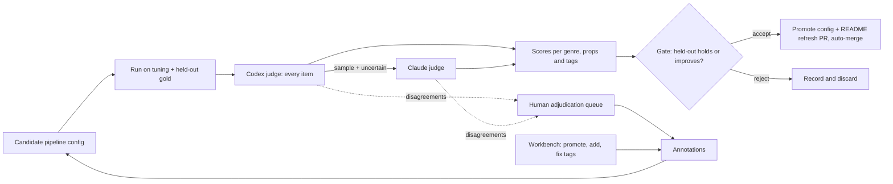

# Measured Propositions and Review Workbench - Plan

## Goal Capsule

- **Objective:** Every claim the README makes about FOLIO Insights' output carries a measured score, and that output keeps getting better between human reviews. The output is flat, source-grounded propositions tagged by meaning across many FOLIO branches, in opinions, statutes and regulations, briefs, and know-how.
- **Means:** Build the measuring loop first: gold suites, LLM judges, and a held-out gate. Then land each pipeline change through that gate. Lawyers audit the loop in a workbench that overlays propositions on the source text.
- **Product authority:** Damien Riehl, in the 2026-10-25/26 brainstorm session. This plan supersedes the build order in `docs/plans/2026-10-20-1830-feat-review-ui-rescope-plan.md` wherever the two conflict, and it retires the `elaborates` hierarchy (KD3).
- **Open blockers:** None for planning. One input is still to come from Damien: the location of his own know-how and article materials (R11). Synthetic examples carry that genre until he provides it.

---

## Product Contract

### Summary

The plan builds an instrument that scores FOLIO Insights' propositions and tags against gold answers. Codex and Claude judges review every run, and a held-out gate accepts only changes that improve the scores. The pipeline then gets rebuilt one measured change at a time: atomic propositions with typed links, multi-tag minting, tagging by meaning (including deontic concepts and areas of law), four source genres, and exports that carry tags and spans. A workbench lets lawyers see what the pipeline missed and correct it over the source text.

### Problem Frame

On 2026-10-25 the README was rewritten to describe the intended product. It describes flat propositions, each grounded in a verbatim span and tagged with as many of FOLIO's 18,000+ concepts as apply. Those concepts cover who owes what duty, what is permitted or prohibited, the exceptions, the penalties, the area of law, the forum, and the actors. A gap scan against master `72d1b91` found the code delivers little of that:

- **Exports:** the OWL and JSON-LD exports carry no tags or spans, and export refuses to run without approved tasks.
- **Distillation:** the pipeline compresses each chunk of up to 600 characters into one "core insight," using an advocacy-specific prompt.
- **Tagging:** "Area of Law" is excluded from deterministic tagging, and no code maps "shall", "may", or "unless" to FOLIO's Deontic Specification concepts.
- **Minting:** the minter keeps only the top tag. It refuses procedural rules and citations, the units statutes produce most.
- **Measurement:** no precision or recall number exists for any real corpus. All runs so far used one trial-advocacy treatise. In July 2026 a review found about 90% of 2,226 tags wrong.

Without a measuring instrument, nobody can tell whether a pipeline change helped. The July results showed how easily output that looks right hides systematic error.

Damien reviews by expert reading. He can tell where a source states a proposition the pipeline missed (a recall miss) and where an extracted proposition is wrong (a precision error). His time is scarce: he will be at a conference the week of 2026-10-26, and Codex credits on his plan expire around 2026-10-28. The loop must therefore run mostly without him, and it must say plainly how far its scores can be trusted.

### Key Decisions

- **Instrument first, then measured pipeline changes.** Each pipeline change lands only as a gate-accepted improvement. (session-settled: user-directed — chosen over rebuilding the pipeline first and over making the LLM judges the extractors: measurement must exist before changes can be judged; a judges-as-extractors pipeline may compete later as one more candidate on the same gate.) Governs R1–R8.
- **Auto-tune is the primary use of annotations.** Annotations also feed scoring, corrected output, and an improvement queue. (session-settled: user-directed — chosen over gold-set-first, fix-output-first, and improvement-queue-first.) Governs R6, R7.
- **Flat propositions with typed links; no hierarchy.** The `elaborates`/Tractarian structure planned in `docs/plans/2026-10-09-0650-feat-shards-axioms-drain-plan.md` and `docs/plans/2026-10-05-0308-feat-phase9-design-principles-plan.md` is retired for units. (session-settled: user-directed — chosen over strictly flat and over keeping the hierarchy underneath: a lawyer must be able to ask which rule an exception modifies.) Governs R9, R10.
- **Atomicity: a rule plus one proposition per element.** (session-settled: user-directed — chosen over one proposition with the elements inside, and over following the source's structure.) Governs R9.
- **The bar is P 0.95 / R 0.90, measured separately for propositions and for tags.** (session-settled: user-directed — chosen over 0.90/0.80 and 0.80/0.70.) Governs R4.
- **LLM judges first; a small human anchor keeps the scores honest.** (session-settled: user-directed — chosen over reviewing disagreements only and over fully autonomous judging.) Governs R3, R5.
- **Codex judges first and Claude judges lightly.** (session-settled: user-approved — chosen over equal dual judging and over Codex-only: protects Damien's interactive Claude Max use while Codex credits last.) Governs R3.
- **The workbench combines pipeline-flagged misses with highlight-to-add.** (session-settled: user-directed — chosen over a select-only view, a flag-only view, and a source-beside-ledger view.) Governs R20–R24.
- **The README stays true by regeneration.** Accepted improvements open and merge a README refresh automatically. (session-settled: user-approved — chosen over waiting for Damien to merge, and over manual regeneration.) Governs R8.
- **The real-corpus scope covers four genres and seven jurisdictions.** The genres: opinions, statutes and regulations, briefs, and know-how and articles. The jurisdictions: federal, Minnesota, Texas, California, New York, Florida, and Illinois. (session-settled: user-directed — chosen over federal-only and federal-plus-Minnesota.) Governs R11.

### Actors

- A1. **Pipeline:** extracts propositions, links them, and tags them, under the current configuration.
- A2. **Codex judge:** reviews every proposition and tag in a run, marking each correct, wrong, or uncertain. It also proposes missed propositions.
- A3. **Claude judge:** independently reviews a sample of each run, plus every item the Codex judge marked uncertain.
- A4. **Human reviewers:** Damien plus a few lawyers. They audit and correct in the workbench, and they adjudicate items where the judges disagree.
- A5. **Gate:** compares a candidate configuration against the current one on held-out gold. It accepts or rejects the change, and on acceptance it triggers the README refresh.

### Requirements

**Measuring loop**

- R1. A gold suite encodes the README's eight synthetic examples under the atomicity rule (R9). Every pipeline run scores against it.
- R2. A real-corpus gold set exists for each genre in R11. The set is drafted by workers and cross-checked by the judges, and it is split into tuning and held-out portions. Tuning never sees the held-out portion.
- R3. Every run is judged by A2 on every item and by A3 on a sample plus every item A2 marked uncertain. Items where the judges disagree go to a human adjudication queue.
- R4. Scores report precision and recall separately for propositions and for tags, by genre and by source. The pass bar is P ≥ 0.95 and R ≥ 0.90.
- R5. A human anchor set, verified by Damien per genre, measures each judge's accuracy. Until it exists, every reported score is labelled "judge agreement, unanchored."
- R6. Every annotation, from a judge or a human, is stored with its author, its verdict, and its reason, and is available as tuning data.
- R7. The gate (A5) accepts a candidate configuration only if held-out scores hold or improve on every measured axis. Every accept or reject leaves a before-and-after record.
- R8. Each accepted change regenerates the README's example tables and scores from real pipeline output, then opens and merges that refresh once checks pass.

**Propositions and tags**

- R9. Extraction emits atomic propositions. A rule with elements becomes the rule plus one proposition per element.
- R10. Propositions carry typed links to other propositions: exception-to, penalty-for, condition-of, cites, and contradicts. No tree or parent hierarchy exists.
- R11. The pipeline handles four genres: judicial opinions, statutes and regulations, briefs, motions and pleadings, and know-how and articles. Real corpora come from federal law plus MN, TX, CA, NY, FL, and IL. Know-how comes from Damien's own materials.
- R12. Each proposition carries every FOLIO tag that applies, across branches. Branch labels name the real FOLIO ancestor, including sub-branches such as Deontic Specification.
- R13. Deontic tagging runs in two passes. A deterministic pass maps modal language ("shall", "must", "may", "may not", "unless", "except") and FOLIO's own labels and alternate labels to deontic concepts. A probabilistic pass catches phrasing the deterministic pass misses.
- R14. Area of Law is assigned deterministically when the source names an area nearly verbatim, and probabilistically otherwise.
- R15. A model may select concepts, but only the deterministic resolver turns a selection into a FOLIO IRI. No model ever writes an IRI.
- R16. Every proposition stays grounded in a verbatim source span, and grounding is checked at extraction as well as at minting.
- R17. Minting keeps every tag on a shard. Minting accepts procedural rules and citations.

**Exports**

- R18. Every export format (OWL, Turtle, JSON-LD, HTML, Markdown) carries each proposition's tags, their branches, its span, and its typed links.
- R19. Export works on extracted propositions directly, without first requiring task discovery or approval.

**Workbench**

- R20. The workbench renders a source document with each proposition's span overlaid on the text.
- R21. Sentences that produced no proposition are shaded. Candidates the pipeline dropped are marked, along with the reason each was dropped.
- R22. A reviewer can promote a dropped candidate, confirm the drop, or highlight any passage to add a missed proposition. Every one of those actions becomes an annotation (R6).
- R23. Selecting a proposition shows its tags grouped by branch. A reviewer can confirm a tag, reject it, or add a missing one.
- R24. The workbench shows judge verdicts, judge disagreements, and gate history, so a reviewer can audit what ran unattended.

### Key Flows

- F1. Unattended improvement cycle
  - **Trigger:** A worker proposes a pipeline change, or the annotations since the last cycle cross a refresh threshold.
  - **Actors:** A1, A2, A3, A5
  - **Steps:** Run the candidate on the tuning and held-out gold. Judge every item. Score the run. Gate the change.
  - **Outcome:** The change is accepted and the README refreshed, or rejected with a record.
  - **Covered by:** R1–R8
- F2. Reviewer audit
  - **Trigger:** A reviewer opens a source in the workbench.
  - **Actors:** A4
  - **Steps:** Scan the shaded gaps and dropped candidates. Promote, confirm, or highlight to add. Fix tags. Adjudicate queued disagreements.
  - **Outcome:** New annotations feed the next F1 cycle.
  - **Covered by:** R20–R24, R6

### Acceptance Examples

- AE1. **Covers R9, R10.** **Given** the opinion excerpt "a plaintiff must prove (1) the formation of a contract, (2) the plaintiff's performance…, and (3) the defendant's breach," **then** extraction yields four propositions: the rule and three elements. Each element links to the rule by condition-of.
- AE2. **Covers R13, R10.** **Given** "(b) A business need not notify if law enforcement requests a delay in writing," **then** the proposition is tagged Permission and Exception (Deontic Specification) and links exception-to the duty in subdivision (a).
- AE3. **Covers R14.** **Given** a statute passage that never names its area of law, **when** the probabilistic pass selects "Privacy Law" from candidates, **then** the resolver supplies the IRI and the tag records a probabilistic origin.
- AE4. **Covers R7.** **Given** a candidate that raises proposition recall but drops held-out tag precision from 0.93 to 0.91, **then** the gate rejects it, records the before-and-after, and leaves the README untouched.
- AE5. **Covers R5.** **Given** no human anchor exists yet for statutes, **then** every statute score displays as "judge agreement, unanchored," even when it clears 0.95/0.90.
- AE6. **Covers R21, R22.** **Given** the pipeline dropped a candidate whose anchor score was 0.78, **then** the workbench shows it dashed with that reason. Promoting it stores an annotation that names the reviewer.

### Success Criteria

- All eight README examples reproduce from real pipeline output at P ≥ 0.95 and R ≥ 0.90 for propositions and for tags, and the README tables are generated rather than hand-written.
- Each genre in R11 clears the same bar on its held-out real corpus. Each genre's numbers count as anchored only once Damien has verified that genre's anchor set.
- At least one full F1 cycle runs end to end without a human and produces an accept or a reject with its record.

### Scope Boundaries

- **Deferred for later:**
  - **Reviewer roles:** roles, permissions, and quality weighting beyond recording each annotation's author.
  - **Other surfaces:** the Phase 15 wizards (polysemy fork, contest, retract/supersede), the shard timeline, and the SPARQL explorer.
  - **Advocacy tasks:** task discovery and grouping stay in the code as a secondary view, and this plan does not improve them.
- **Outside this work:**
  - **Generation:** writing or evaluating legal merit. The pipeline extracts and never generates.
  - **Model-minted IRIs:** no model writes an IRI on any path (R15).

### Dependencies / Assumptions

- **Codex credits:** Codex capacity on Damien's plan is available through about 2026-10-28. After that, the work continues on the regular Codex allotment or on Claude workers.
- **Coordination:** this lane shares worker admission limits with the concurrent Codex drain the Chief session runs (`agent-admit`, at most 3 workers).
- **Anchors:** Damien verifies the human anchor sets after the conference. Until then, R5 labelling applies.
- **Public corpora:** opinions, statutes, regulations, and briefs come from public sources. Know-how waits on Damien's materials (R11).

### Outstanding Questions

**Deferred to Planning**

- The held-out split ratio and each gold set's size per genre and jurisdiction.
- The A3 sample rate (about 20% proposed) and the agreement threshold that routes an item to the human queue.
- How the workbench relates to the existing Read/Decide modes and tokens in `docs/plans/2026-10-20-1830-feat-review-ui-rescope-plan.md`. That plan's open look-and-workflow questions remain Damien's.
- The source and licensing check for each public corpus.

### Sources / Research

- README claims this plan must make true: `README.md` at `72d1b91`.
- The prior review-UI plan and mockups: `docs/plans/2026-10-20-1830-feat-review-ui-rescope-plan.md`, `docs/design/review-ui/`.
- Code facts from the gap scan:
  - **Exports:** no tags in `src/folio_insights/services/jsonld_builder.py` or `owl_serializer.py`, and the approved-task requirement in `cli.py:477-502`.
  - **Area of Law exclusion:** `services/folio_ontology.py:94-99`.
  - **Minting limits:** supported unit types in `minting/eligibility.py:138-142`, and the single top tag in `minting/mapper.py:21-23`.
  - **Distillation:** the 600-character cap in `config.py:65`, and the prompt in `services/prompts/distillation.py:3`.
  - **Existing judge:** the off-by-default judge in `pipeline/stages/folio_tagger.py:1-23,76-77`.
- The FOLIO Deontic Specification class (`RClhbl4E1TJp9LygIXewIhn`) and its children: Obligation (alternate labels Duty, Legal Obligation, Responsibility), Permission, Prohibition, Exception, Right, Waiver, Violation, Compliance, and Authority.
- The Codex drain pattern: cockpit `docs/plans/2026-10-09-1840-ops-midnight-drain-plan.md`.
