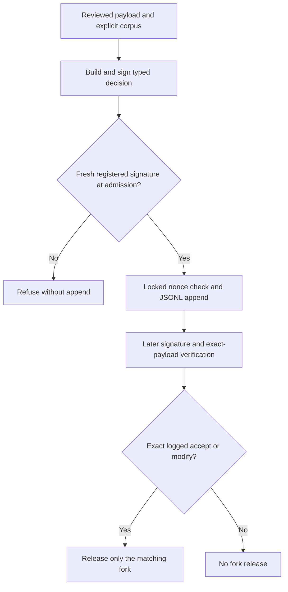
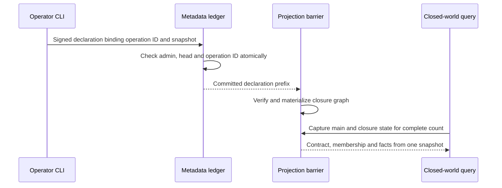
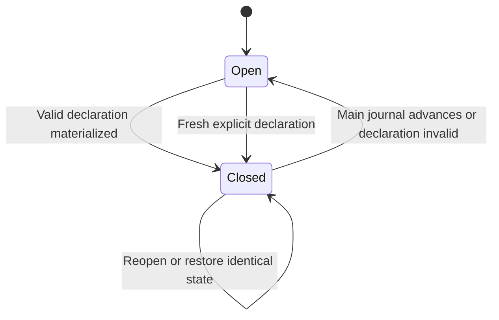

# fi-1 Verified Corpus Decisions and Closure - Plan

## Goal Capsule

- **Objective:** Reviewers can prove who approved a polysemy fork, operators can require signatures for selected corpora, and stored corpora yield durable closed-world answers and measured CORPUS-04 validation results.
- **Means:** Extend the existing decision-signing stack, append-only ledger and projection recovery paths; call the existing cluster validator (KTD1–KTD8).
- **Authority:** The fi-1 mandate and campaign instructions govern this lane. The chief repository's `docs/plans/2026-10-26-0705-feat-codex-drawdown-campaign-plan.md` is the campaign authority; its Goal Capsule and cited requirements were not available in this isolated clone. The prompt supplies the applicable campaign constraints, including R11, R15, R16, R17, R19 and R20. This plan does not claim to have independently read that source.
- **Repository authority:** `docs/handoffs/2026-10-20-sweep-cloud-folio-insights.md`, `docs/plans/2026-10-20-feat-phase9-u6-polysemy-plan.md`, and `docs/handoffs/2026-10-09-drain-coordination.md`. No repository `AGENTS.md` or `CLAUDE.md` was present at the inspected revision; the supplied standing instructions apply.
- **Execution profile:** This artifact covers fi-1 only. This stage commits the plan locally without implementation or test execution. The build stage uses `lfg` on this plan; the controller handles publication, and the campaign gate handles merging and required reviews. The clone must remain without a remote or credential discovery.
- **Stop boundary:** R7–R8 govern scope and protected operations. No database migration, authoritative data rewrite, vocabulary/package release or new service is planned. Any unavoidable held change must be identified separately for the campaign gate.

---

## Product Contract

### Summary

Complete the four agent-doable capabilities assigned to fi-1: signed polysemy dispositions and certification, corpus-scoped signature enforcement, a persisted `fi:closedUnder` writer, and CORPUS-04 cluster-validation wiring. Reuse the shipped implementations and retain honest distinctions between authenticated authorship, review correctness and measured acceptance.

### Problem Frame

The sweep's remaining gaps still exist at `c2f3fa9`. A `human` label or certifier name currently asserts its own authority. The signature requirement is server-wide. The P5 roll-up constructs closure membership in an in-memory overlay, and CORPUS-04 returns a placeholder although the cluster validator is implemented. These gaps prevent operators from relying on stored review authority, closure and benchmark results.

### Reverified Starting State

This is source inspection, not a test result. Historical suite counts and R9 measurements from the handoff are not current acceptance evidence.

| Area | Current evidence | Work remaining |
|---|---|---|
| Branch | Clean `drawdown/fi-1`, HEAD `c2f3fa9`; no configured remote | Commit only this new plan in this stage |
| Decision signing | `src/folio_insights/proposals/signed_decisions.py` provides JCS-bound `SignedDecision`, offline `did:key` verification, registered-signer attribution and freshness checks | Extend typed decision adapters; retain existing kinds |
| Corpus policy | `load_policy()` and `api/services/decision_signatures.py:policy_or_503()` have no corpus parameter | Propagate the already resolved corpus through proposal writes and all ten review/discovery API policy calls |
| Polysemy authority | `polysemy/dispositions.py` appends JSONL with a legacy signature string and self-asserted labeler; `fp_audit.py` accepts self-asserted certification | Verify the complete signed payload at admission and at authority consumers |
| Closure | `query/closed_world.py` requires membership plus a caller contract; `bench/phase9_rollup.py:_p5` supplies membership through `_OverlayRunner` | Persist declarations and materialize actual corpus-bound RDF |
| Durable metadata | `storage/proposals.py` supports arbitrary typed ledger kinds, replay, PII checks and transaction authorization; ledger rows are not projected today | Add bounded closure projection integration; retain all other ledger behavior |
| CORPUS-04 | `bench/corpus04.py:cluster_validation` always returns unavailable; `validation/validator.py:validate_corpus` already reads shards and frameworks | Await the real validator and classify its execution coverage and findings |

### Requirements

Unqualified R-IDs below are local to this plan. References to Phase 9, the drain plan, or the campaign identify a separate requirement namespace.

**Review authority**

- R1. A selected corpus can require signed decisions while other corpora retain their existing behavior; a corpus setting cannot relax a server-wide requirement. Source: drain-plan R16/KTD11 and the sweep's corpus-level signing follow-up.
- R2. A polysemy disposition authorizes only its exact logged fork after its complete decision verifies under a registered reviewer identity. Unsigned legacy records remain readable and usable for descriptive audits, but cannot establish human approval. Source: sweep signed-disposition follow-up and U6 decisions 2, 8 and PR #44 fixes.
- R3. A certificate establishes human review only through a registered signer's valid signature bound to the actual cases and reviewed sample. Existing digest, record-correspondence, sampling, label-coverage and Wilson checks still decide gate status. Source: U6 decision 1 and its certification fixes.

**Stored closure and validation**

- R4. Explicit closure declarations persist per corpus and produce `fi:closedUnder` triples visible through normal storage queries. Closed answers still require both membership and a covering closure contract. Source: Phase 9 R8/KTD8 and sweep closedUnder follow-up.
- R5. Closure survives reopening, projection rebuilding and snapshot restore for the declared corpus state; a changed corpus cannot silently retain an obsolete completeness claim. Source: R4's durable writer and Phase 9's journal-derived-state constraints.
- R6. CORPUS-04 executes the existing cluster validator and reports measured coverage, findings and unavailable prerequisites. Synthetic stand-ins remain `unmet`, and unexecuted validation cannot count as a pass. Source: Phase 11 R10 and sweep CORPUS-04 follow-up.

**Compatibility and evidence**

- R7. Retain existing tests and their protections, signed shard bytes, envelope/vocabulary versions, minting recipes, operator authentication and no-auto-apply behavior. Keep fixtures and committed evidence synthetic and public-safe. Source: campaign guardrails, Phase 9 R1–R3 and drain coordination contracts.
- R8. Complete the work offline with generated test identities and injected local backends. Do not read credential files, enroll real signers, toggle deployed security settings, spend, send messages, change remotes or work on other mandate items. Source: campaign R11/R15–R20 as supplied in the mandate.

### Key Decisions

- **One assigned item:** fi-1 is the entire scope, with fi-2's detector redesign and other mandate items excluded. Governs R7–R8.
- **Build without waiting for operator availability** (session-settled: user-directed — chosen over waiting for Damien through 2026-10-30: the campaign must proceed autonomously). Real certification and real-corpus evidence remain separate from code acceptance. Governs R3, R6, R8.
- **Controller publication and campaign review gate** (session-settled: user-directed — chosen over lane-side publication and per-action review requests: this isolated clone is intentionally unauthenticated). Local work uses the assigned branch; cloud build execution uses its default model and still receives the campaign's Astra and Fable reviews. Governs R8.

### Scope Boundaries

The active work is backend/library, CLI, storage integration, tests and focused documentation. The review viewer remains untouched, so no frontend screenshot is expected. If a later authorized scope change touches a frontend, the campaign screenshot rule applies.

#### Deferred to Follow-Up Work

- fi-2: held-out Rule 3 evaluation, homonym classification redesign and achieving the Phase 9 R9 bound.
- fi-3, fi-4 and fi-5: branch reconciliation, a new readiness CLI, CI and broader property-test work.
- Review UI, U7 provider bake-off, bridge retry cleanup, vocabulary type correction, bulk-load benchmarking and worker image work.
- Actual reviewer enrollment, human certification and operator-provided real CORPUS-04 inputs. None is needed to finish the offline implementation.

#### Considered and Not Built

- A new database table or shard field for closure: the existing ledger stores versioned metadata without changing signed records.
- A new signer registry per corpus: scope the requirement while retaining the existing trust source.
- Fine-grained closure dependency tracking: conservative snapshot invalidation is sufficient for the first durable writer; narrower invalidation needs evidence of a practical operator cost.
- New polysemy API routes or automatic application commands: the existing library and CLI surfaces cover this item and preserve the no-auto-apply guards.

### Acceptance Examples

- AE1. **Covers R1.** With the global requirement off and corpus A selected, unsigned review writes fail for A and retain current behavior for B. Global enforcement remains effective for both.
- AE2. **Covers R2–R3.** A registered test signer approves a synthetic fork or sample. An altered fork, corpus or sample invalidates that authority. A statistically failing set remains `fail` with a valid certificate.
- AE3. **Covers R4–R5.** An explicit declaration gives a closed count after reopening the same corpus. Advancing its main journal returns the answer to open until a fresh declaration is recorded.
- AE4. **Covers R6.** Clean synthetic inputs exercise the actual validator and report completed checks, while overall CORPUS-04 remains `unmet` because the real corpora were not supplied.

---

## Planning Contract

### Key Technical Decisions

- KTD1. **One corpus-aware policy resolver.** Add a typed `require_signed_decision_corpora` selection to existing settings, default empty. Effective enforcement is global-required OR membership of the canonical corpus ID. Validate IDs with the existing decision corpus grammar. The selected corpus comes from the bound store or resolved route, never the signed body. Keep signer registration and operator authorization separate. Governs R1, R7.
- KTD2. **Extend the U9 decision envelope without changing shard actions.** Add distinct polysemy disposition and certification decision kinds. Use a focused polysemy adapter to bind nested semantic payloads through a canonical digest in the existing scalar `detail` shape. Preserve the legacy signature string and add an optional typed signed envelope with corpus binding. Hash all authority-relevant fields, including the proposed fork, detector snapshot, decision, rationale, identity and review time; exclude transport evidence and derived flags from their own digest. Governs R2–R3, R7.
- KTD3. **Admission and later use are different checks.** New signed JSONL dispositions undergo registered-signer verification and freshness checking under a file lock that covers nonce inspection and append. An exact signed-body retry returns the existing record; reuse of that signer's nonce for a different body refuses without writing. A damaged log refuses further writes without repairing or truncating it. Release rechecks cryptography, payload binding, current reviewer registration and exact log membership; it does not expire a stored decision against today's clock. A portable certification is immutable signed evidence: gate reads are repeatable and consume no nonce. Its signed timestamp is an assertion by the signer, not a server commit time. Governs R2–R3.
- KTD4. **Authority is always independently verified.** `labeler`, certifier names and stored verification booleans never establish human status. A new unsigned/agent disposition may still be recorded where R1 permits, but the fork-release and certification boundaries always require a registered signature. The shipped labeled set stays uncertified. Existing gate arithmetic, sample threshold and label coverage remain unchanged. Governs R2–R3, R7.
- KTD5. **Closure declarations use the existing metadata ledger.** Add a versioned, corpus-admin-signed declaration containing its operation ID, corpus, scope IRI, classes, properties, explicit member IRIs and a captured main-journal head/digest. Use the signed operation ID as the ledger operation ID. Reuse `frameworks/registry.py`'s offline signing and in-transaction admin authorization pattern. Refuse unsafe IRIs, absent/foreign members or a changed main head before append. A declaration replaces the entire prior declaration for its scope; membership is never silently unioned. An identical retry returns its original ledger record without making that declaration current again; changed content under that ID conflicts. Governs R4–R5, R7.
- KTD6. **Materialize closure as recoverable RDF.** Maintain a separate corpus-scoped derived closure graph through the projection lock, not direct writes from the query package. Fold one captured ledger prefix and verify its digest, signatures and commit-time authorization. Activate only the latest declaration matching the current main-journal head/digest. Any main-journal advancement makes it inactive until redeclaration. Track closure projection validity independently of the shard watermark, including equal-height/different-prefix restores. Include the graph in query, reset and export graph selection. Existing snapshots already copy the ledger. Governs R4–R5.
- KTD7. **Persisted and caller contracts intersect within one snapshot.** Production query wiring loads the verified declaration contract and accepts caller restrictions only within it; a caller cannot broaden the stored contract by supplying extra properties. The storage adapter supplies one captured main-journal and closure-ledger view for contract selection, membership and counted facts across the complete count operation. Separate awaited reads must not assemble a closed answer from different snapshots. Keep `query/closed_world.py` dependency-light through a protocol/data interface, and retain its existing generic runner behavior for callers supplying trusted contracts. Storage and signing imports belong in adapters or CLI wiring outside the pure query module. Governs R4–R5, R7.
- KTD8. **CORPUS-04 uses execution coverage, not an empty findings list.** Await `validation.validator.validate_corpus` inside the existing storage lifetime. Permit per-corpus validator inputs through the harness interface: task tree, ancestry resolver, TBox/seeds and injected reasoner/NLI backends. Required coverage includes nonempty input, eligible clusters actually checked, cross-reference checking and task-tree coverage. Missing inputs yield incomplete results. Honor the validator's documented NLI fallback while reporting it; a disabled or unchecked required path cannot pass. Return controlled codes and counts, not source excerpts or raw exception values. Governs R6–R8.

The existing signing, framework registration and recovery implementations settle these mechanisms. No new cryptographic primitive or external service is selected. External research adds no implementation decision here; the plan follows the current repository's protocols.

### Assumptions

These are explicit technical defaults for this lane, not new user approvals:

- A process configuration selecting corpora satisfies the requested corpus-level setting; no runtime policy editor or per-corpus trust store is needed.
- Closure is a completeness assertion by an existing corpus administrator. The conservative whole-corpus snapshot binding in KTD5–KTD6 is acceptable for this first writer.
- CORPUS-04 must disclose missing task coverage rather than treating a skipped checker as accepted validation. KTD8 defines the harness's completeness rule without changing the existing validator CLI's warn-only default.
- Real corpus availability and human certification are deferred acceptance inputs. Test fixtures cannot supply either real-world claim.

### High-Level Technical Design

Disposition authority passes through the existing signature stack:

Closure writes and normal reads share the storage recovery boundary:

Closure lifecycle:

Corpus policy combinations (KTD1):

| Global required | Corpus selected | Effective requirement |
|---|---|---|
| false | no | Existing optional behavior |
| false | yes | Required |
| true | no | Required |
| true | yes | Required |

CORPUS-04 result classification (KTD8):

| Observation | Cluster status | Overall gate consequence |
|---|---|---|
| Required checks ran, nonempty clusters, no warning findings | `pass` | Eligible only if every source is real and SHACL passes |
| Warning findings exist | `fail` | `unmet` |
| Empty input/clusters, skipped required checker or unchecked cluster | `incomplete` | `unmet` |
| Required local dependency cannot load | `unavailable` | `unmet` |
| Validator execution fails | `error` | `unmet`; sanitized reason |

### Behavior Trace and System Impact

`PersistentProposalLedger.append` commits under `BEGIN IMMEDIATE`, but currently leaves the RDF watermark unchanged. `CorpusStorageContext._catch_up` follows only the main journal, and `_barrier` can return early when that head is unchanged. U4 must therefore observe closure ledger changes even when no shard write occurs. A projection that follows only the old watermark would miss the new writer entirely.

`ProjectionHandle.apply` replaces a revised shard's ABox quads. A separate closure graph avoids losing membership during that replacement, while snapshot binding prevents stale closure from surviving the revision. `storage/exports.py:capture_dataset` explicitly selects corpus and governance graphs today, so it must capture closure state at the same read boundary. Snapshot/restore already preserves proposal-ledger rows; roundtrip tests must prove the new consumer rebuilds them.

Policy propagation crosses API and CLI entry points. Existing injected policies are test seams, not a way for a production caller to disable configured corpus enforcement. No actual deployed policy or signer registry is modified by implementing the resolver.

### Risks and Dependencies

- Closure materialization introduces a second committed input to derived RDF. Follow the existing lock order; do not hold a SQLite write transaction while waiting for projection catch-up. Compare a captured prefix, not a moving ledger scan.
- A commit followed by materialization failure needs an explicit committed/recovery-pending outcome. Reopen and retry the same operation; never claim that nothing was written or append another declaration automatically.
- Existing positive authority tests use self-asserted human records. Upgrade their synthetic setup to signed records and retain every assertion about exact fork matching, rationale, membership, sampling and gate status.
- CORPUS-04 and roll-up tests depend on local worker libraries and cached models. Use injected backends for deterministic wiring tests and distinguish missing dependencies from code failures.
- Projection replay is derived-state reconstruction. Existing authoritative journal bytes and ledger rows remain unchanged; no migration or data rewrite is required.

---

## Implementation Units

### U1. Resolve signature requirements for the selected corpus

**Goal:** Every existing decision entry point enforces R1 consistently.

**Requirements:** R1, R7–R8; AE1. **Dependencies:** none. **Decisions:** KTD1.

**Files:** `src/folio_insights/config.py`, `src/folio_insights/proposals/signed_decisions.py`, `src/folio_insights/proposals/store.py`, `api/services/decision_signatures.py`, `api/routes/review.py`, `api/routes/discovery.py`, `README.md`; new `tests/proposals/test_corpus_decision_policy.py`; extend `tests/proposals/test_signed_decisions.py` and `tests/test_signed_decisions_api.py`.

**Approach:**

1. Add the typed setting and shared resolver, preserving the empty-selection default and existing global-only call compatibility where needed.
2. Pass the canonical corpus through all production decision paths, including proposal-store defaults and approval-script callers.
3. Preserve existing controlled API errors and no-mutation behavior for unusable signing policy; document selection syntax without modifying environment files.

**Patterns:** U9 `DecisionSignaturePolicy`, existing route corpus validation, registered-signer and nonce fixtures.

**Test scenarios:**

1. Covers AE1. Exercise all four policy combinations and two corpora in one process.
2. A required corpus with no usable reviewer registry refuses before storing decisions or consuming nonces.
3. A correctly signed decision succeeds only for its bound corpus; malformed corpus configuration refuses explicitly.
4. Unit and task reviews, bulk approval/reset, task create/delete, hierarchy edits, contradiction resolution and proposal decisions use the route/store corpus.
5. Direct store calls and approval-script paths retain enforcement even if an open policy object is supplied; unselected corpora retain existing attribution and unsigned behavior.

**Verification:** Targeted policy, proposal and API suites prove the same policy at each boundary. No settings file or deployed credential changes appear in the diff.

### U2. Authenticate polysemy dispositions and certificates

**Goal:** Fork release and certification depend on verified reviewer evidence.

**Requirements:** R2–R3, R7–R8; AE2. **Dependencies:** U1. **Decisions:** KTD2–KTD4.

**Files:** new `src/folio_insights/polysemy/signing.py`; modify `src/folio_insights/proposals/signed_decisions.py`, `src/folio_insights/polysemy/dispositions.py`, `src/folio_insights/polysemy/distinguo.py`, `src/folio_insights/polysemy/fp_audit.py`, `src/folio_insights/polysemy/labeled_set.py`, `src/folio_insights/polysemy/cli.py`; adjust `src/folio_insights/proposals/cli.py` only if the existing signing helper needs descriptions for the new kinds. New `tests/polysemy/test_signed_dispositions.py` and `tests/polysemy/test_signed_certification.py`; extend `tests/polysemy/test_dispositions_jsonl.py`, `tests/polysemy/test_cli_review.py`, `tests/polysemy/test_review_fixes.py`, `tests/polysemy/test_fp_gate.py`, `tests/polysemy/test_distinguo_fork_shape.py`, `tests/polysemy/test_no_auto_apply.py`.

**Approach:**

1. Add typed semantic-to-signable adapters and backward-compatible optional evidence fields. Validate the reconstructed payload rather than trusting adjacent flags.
2. Implement KTD3's locked append and retry semantics without a separate nonce database. Preserve the legacy JSONL reader and reject-rationale check.
3. Wire fork release and certificate checking to the shared authority adapter. Certificate validation uses the loaded set's own digest and evaluated records.
4. Keep the four polysemy commands. Extend `review` with explicit corpus and detached signed-decision input, and a preparation mode that outputs the exact body for the existing `proposals sign-decision` helper without recording approval. Submission displays that same bound payload and retains the confirmation gesture. Cancellation writes nothing. `gate` reads signed certificate evidence without creating it.

**Execution note:** Start with failing tests at fork release and `fp_gate`, not only signing roundtrips.

**Patterns:** U9 `ExpectedDecision`, `stored_signature_problem`, `sign_attestation` and generated in-memory reviewer fixtures. Retain all PR #44 review protections.

**Test scenarios:**

1. Covers AE2. Registered signed accept/modify releases only the exact logged fork; reject never releases.
2. Unsigned legacy records still load, but self-asserted human labels, unregistered keys and fabricated verification flags cannot authorize release or certification.
3. Alter each signed semantic field, corpus, fork component, detector snapshot, cases digest or reviewed sample and refuse the applicable authority claim.
4. Stale new submissions fail before append; an exact retry after the skew returns the original record; historical verification succeeds after reopening.
5. Concurrent same-nonce submissions commit once; changed-body nonce reuse and a damaged log refuse without mutation or truncation.
6. Valid synthetic certification can authenticate an otherwise passing synthetic evaluation; missing/invalid certificates remain provisional, insufficient sampling and missing gold labels refuse, and an excessive Wilson bound stays fail.
7. Preparation and cancellation never append approval. Existing no-auto-apply flag, command and API-import guards remain enforced.

**Verification:** Polysemy and U9 signing suites pass with generated identities. The detector, shipped labeled cases, threshold and real certification state remain untouched.

### U3. Persist explicit closure declarations

**Goal:** A corpus administrator can durably declare a closed-world scope.

**Requirements:** R4–R5, R7–R8; AE3. **Dependencies:** existing framework/ledger substrate. **Decisions:** KTD5.

**Files:** new `src/folio_insights/closure/__init__.py`, `src/folio_insights/closure/declarations.py`; modify `src/folio_insights/storage/proposals.py` only for the atomic main-head precondition and `src/folio_insights/query/cli.py` for explicit declaration submission. New `tests/query/test_closure_declarations.py` and `tests/query/test_closure_cli.py`.

**Approach:**

1. Add typed declaration signing, verification and ledger folding beside the dependency-light query package.
2. Bind a declaration to a captured main-journal head/digest and verify its members against that captured corpus view.
3. Reuse ledger authorization to check the administrator and captured head inside the write transaction. Use the operation ID bound by the signature and preserve replay/conflict semantics.
4. Add an explicit `query` declaration command taking a signed declaration artifact. Derive the ledger operation ID from the artifact; any explicit CLI operation ID must match it. The command accepts no private key from a server and never infers closure from existing data. Reuse library signing patterns for operator tooling and in-memory tests.

**Patterns:** `src/folio_insights/frameworks/registry.py`, `PersistentProposalLedger._append_authorized`, `query/closed_world.py:ClosedWorldScope` IRI checks.

**Test scenarios:**

1. A signed existing administrator declaration is persisted for its exact corpus, members and contract; reopening recovers the same verified record.
2. A non-admin, revoked admin, wrong corpus, invalid signature, unsafe IRI or unknown/foreign member refuses with no ledger append.
3. A main-journal advance between preparation and commit refuses atomically.
4. Identical operation-ID retry returns the same declaration; changed payload under that ID conflicts.
5. A fresh declaration for an existing scope replaces its complete member set and contract; it does not union prior members or broaden another corpus.
6. After a broad declaration is replaced by a narrower declaration at the same main-journal head, resubmitting the older artifact with a changed operation ID refuses. An identical retry returns its historical record without restoring withdrawn members or properties.

**Verification:** Synthetic library and CLI tests prove persisted authority and atomic refusal. No new SQL table, shard field, vocabulary term or migration is introduced.

### U4. Recover and query stored closure through the projection

**Goal:** Normal queries and the P5 roll-up use persisted closure membership.

**Requirements:** R4–R5, R7–R8; AE3. **Dependencies:** U3. **Decisions:** KTD6–KTD7.

**Files:** new `src/folio_insights/closure/projection.py`; modify `src/folio_insights/storage/context.py`, `src/folio_insights/storage/projection.py`, `src/folio_insights/storage/exports.py`, `src/folio_insights/query/closed_world.py`, `src/folio_insights/query/cli.py`, `src/folio_insights/bench/phase9_rollup.py`; new `tests/storage/test_closure_projection.py`; extend `tests/query/test_closed_world.py`, `tests/storage/test_snapshot_restore.py`, `tests/storage/test_corpus_isolation.py`, `tests/bench/test_phase9_rollup.py`.

**Approach:**

1. Materialize KTD6's verified closure graph under the existing lock and attach its captured prefix/digest to derived-state validity.
2. Integrate graph selection and catch-up across reads, rebuild/reset, export and restore. Ledger-only changes must be visible to already open contexts.
3. Load the persisted contract through the production query adapter and apply KTD7. Keep contract selection and every membership/fact read within the same captured main-journal and closure-ledger view for the entire count. Preserve the existing caller-only generic runner behavior and dependency-leak guard.
4. Replace the roll-up overlay with an actual signed declaration. Preserve its open-before-declaration checks, add persisted/reopened evidence and keep the other six principles' assertions.

**Execution note:** Characterize projection recovery and snapshot restore before changing the barrier.

**Patterns:** `CorpusStorageContext._catch_up`, `_read_projection`, projection chain validation, `exports.capture_dataset`, snapshot manifests.

**Test scenarios:**

1. Covers AE3. Declare, query, reopen and rebuild: closed counts and stored membership agree; no declaration remains open.
2. A ledger-only declaration becomes visible through a second already open context without a shard write.
3. Covered-member, unrelated-shard and governance journal advancement all invalidate the snapshot; a new declaration restores closure.
4. A smaller replacement declaration removes prior derived membership. A caller contract broader than the stored declaration does not close the extra question.
5. Journal-only snapshot restore, an older snapshot beside a newer projection, and an equal-height/different-prefix ledger produce only their own valid closure state.
6. Materialization failure after append reports recovery pending; reopen and identical retry recover without duplicate records.
7. Query and export remain corpus-isolated even with identical scope IRIs. Reset/rebuild clears derived closure without deleting authoritative history.
8. The P5 roll-up reads actual `fi:closedUnder` triples and records the persisted source, while existing open-world and no-NAF-outside-scope assertions remain.
9. Advance the main journal or commit a narrower replacement declaration between underlying reads of each count operation. Neither interleaving may produce a closed answer using a contract, membership or facts from different snapshots.

**Verification:** Storage/query/roll-up suites demonstrate recovery, isolation, export agreement and dependency boundaries. Original shard bytes remain identical.

### U5. Execute cluster validation in CORPUS-04

**Goal:** Benchmark status reflects what the shipped validator actually checked.

**Requirements:** R6–R8; AE4. **Dependencies:** existing Phase 9 validator; independent of U1–U4. **Decision:** KTD8.

**Files:** `src/folio_insights/bench/corpus04.py`, `tests/bench/test_corpus04_harness.py`, new `tests/bench/test_corpus04_cluster_validation.py`, focused `README.md` benchmark documentation. Reuse `src/folio_insights/validation/validator.py` and `report.py` without changing detector or checker semantics.

**Approach:**

1. Make the cluster adapter asynchronous and await it before closing each corpus context.
2. Pass per-corpus inputs to the existing validator. Use injected local scorer/reasoner interfaces in tests; production runs report missing prerequisites explicitly.
3. Apply the classification table and preserve existing load/SHACL/source conditions. Summarize controlled checker statuses, cluster mode counts, finding counts and elapsed time.
4. Retain the current unavailable-path tests by injecting an unavailable dependency. Add actual-validator happy, negative and incomplete paths rather than weakening old assertions into permissive status checks.

**Test scenarios:**

1. Covers AE4. Actual validator wiring examines a clean synthetic corpus with explicit local fakes and task inputs; overall acceptance stays unmet for stand-ins.
2. A planted contradiction produces fail and finding counts without returning source text or excerpts.
3. Missing backends, missing task tree, empty records, zero eligible clusters, disabled checks and unchecked clusters each cannot pass.
4. A documented NLI fallback records its mode and can satisfy consistency coverage when all required checks ran.
5. An execution exception yields a sanitized error reason and closes the context; remaining corpora receive their own results.
6. Fixture files for all three names exercise the all-checks-success branch without being presented as real-world acceptance evidence. Mixed synthetic/file inputs remain unmet.
7. Cluster validation leaves the main journal and proposal ledger unchanged and applies no reconciliation proposals.

**Verification:** Focused harness tests prove awaited integration and each classification branch. Preserve the existing cluster validator's warn-only CLI behavior and worker-tier import guard.

---

## Verification Contract

The build begins by establishing current baseline results. This planning stage ran no tests. Use declared dependencies and existing caches; missing infrastructure is reported as unavailable, never converted into a pass.

| Scope | Build-stage check | Evidence required |
|---|---|---|
| U1 | `python -m pytest tests/proposals tests/test_signed_decisions_api.py tests/api -q` | Policy matrix and actual decision-route coverage; no new writes on refusal |
| U2 | `python -m pytest tests/polysemy tests/proposals/test_signed_decisions.py -q` | Authenticity, replay, historical readback and unchanged gate/no-auto-apply protections |
| U3–U4 | `python -m pytest tests/query tests/storage tests/frameworks -q` | Persist/reopen/rebuild/restore, two-context visibility, signed replay identity, consistent count snapshots, contract intersection and corpus isolation |
| U4–U5 | `python -m pytest tests/bench/test_phase9_rollup.py tests/bench/test_corpus04_harness.py tests/bench/test_corpus04_cluster_validation.py tests/validation -q` | Actual persisted P5 and actual validator wiring with synthetic evidence |
| Regression | `python -m pytest -m 'not gate5 and not slow' -q` | Before/after failures distinguished from dependency or socket restrictions |
| Public-safe diff | `git diff --check` plus staged-file inspection | Only fi-1 files; no private payloads, real identities, credentials or machine-local paths |

Tests use in-memory generated keys and injected public signer maps. Do not read real key files or enroll a reviewer to make tests pass. Cached embeddings may support existing tests; new signature and wiring coverage must not need provider credentials. Existing folio-enrich integration tests need their documented backend prerequisite; if absent, report that limitation without changing the tests.

Do not delete, skip or weaken a test to accommodate the change. Where a test encodes an obsolete placeholder or self-asserted positive fixture, retain the original protection with an explicit unavailable dependency or signed synthetic setup and add the new behavior assertion. Keep baseline and changed results distinct.

Commit a concise, content-free build receipt under `docs/plans/evidence/` with commands, counts, unavailable prerequisites and revision. This is backend work; no screenshot is required unless the authorized diff later includes a frontend change. Do not claim that passing synthetic tests certifies R9 or fulfills real CORPUS-04 acceptance.

---

## Definition of Done

- U1–U5 deliver the local requirements and their named tests without work from another mandate item.
- Every production decision path resolves its bound corpus; fork and certification consumers verify registered signatures independently.
- Closure is stored, recoverable and observable through normal queries; the roll-up no longer constructs its closed membership through an overlay.
- CORPUS-04 reports measured execution and preserves unmet/incomplete conditions honestly.
- Existing test protections, operator guards, immutable signed records and isolated corpus reads remain intact.
- Validation evidence states what ran and what could not run. No real human certificate or real-corpus acceptance is manufactured.
- The final diff contains no abandoned implementation attempts or unrelated edits; scratch artifacts are kept outside the repository.
- Changes remain on `drawdown/fi-1` for controller publication. No held migration, release, new service or deployed security change is expected.

### Deferred Acceptance Inputs

Real CORPUS-04 acceptance requires operator-supplied benchmark corpora and their validation inputs. Human certification requires a registered reviewer to attest the reviewed sample after the separate fi-2 quality work is ready. These do not block offline implementation and do not justify credential discovery or asking Damien to act during this lane.

### Sources

- `docs/handoffs/2026-10-20-sweep-cloud-folio-insights.md`: assigned follow-ups and historical acceptance gaps.
- `docs/plans/2026-10-20-feat-phase9-u6-polysemy-plan.md`: honest gate, exact fork release and certification safeguards.
- `docs/plans/2026-10-05-0308-feat-phase9-design-principles-plan.md`: R1–R4, R8–R9, KTD2/KTD8 and U5/U8 closure gaps.
- `docs/plans/2026-10-09-0650-feat-shards-axioms-drain-plan.md`: R16, KTD11 and U9 signing stack.
- `docs/plans/2026-10-05-0305-feat-phase11-shacl-hybrid-plan.md`: R10 and existing CORPUS-04 scope.
- `docs/handoffs/2026-10-09-drain-coordination.md`: frozen identity and bridge/storage contracts.
- `docs/solutions/llm-path-unverified-iris.md`, `docs/solutions/verifiable-source-anchoring.md`, `docs/solutions/sys-path-bridge-staleness.md`, `docs/solutions/fastapi-undeclared-web-tier-deps.md`: independent evidence checks, synthetic fixtures and honest dependency reporting.
