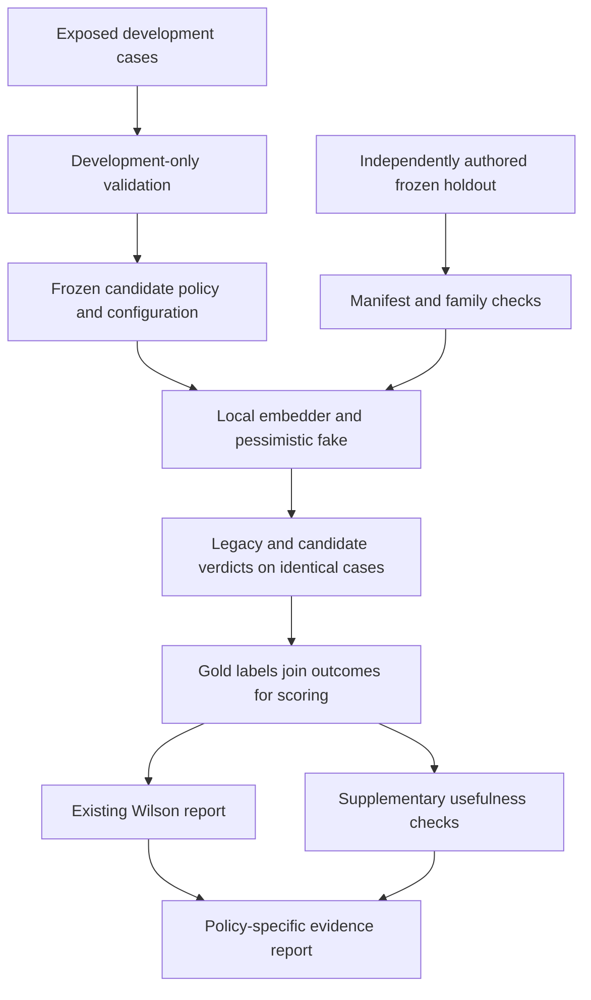
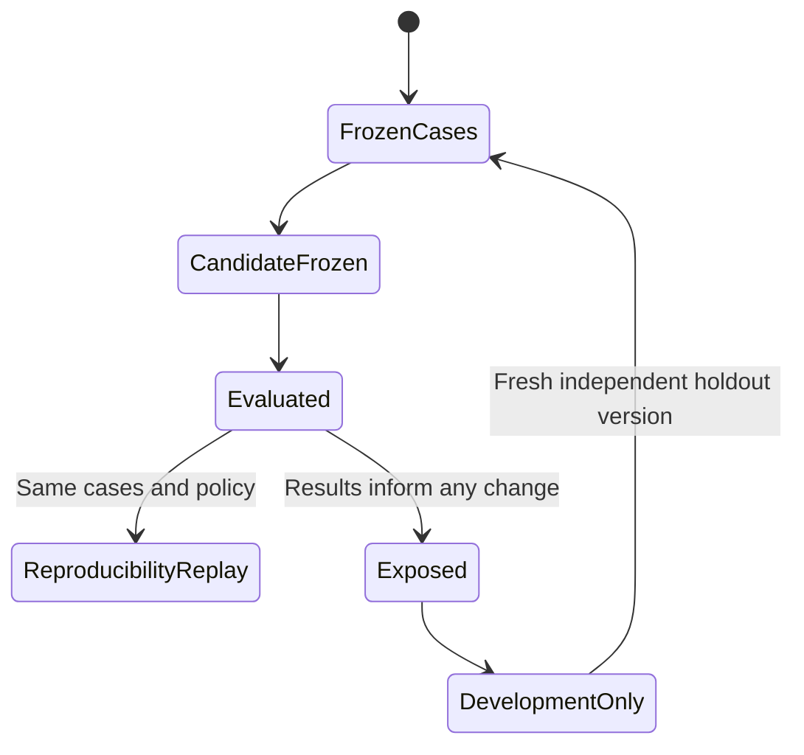
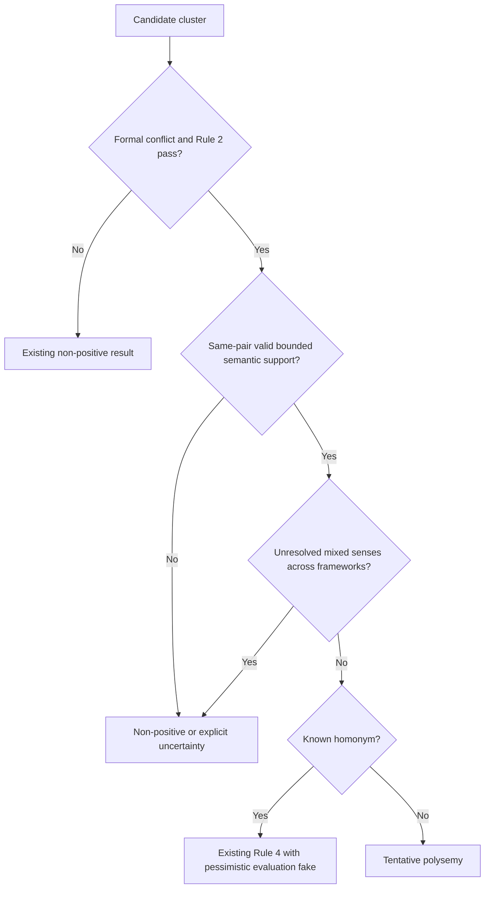

# FI-2 Offline Polysemy Quality Gate - Plan

## Goal Capsule

- **Objective:** Reviewers receive fewer false polysemy suggestions for unrelated senses, with reproducible offline evidence that useful analogous senses are still detected.
- **Means:** An explicit versioned Rule 3 policy, independently labeled held-out cases, and the existing Wilson gate with additional usefulness checks (KTD1-KTD6).
- **Authority:** The controller's `fi-2` mandate and supplied campaign rules govern this item. The chief repository's `docs/plans/2026-10-26-0705-feat-codex-drawdown-campaign-plan.md` and `ops/drawdown/mandates/_common.md` were unavailable in this clone; their Goal Capsule and cited R-IDs were not independently read. The source contract available here is Phase 9 R9/KTD9/KTD10 in `docs/plans/2026-10-05-0308-feat-phase9-design-principles-plan.md`, clarified by `docs/plans/2026-10-20-feat-phase9-u6-polysemy-plan.md`.
- **Execution profile:** This stage creates and commits this plan only. The later build remains on `drawdown/fi-2` and covers only the implementation units below.
- **Delivery:** Local commits only. The controller owns publication and the campaign merge gate owns integration under supplied campaign R15/R19. No remote or credential discovery belongs to this lane.
- **Stop conditions:** Preserve the campaign R11/R15-R17/R20 restrictions supplied with the mandate. No provider spend, credential or security-setting changes, real-person messages, unbacked deletion, migrations, data rewrites, package releases, or outside services. A missing prerequisite yields an explicit unavailable measurement, never a substituted pass.

---

## Product Contract

### Summary

Add a reusable, opt-in `r9-v2` Rule 3 policy and evaluate it against a fixed, fresh synthetic holdout. Keep the historical detector and its tests intact. The result must distinguish quantitative acceptance, human certification, and the unchanged legacy default.

### Problem Frame

The sweep handoff records 12 false positives among 82 labeled cases, all homonyms, with a Wilson upper bound of 23.9% against a 10% ceiling. Rule 3 promotes larger centroid distance after a formal conflict check, so unrelated senses can look stronger than related senses. The same historical evaluation detected only four of 29 gold polysemy cases.

Those are recorded measurements, not results rerun during this planning stage. Static inspection at commit `99c3f6db65385f85fa41ed975a0c12924d155397` confirms that the mechanism and exact numerical regression assertions remain. The working tree was clean on `drawdown/fi-2`; no local `AGENTS.md` or `CLAUDE.md` was found in the repository or its ancestors. Runtime baseline verification belongs to the build stage.

### Requirements

The R-IDs below are local to this plan. “Phase 9 R9” names the upstream quality requirement; “campaign R…” names the supplied campaign rules.

**Evaluation and reporting**

- R1. Evaluate the candidate on complete, independently labeled synthetic cases withheld from policy selection, with family-disjoint development and holdout partitions.
- R2. Preserve Phase 9 R9's Wilson 95% upper-bound ceiling of 0.10, its false-positive definition, and its denominator of all valid dispositions.
- R3. Preserve certification semantics: a quantitative result within the ceiling remains `provisional` without valid human certification of those exact cases, and a result above the ceiling remains `fail`.
- R4. Demonstrate useful detection as well as fewer homonym errors, using the preregistered supplementary checks in A1; report false negatives, uncertainty, and every gold-label denominator.
- R5. Produce reproducible offline results without reading credentials, calling a provider, or downloading a model; incomplete or unavailable evaluation cannot satisfy the gate.
- R6. Bind reports to the exact dataset, split, detector policy, embedding artifact, and source revision, and retain unsuccessful evaluation attempts.

**Detector and compatibility**

- R7. Rule 3 must stop treating large distance alone as positive evidence of polysemy; formal conflict and semantic evidence must refer to the same framework pair.
- R8. Preserve existing tests, fixture bytes, public defaults, Rule 1/2 requirements, pessimistic Rule 4 evaluation, and the human disposition boundary for fork release.
- R9. Make the versioned candidate callable outside the benchmark and selectable through the existing `polysemy gate` command, with explicit policy identity in its report.

### Scope Boundaries

In scope are the polysemy detector's opt-in policy, synthetic evaluation data, the existing gate command, new regression tests, and public-safe evidence under `docs/plans/evidence/`.

Out of scope are viewer/review-UI changes, provider bake-offs, production corpora, book-derived material, signing/certification implementation, vocabulary changes, corpus migrations, branch reconciliation, pipeline readiness reporting, and CI expansion. These belong to other mandate items or reserved decisions. No screenshot is required because this plan contains no front-end change.

Considered and not built:

- A default-policy switch would contradict the exact historical assertions that R8 preserves. This item delivers an explicit candidate path; it does not claim that the default pipeline's failing gate has changed.
- A new command or API route is unnecessary: existing tests pin the four polysemy commands and the API boundary. Existing `gate` options plus the callable detector cover R9.
- A larger homonym whitelist or per-term exceptions would memorize observed failures. General evidence rules must handle unseen terms.
- Cryptographic holdout secrecy and an external labeling service are unnecessary for this offline synthetic evaluation. Independent authorship and recorded exposure/freeze history are sufficient for the bounded claim; they do not establish population-level accuracy.

### Acceptance Examples

- AE1. Covers R2-R4. A complete candidate run satisfies the Wilson ceiling and A1's usefulness checks, but has no human certification: quantitative checks pass and `FpGateReport.status` remains `provisional`.
- AE2. Covers R4. A detector returns `uncertain` for every case: the false-positive count may be zero, but the supplementary acceptance check fails on recall.
- AE3. Covers R5. The required embedding snapshot is absent: evaluation reports unavailable, makes no download or provider attempt, and produces no measured gate result.
- AE4. Covers R7. Only A/B has a formal conflict, while only B/C has favorable similarity: the three-framework cluster is not promoted to polysemy.
- AE5. Covers R8. A caller omits the new options: historical detector behavior and reporting remain unchanged, including the recorded failing gate.

---

## Planning Contract

### Verified Starting State

| Surface | Current evidence | Planning consequence |
|---|---|---|
| Rule 3 | `src/folio_insights/polysemy/detector.py`, `detect_polysemy`: any eligible distance at or above its threshold can pass | Add a bounded policy without altering the legacy branch |
| Historical assertions | `tests/polysemy/test_labeled_set.py`, `test_measured_gate_as_built`: N=82, FP=12, upper about 0.2386, positives=16, FN=25 | Preserve the file and add candidate-specific tests |
| Dataset structure | `tests/polysemy/fixtures/labeled_set.json`: 82 cases, 70 normalized term groups, 29 polysemy/19 homonymy/34 univocal | Row-level splitting leaks related cases; all existing cases are exposed development data |
| Eligibility | Existing case metadata has 26 polysemy, 17 homonymy and three univocal cases with conflict seeds and sufficient samples | Report overall and eligible recall separately; never drop ineligible cases from the full count |
| Centroids | `src/folio_insights/polysemy/prototype_cluster.py` averages normalized embeddings without normalizing the mean before its dot product | Compute true cosine inside the candidate policy; leave legacy measurements stable |
| Formal conflict | `src/folio_insights/polysemy/tbox.py`, `framework_conflicts` supplies pair-level results | Reuse that interface instead of combining evidence from different pairs |
| Gate and certification | `src/folio_insights/polysemy/fp_audit.py`, `fp_gate` | Reuse its computation; add supplementary checks around it |
| CLI compatibility | `tests/polysemy/test_no_auto_apply.py` pins command names; `tests/polysemy/test_cli_review.py` expects read-only gate behavior and exit zero on a measured failure | Extend existing options and make enforcement explicit |
| Offline boundary | `polysemy/cli.py` creates environment credentials even for gate; `services/boundary/semantic.py` loads a model without a local-only restriction | Isolate the gate's context and inject an explicitly local embedder |
| Roll-up | `tests/bench/test_phase9_rollup.py` checks a planted positive, no fork/journal mutation, and legacy gate/CLI agreement | Preserve it and add candidate integration coverage separately |

### Assumptions

These are engineering choices for the item, not thresholds already authorized by the Phase 9 contract. Freeze them before candidate scoring; do not relax them in response to a failing result.

- A1. The primary holdout has exactly 140 independent semantic families: 50 homonymy, 45 polysemy, and 45 univocal, with one primary case per family. At least 35 homonym families are absent from `HOMONYMS`. Candidate overall polysemy recall must be at least 50% (at least 23/45 true positives) and no lower than legacy on the same holdout. Its homonym false-positive point rate must be at most 10% and no greater than legacy on that holdout. On the exposed 82-case replay set, homonym false positives must strictly decrease while every legacy true positive is retained. These supplement R2; the homonym point-rate ceiling is not a Wilson confidence claim.
- A2. Cases use registered frameworks, with at least 30 holdout families spanning Louisiana civil law and a common-law framework. All 50 primary homonym families, including at least 35 outside `HOMONYMS`, must satisfy Rules 1/2 and actually reach Rule 3 in both policies. Upstream-ineligible homonym examples belong to the separate stress set. The manifest fixes eligibility counts before tuning and includes positive cases without seeds or sufficient samples; those positives remain false negatives in overall recall. Independent label review checks these strata for shortcuts before the manifest freezes.
- A3. The existing `all-MiniLM-L6-v2` embedding artifact and declared Python dependencies will be available from the build environment's caches. Their presence and actual baseline results are unverified here. Missing caches are an environment limitation, not authority to download, add a provider, or fabricate acceptance evidence.
- A4. Human certification is not a dependency for this item's offline quantitative acceptance. Any later certified/global R9 claim still needs the existing human process and the separately owned signing work.

### Key Technical Decisions

- KTD1. **Version the candidate explicitly.** Add `legacy-v1` and `r9-v2` selection, with the omitted-policy path retaining current behavior. Thread selection through `detect_polysemy`, `detect_case`, and `evaluate_labeled_set`; never infer it from fixture filenames or gold labels. Keep the existing verdict union and annotate candidate `matched_rules` with its policy identity. Reject incompatible legacy threshold overrides when v2 is selected rather than silently mixing semantics. Governs R7-R9.
- KTD2. **Keep labels outside the detector.** Reuse `LabeledSet` for cases and add a separate evaluation manifest for split membership, semantic-family/alias/template groups, primary-versus-stress roles, fixed strata, and canonical digests. Detector inputs remain axiom summaries, framework IDs, the term, and formal conflict evidence. Case IDs, gold labels, dispositions, explanatory notes, and split metadata never become classifier features. Governs R1/R6.
- KTD3. **Treat holdout exposure as irreversible.** The existing 82 cases are development/replay only. A separate fixture author prepares new synthetic cases and gold rationales before candidate tuning; the policy author receives development cases and the holdout specification, not holdout text or labels. Commit the cases and manifest before tuning, then freeze the candidate/configuration before the first holdout run. If results influence a redesign, retain the report and mark that split exposed. A later candidate needs a fresh independently authored holdout with the same A1/A2 distribution, frozen before scoring. No repeated selection against the same holdout, removal of failed cases, or post-result sample enlargement. Every attempted round remains in the evidence record. Governs R1/R6.
- KTD4. **Require bounded, distributed semantic support.** For v2, calculate true cosine using finite, nonzero normalized centroids. Admit a pair only within a lower/upper distance band and with support across multiple distinct axiom summaries after masking the target term. Use the existing local embedding model for masked summaries; shared spelling or one copied sentence cannot supply the support. Both the band and support must concern the pair proven disjoint by Rule 1. Freeze the global band/support parameters using development-only validation; no term-specific tuning. Far-apart, missing, contradictory, or invalid evidence produces an explicit non-positive/uncertain outcome, not an asserted homonym diagnosis. Preserve Rule 2 and the pessimistic Rule 4 behavior. A multi-framework cluster with unresolved mixed senses remains uncertain rather than proposing a whole-cluster fork. Governs R7/R8.
- KTD5. **Inject a local embedder without changing the shared singleton.** Add an optional encoder seam to prototype construction and evaluation; the omitted seam preserves existing behavior. The new offline runner resolves the exact cached snapshot with local-only loading and supplies it to both policies. Candidate pair-support encoding uses that same instance. Gate execution installs an empty scoped `LLMRunContext`, avoiding `Credentials.from_env` and inherited credentials; live `detect`, `review`, and `audit` retain their existing context behavior. Evaluation always injects `AlwaysPolysemyLLM`. Governs R5/R8.
- KTD6. **Keep the R9 report and quantitative checks distinct.** Wrap the existing `FpGateReport` with complete per-label outcomes, overall/eligible recall, homonym errors, unknown-whitelist errors, uncertainty, detector positives, and Rule-4 calls. Record actual Rule-3 entry counts for primary homonyms to verify A2, rather than inferring coverage from low error rates. The wrapper accepts only a complete primary split with zero invalid dispositions; stress variants never enlarge its Wilson denominator. Compare legacy and candidate on identical cases and embeddings. Report policy/configuration, dataset, manifest, code, and model identities without machine-local paths. Governs R2-R6.
- KTD7. **Keep publication with the controller.** The cloud build uses its default model, while campaign Astra/Fable reviews remain external merge prerequisites (session-settled: user-directed — chosen over the local Astra-only build route: the campaign explicitly assigns cloud builds to its default model). The lane neither substitutes a cross-model review claim nor searches for credentials. Governs delivery in the Goal Capsule.

A general distance band plus distributed support is a bounded extension of the existing evidence path. Threshold choices are reversible and depend on development measurements, so competing storage designs or a provider bake-off would not help settle them. The policy's effectiveness remains an execution-time question; this plan promises no unmeasured success.

### High-Level Technical Design

The evaluation pipeline keeps labeled data at the scoring boundary:

The holdout lifecycle prevents evaluation from silently becoming tuning:

Candidate decision sequence:

CLI behavior is explicit rather than inferred from the certification status:

| Invocation shape | Evaluation | Output | Exit behavior |
|---|---|---|---|
| Existing `gate` options only | Historical labeled-set path | Existing table | Existing behavior, including zero for a measured failure |
| `gate` with `r9-v2` and evaluation manifest | Named development, validation, or holdout partition | Policy-specific comparison table | Reporting only unless `--check` is selected |
| Candidate invocation with `--json` | Same evaluation | Deterministic JSON on stdout | Same checks as table mode |
| Candidate invocation with `--check` | Complete primary partition | Report includes quantitative acceptance and certification separately | Zero for quantitative/usefulness acceptance, one for measured failure |
| Invalid manifest/options or unavailable model | No valid measurement | Specific error or structured unavailable result | Nonzero distinct from measured failure |

Only a holdout-partition result can support the held-out claim. Development/validation output identifies itself accordingly. No command writes cases, dispositions, certifications, forks, or report files; evidence capture is an explicit build-stage action.

### Risks and Dependencies

- Shared-support embeddings remain a heuristic, not proof of analogy. Independent labels, unknown-term homonyms, masked-term stress cases, and A1 guard against the known failure without claiming real-corpus validity.
- Family IDs alone cannot detect semantic duplicates. The fixture review must check aliases, shared templates, and paraphrases before freezing; automated checks catch exact duplication and declared overlap.
- One selectively reported successful holdout would overstate repeated experimentation. Retain earlier rounds and disclose their exposure histories under KTD3.
- `fi-1` may change disposition/certification code before the build. Reverify its interfaces at build start and consume them without editing signing behavior or weakening the existing gate.
- The unavailable chief document remains a source limitation for the controller to reconcile against the supplied rules. No unseen campaign requirement is claimed as verified.

---

## Implementation Units

### U1. Freeze evaluation cases, grouping, and acceptance metadata

**Goal:** Provide a reproducible held-out input contract before candidate development.

**Requirements:** R1/R4/R6, A1/A2. **Dependencies:** None.

**Files:** Create `src/folio_insights/polysemy/evaluation_set.py`, `tests/polysemy/fixtures/r9_v2/holdout-v1.json`, `tests/polysemy/fixtures/r9_v2/split-manifest.json`, `tests/polysemy/fixtures/r9_v2/README.md`, and `tests/polysemy/test_evaluation_set.py`. Reference the existing `tests/polysemy/fixtures/labeled_set.json` unchanged; any additional development cases get a separate file in `r9_v2/`.

**Approach:**

1. Establish the KTD2 manifest using existing strict/frozen Pydantic and canonical case-digest patterns.
2. Assign all exposed legacy cases to development/replay, grouping aliases and shared sense templates together for development validation.
3. Author and independently review the A1/A2 holdout, record its labeling provenance and family assignment, then freeze it under KTD3.

**Patterns to follow:** `labeled_set.LabeledSet`, `cases_sha256`, `tbox.normalize_term`, and `tests/polysemy/test_labeled_set.py`.

**Test scenarios:**

- Reordering manifest entries preserves canonical identity and partition membership.
- A repeated normalized term, declared alias, semantic family, or sense template across partitions is refused.
- Missing/duplicate IDs, mutated case digests, duplicate primary families, or incomplete coverage are refused before detection.
- A small or incorrectly stratified holdout cannot count as final evidence.
- A primary homonym without the formal conflict or sample counts required by A2 is refused; upstream-ineligible homonym stress cases do not enter primary N.
- Repeated paraphrases can appear as stress cases but cannot increase primary N.
- Gold labels and disposition rationales remain agent-authored; no certification block is generated.

**Verification:** Dataset review and integrity tests establish the declared distribution, provenance and separation without invoking a classifier on the holdout.

### U2. Add the reusable versioned Rule 3 policy

**Goal:** Distinguish plausible related senses from distance-only homonym candidates.

**Requirements:** R7-R9. **Dependencies:** U1's frozen evaluation specification and development partition; holdout contents stay outside tuning.

**Files:** Create `src/folio_insights/polysemy/rule3_policy.py`, `src/folio_insights/polysemy/offline_embeddings.py`, `tests/polysemy/test_rule3_policy.py`, and `tests/polysemy/test_offline_embeddings.py`. Modify `src/folio_insights/polysemy/detector.py`, `src/folio_insights/polysemy/prototype_cluster.py`, and `src/folio_insights/polysemy/labeled_set.py` only through additive policy/encoder seams. Leave `thresholds.py`, `whitelists.py`, and shared boundary-model behavior unchanged.

**Approach:**

1. Add policy dispatch and encoder injection under KTD1/KTD5, preserving the omitted-option path.
2. Implement KTD4 using existing pair-level reasoner results and axiom summaries.
3. Compare candidate configurations only on development/validation groups, including all historical failures, then freeze one configuration and its evidence identity.

**Execution note:** Start with synthetic-vector rule tests and legacy compatibility checks before selecting any empirical thresholds.

**Test scenarios:**

- A formally conflicting, adequately sampled related pair with distributed support can yield polysemy; a high-distance unrelated pair cannot win merely by being farther apart.
- Identical/near-identical meanings below the lower band do not qualify as distinct senses.
- Repeated target spelling, shared boilerplate, or copied summaries cannot alone meet the support requirement.
- Zero-length, nonfinite, missing, or dispersed centroids are handled explicitly; cosine normalization is scale-invariant and cannot change legacy results.
- Conflict on A/B and support on B/C do not combine; pair ordering does not affect the result.
- Mixed three-framework senses remain uncertain; Rule 1 absence and Rule 2 undersampling keep their current precedence.
- Every candidate case reaching Rule 4 uses the same pessimistic fake during evaluation; no alternative fallback improves the headline score.
- V2 cannot inspect a label, case ID, note or manifest, and incompatible legacy overrides are refused.

**Verification:** New policy tests and the unchanged existing polysemy suite pass. Development results satisfy the replay portion of A1 before the candidate is frozen for holdout evaluation.

### U3. Expose complete offline comparison through the existing gate

**Goal:** Give operators and automation one honest, policy-specific evaluation result.

**Requirements:** R2-R6/R8/R9, AE1-AE3/AE5. **Dependencies:** U1/U2.

**Files:** Create `src/folio_insights/polysemy/evaluation.py`, `tests/polysemy/test_evaluation.py`, and `tests/polysemy/test_gate_candidate_cli.py`. Modify `src/folio_insights/polysemy/cli.py`; use the U2 seams in `labeled_set.py`. Consume `fp_audit.py` and existing certification/disposition APIs without redefining them.

**Approach:**

1. Evaluate legacy and candidate over the same validated partition and real local embedder, then compute KTD6's report.
2. Extend `gate` with explicit policy, manifest, split, JSON, and check options; reject ambiguous legacy-labeled-set versus manifest selections.
3. Implement KTD5's gate-only empty context and the CLI behavior table. Keep the existing command set and default output contract.

**Patterns to follow:** `evaluate_labeled_set`, `fp_gate`, Click's existing gate command, and existing CLI tests.

**Test scenarios:**

- AE1's numerically accepted but uncertified run reports quantitative acceptance and `provisional` together.
- An all-negative/all-uncertain candidate fails usefulness checks despite zero false positives.
- Missing outcomes, invalid dispositions, wrong split/hash, or omitted label categories cannot yield an accepted report.
- Supplementary homonym point rate, all-case Wilson rate, FDR and both recall denominators remain distinct; comparisons use integer counts before display rounding.
- A no-seed gold positive counts as a false negative overall and appears separately in eligibility reporting.
- A primary homonym that bypasses Rule 3 causes the A2 coverage check to fail even when its prediction is non-positive; unknown-whitelist coverage is verified separately.
- Root CLI and direct-group invocation succeed without touching credential loaders, live provider constructors, or network/download paths; patch those paths to raise in tests.
- Missing cached embeddings return unavailable with no partial pass, and injected fake embeddings are labeled test-only rather than empirical evidence.
- JSON and table figures agree; identical code/data/model runs reproduce the measured fields and digests.
- Legacy invocations retain exit behavior and write no files; explicit candidate `--check` distinguishes measured failure from unavailable input.

**Verification:** New evaluator/CLI tests pass, and the unchanged no-auto-apply, certification, review, and legacy gate tests still pass.

### U4. Measure the frozen candidate and record acceptance evidence

**Goal:** Establish the item's actual offline result and regression status.

**Requirements:** R1-R9, AE1-AE5. **Dependencies:** U1-U3 and cached runtime prerequisites.

**Files:** Create `tests/polysemy/test_candidate_integration.py` and evidence under `docs/plans/evidence/fi-2/`, including `baseline.json`, versioned `holdout-v1.json` results, `verification.md`, and an attempt index if further rounds occur. Fixture JSON and result JSON are in different directories. No existing test file is modified.

**Approach:**

1. Reverify the starting revision and runtime baseline in the build environment before accepting candidate results.
2. Run the frozen holdout through both policies with the real cached model and no network; retain per-case synthetic IDs and complete aggregate counts.
3. Check A1/A2 and R2 independently, then run focused and repository regression checks under the Verification Contract.
4. Capture source/fixture/policy/model identities, independent labeling/freeze history, failures and unavailable prerequisites, and the precise bounded conclusion. Follow KTD3 for any redesign after exposure.

**Test scenarios:**

- P1 candidates plus a real in-memory TBox reach the same versioned detector used by the evaluator; the policy is not a benchmark-only classifier.
- New positive and homonym fixtures exercise the candidate through actual prototype construction and reasoner boundaries.
- Candidate execution leaves input corpora, journals, dispositions and fork outputs unchanged.
- Existing planted-positive roll-up behavior remains intact; candidate integration assertions do not replace the historical roll-up.

**Verification:** Complete, reproducible evidence meets the acceptance contract. A measured failure or unavailable prerequisite is recorded accurately and does not satisfy this unit's quantitative completion criterion.

---

## Verification Contract

No tests, model loads, or classifier experiments ran in this planning stage. The historical counts above must be reproduced or their drift explained during the build.

| Check | Scope | Required evidence |
|---|---|---|
| Starting-state verification | Current commit, existing fixture/test hashes, baseline gate | Identify concurrent changes and baseline failures before attributing anything to v2 |
| New deterministic tests | New split, policy, offline-embedding, evaluator, CLI and integration test files | Each unit's listed scenarios passes without real providers |
| Focused regression | Pytest over `tests/polysemy/` and `tests/bench/test_phase9_rollup.py` | Existing tests remain present and unweakened; failures are reconciled against baseline |
| Quantitative evaluation | Frozen primary holdout, real cached `all-MiniLM-L6-v2`, pessimistic fake | R2 plus A1/A2; all outcomes present and `invalid_dispositions=0` |
| Broad regression | Existing pytest fast-suite selection `not gate5 and not slow` | Record pass/fail/skip counts and exact command used in the evidence receipt |
| Public-safe evidence | `docs/plans/evidence/fi-2/` | Relative paths, synthetic case IDs, hashes and metrics only; no source matter, credentials or local machine paths |

The fast suite may require the configured folio-enrich backend and other existing worker dependencies. Use only controller-provided/cache-resident prerequisites and record missing dependencies separately from behavior failures. Do not remove tests, add blanket skips, change markers to hide failures, enable live-LLM tests, or silently substitute embeddings. An unchanged-code rerun on a provisioned offline worker is valid recovery; an unmeasured result is not a pass.

No viewer test or screenshot is required for this backend-only item. No migration, package publication, or deployment is part of its verification. Cross-model reviews and publication remain the controller's campaign prerequisites.

---

## Definition of Done

- U1-U4 have their required evidence, with a fixed independent holdout and preserved exposure history.
- The explicit `r9-v2` policy meets R2 and A1/A2 offline, and every reported figure is traceable under R6.
- Certification remains truthful under R3. Evidence explicitly identifies the legacy default as unchanged and makes no claim of a certified or default-pipeline R9 pass.
- Existing fixtures and tests are unchanged; new tests cover the candidate, integration boundaries and evaluator failure modes.
- No viewer, provider, signing, migration, release, CI, or unrelated mandate work enters the diff.
- The branch contains only this item. Abandoned candidate code is excluded from the final implementation while failed-attempt evidence is retained; do not delete unbacked work.
- The controller receives the plan, local commits, review state, measured evidence and any remaining prerequisite limitation. This plan-stage commit itself makes no implementation-success claim.

---

## Sources and Research

- `docs/handoffs/2026-10-20-sweep-cloud-folio-insights.md`: observed Rule 3 failure and held-out redesign follow-up; the mandate now authorizes planning that follow-up.
- `docs/plans/2026-10-20-feat-phase9-u6-polysemy-plan.md`: pessimistic fake, human certification, no-auto-apply, and exact-fork protections.
- `docs/plans/2026-10-05-0308-feat-phase9-design-principles-plan.md`: Phase 9 R9, KTD9/KTD10 and U6 as-built evidence.
- `docs/handoffs/2026-10-09-drain-coordination.md`: neighboring ownership boundaries; this item changes none of the bridge/shard contracts.
- `docs/solutions/proposed-tags-outvote-task-mapping.md`: a green quality check can conceal the loss of useful output; informs R4.
- `docs/solutions/llm-path-unverified-iris.md`: lexical agreement and circular verification do not establish intended meaning; informs KTD2/KTD4.
- `docs/solutions/sys-path-bridge-staleness.md` and `docs/solutions/fastapi-undeclared-web-tier-deps.md`: missing deterministic dependencies must stay visible; inform R5.
- `docs/solutions/verifiable-source-anchoring.md`: provenance must resolve to actual evidence and committed fixtures must remain synthetic; informs R6.
