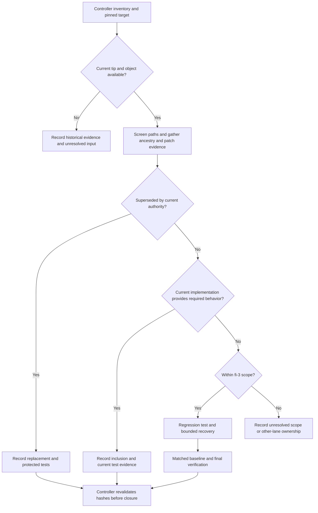

# fi-3 Drain Branch Reconciliation - Plan

## Goal Capsule

- **Objective:** Maintainers can account for every `feat/drain-*` branch, retain any still-required work on `master`, and close superseded work with evidence while preserving every branch.
- **Means:** Compare pinned branch tips against a pinned target, recover only demonstrated missing changes, and record dispositions for the controller (KTD1–KTD4).
- **Authority:** The supplied drawdown mandate for `fi-3`; the chief repository's `docs/plans/2026-10-26-0705-feat-codex-drawdown-campaign-plan.md`; this repository's current product decisions. The chief file is unavailable in this sandbox. Its Goal Capsule and cited campaign rules must be supplied before final dispositions; the mandate's supplied rules remain binding meanwhile.
- **Execution boundary:** This plan belongs to `drawdown/fi-3`. The present delivery is the committed plan only. The build stage produces local commits; the controller scans, pushes and opens the PR, and the campaign gate handles review and merging (campaign R15, R19).
- **Stop conditions:** Missing source objects or authority leave the affected comparison unresolved. Protected scope and prohibited operations are governed by R5–R7. No incomplete inventory may be reported as complete reconciliation.

---

## Product Contract

### Summary

Reconcile historical drain work against the current product, preserving later changes and recovering only proven omissions. Deliver a durable branch-by-branch record and controller closure recommendations, including an explicit incomplete result when required source tips are unavailable.

### Problem Frame

The October 20 sweep handoff reports all twelve original drain units landed. Local history corroborates several merges, and current source and tests cover every unit. However, this clone has no drain refs, so it cannot prove whether those branches advanced after their recorded landings. Later measured-propositions work also replaced the old hierarchy. Replaying historical branches without checking those changes could undo the current design.

### Requirements

**Reconciliation evidence**

- R1. Account for the complete controller-supplied `feat/drain-*` inventory against an identified `master` commit, recording exact tip hashes and the inventory's capture time.
- R2. Classify each branch's distinct changes as included, superseded, missing, or unresolved, with landing/replacement evidence and current test references; a branch closes only when every relevant change is accounted for.
- R3. Land every demonstrated missing, still-required change within `fi-3` scope with regression coverage, preserving existing behavior and tests.
- R4. Record closure recommendations and outstanding evidence in durable repository documents; distinguish local completion from controller publication and external PR closure.

**Scope and preservation**

- R5. Preserve the measured-propositions plan's flat references, typed links, logical dependency safeguards, atomic identity, and signed history; do not restore retired `elaborates`/Tractarian hierarchy. Authority: `docs/plans/2026-10-26-0716-feat-measured-propositions-and-workbench-plan.md`, KD3, R9–R10, KTD9, KTD11, U36.
- R6. Leave review-UI viewer code, the provider bake-off, other mandate items, and all `archive/*` and `backup*` branches untouched. No new schema migration, data rewrite, package release, or outside service is part of the planned work.
- R7. Preserve all refs and unrelated work. Do not add a remote, seek credentials, read prohibited secret/environment/key files, spend, change security settings, send messages in the user's voice, force-push, or delete anything without a verified backup. Public artifacts contain only repository-relative paths and content-free evidence (campaign R11, R15–R17, R19–R20 as supplied in the mandate).
- R8. Record fresh checks against the tested revision, distinguishing pass, fail, skip, blocked prerequisite, and timeout; never delete or weaken an existing test to obtain a pass.

### Key Decisions

- **Guarded campaign delivery.** The controller and campaign gate own publication; routine work does not wait for a new human approval. (session-settled: user-directed — chosen over holding every expansion for review: work proceeds behind the campaign guardrails.) Governs R4, R7.
- **Keep the assigned scope.** No speculative feature replaces a completed reconciliation. (session-settled: user-directed — chosen over speculative features when useful planned work runs out: durable hygiene is the fallback.) Governs R2, R3, R6.

### Acceptance Examples

- AE1. **Covers R1, R2.** A recorded merge parent is already an ancestor of the target, but the current source tip is absent. The record says historical inclusion is proven and current-tip reconciliation is unresolved.
- AE2. **Covers R2, R5.** A branch contains an old hierarchy implementation and an independent missing backend fix. The former is superseded by the measured-propositions decision; only the latter is eligible for recovery.
- AE3. **Covers R2, R3.** A squash landing has a different hash from its source. Patch comparison plus current source/tests establishes equivalent behavior; the change is recorded as included without replaying it.
- AE4. **Covers R4, R8.** All accessible changes are included or superseded, but a required parity check lacks its sibling checkout. The record contains no invented code change and no claim that the unavailable check passed.
- AE5. **Covers R1, R4.** A source tip advances before the controller closes its PR. The recommendation is rechecked against the new tail before closure; the old receipt remains evidence only for its original hashes.

### Scope Boundaries

`fi-3` reconciles existing drain work. It does not resume the original twelve-unit build as a fresh feature request.

#### Deferred to Follow-Up Work

- `fi-1`: signed polysemy dispositions, corpus-scoped signing, the `closedUnder` writer, and CORPUS-04 wiring.
- `fi-2`: held-out polysemy Rule 3 redesign and its R9 quality gate.
- `fi-4` and `fi-5`: readiness CLI, CI and Hypothesis expansion. Existing `.github/workflows/viewer.yml` already contradicts the old handoff's blanket statement that no workflows exist.
- Review-UI workflow/design and the Phase 10 U7 provider bake-off remain outside this lane. The original drain's U7 paused-job expiry is a different unit.

#### Considered and Not Built

A general branch-audit CLI, dependency refresh, wholesale bridge rewrite, and removal of the redundant bridge-open retry add no demonstrated missing drain behavior. None is planned. A specific source delta and failing current-contract test would be needed to justify an in-scope repair.

### Controller Prerequisites

1. **Authority excerpt:** Supply the chief campaign Goal Capsule and the cited campaign R-IDs, including R11, R15, R16, R17, R19 and R20. Confirm which R9 reference belongs to the campaign versus the repository's polysemy plan; they must not be conflated. The campaign file and `ops/drawdown/mandates/_common.md` were not present locally.
2. **Complete source snapshot:** Supply all current `feat/drain-*` names and tip hashes, the authoritative target `master` hash, capture time, and corresponding local Git objects through the controller's sandbox preparation. Include known historical names missing from the current inventory with an explicit disposition; do not infer that a missing ref was deleted or closed.
3. **Verification environment when required:** Supply existing dependencies, sibling checkout/model/JRE inputs, or host execution for required checks the socket-restricted sandbox cannot run. This lane never obtains provider keys or services.

The first two prerequisites block full reconciliation and closure, not the useful historical inventory. They require controller preparation, not a decision or time from Damien.

---

## Planning Contract

### Verified Starting State

Inspected on 2026-10-27:

- Clean `drawdown/fi-3` at `99c3f6db65385f85fa41ed975a0c12924d155397`.
- Local `master` at `269171e47bdfc20fa574fa9eeeff730b91919b91`, exactly one commit ahead. Its changes are session/planning metadata; `src/`, `api/`, `viewer/`, `tests/`, manifests, and the relevant documentation match the starting branch. Preserve that metadata commit without importing it as fi-3 work.
- No remotes, remote-tracking refs, or `feat/drain-*` refs. History is not shallow. No on-disk `AGENTS.md` or `CLAUDE.md` was found; the supplied instructions govern alongside repository plans.
- The following seven names are historical discoveries, **not a complete current branch inventory**. Ancestry checks verified the four recovered merge parents against both starting revisions.

| Historical branch | Local evidence | What is established | What remains unknown |
|---|---|---|---|
| `feat/drain-shards-axioms` | Merge `103d9ca`, PR #32; second parent `183bcf8` | Recorded plan/coordination tip is included | Any later source tail |
| `feat/drain-retire-syspath-bridges` | Merge `09b54b7`, PR #33; second parent `b1282f5` | Recorded retirement tip is included | Any later source tail |
| `feat/drain-wave1` | Merge `3dd361e`, PR #34; second parent `22f921a` | Recorded wave tip is included | Any later source tail |
| `feat/drain-bridge-ingest` | Merge `8c98170`, PR #35; second parent `bf683c2` | Recorded ingest tip is included | Any later source tail |
| `feat/drain-u5-auth` | Commit `6d1b297` names the squash source | Auth implementation landed within wave 1 | Source tip and complete squash equivalence |
| `feat/drain-fix-u9` | Review plan names branch; `d2b1f7c`, PR #36, includes that plan, signed decisions and tests | U9 landing is present | Source tip and complete branch equivalence |
| `feat/drain-fix-u10` | Review plan names branch; `2f742eb`, PR #38, includes that plan, graph API and tests | U10 landing is present | Source tip and complete branch equivalence |

Supplemental landings are `fe430a4` (U8, PR #37), `1738558` (bridge guard classification, PR #39), and `1c6d4b4` (WAL-open retry, PR #40). Later commits `b08525b` (hierarchy retirement, PR #56) and `2bdc1d0` (archived hierarchy protection, PR #67) are also ancestors of local `master`.

Source inspection established implementation and test artifacts for all U1–U12, but established no missing production change. **No tests were executed during planning; old pass counts are historical evidence only.**

### Current Implementation and Test Map

These are existing files to preserve and use for comparison, not a proposed rewrite list.

| Original drain area | Current implementation | Existing tests |
|---|---|---|
| U1 lineage | `src/folio_insights/models/knowledge_unit.py`, `src/folio_insights/pipeline/stages/base.py`, `src/folio_insights/llm/templates.py` | `tests/pipeline/test_unit_template_lineage.py` |
| U2 rubric | `src/folio_insights/rubric/harness.py`, `src/folio_insights/rubric/criteria.py` | `tests/rubric/test_harness.py`, `tests/rubric/test_criteria.py`, `tests/rubric/test_gold.py` |
| U3 kernel | `src/folio_insights/kernel/seed.py`, `src/folio_insights/kernel/traversal.py` | `tests/kernel/test_catalog.py`, `tests/kernel/test_seed.py`, `tests/kernel/test_traversal.py` |
| U4 references/cycles | `src/folio_insights/revision/tractarian.py`, `src/folio_insights/revision/acyclicity.py`, `src/folio_insights/storage/context.py` | `tests/revision/test_tractarian.py`, `tests/revision/test_cycle_guard.py`, `tests/revision/test_flat_propositions.py` |
| U5 auth | `api/auth.py`, `api/routes/bridge.py` | `tests/api/test_auth.py`, `tests/api/test_read_side_effects.py` |
| U6 server time | `src/folio_insights/governance/clock.py`, `src/folio_insights/storage/governance.py` | `tests/governance/test_server_time.py` |
| U7 job expiry | `src/folio_insights/jobs/queue.py`, `src/folio_insights/jobs/worker.py` | `tests/jobs/test_paused_expiry.py` |
| U8 minter | `src/folio_insights/minting/minter.py`, `src/folio_insights/minting/mapper.py` | `tests/minting/test_minter.py`, `tests/minting/test_atomic_mapper.py`, `tests/minting/test_support.py` |
| U9 decisions | `src/folio_insights/proposals/signed_decisions.py`, `src/folio_insights/proposals/store.py`, `src/folio_insights/persistence/review_db.py` | `tests/proposals/test_signed_decisions.py`, `tests/test_signed_decisions_api.py` |
| U10 graph | `api/routes/shard.py` | `tests/test_shard_graph_api.py`, existing `viewer/src/lib/graph/layout.test.ts` |
| U11 validator | `src/folio_insights/validation/validator.py`, `src/folio_insights/reason/hermit_harness.py` | `tests/validation/test_clusters.py`, `tests/validation/test_hermit_cluster.py`, `tests/validation/test_dep_leak_guard.py` |
| U12 closed-world query | `src/folio_insights/query/closed_world.py` | `tests/query/test_closed_world.py` |
| Bridge retirement/ingest | `src/folio_insights/services/bridge/folio_bridge.py`, `src/folio_insights/bridge_ingest/ingest.py`, `src/folio_insights/storage/journal.py` | `tests/test_bridge_retirement_parity.py`, `tests/bridge_ingest/test_identity_parity.py`, `tests/bridge_ingest/test_ingest.py`, `tests/bridge_ingest/test_bridge_api.py`, `tests/storage/test_journal_wal_open.py` |

The retained ingestion and mapper seams are intentional (`docs/bridge-retirement-2026-10-09.md`). The historical planned `tests/services/bridge_retire/` directory is not the current parity-test location. The auth guard deliberately treats bridge status as read-only and ingest as service-token authenticated.

### Key Technical Decisions

- KTD1. **Pin the audit universe before judging completion.** Keep a Markdown evidence ledger at `docs/plans/evidence/fi-3-drain-reconciliation.md` containing source/target hashes, inventory provenance, comparison basis and per-change dispositions. Historical merge parents are useful fallback evidence, never substitutes for current tips (R1, R2).
- KTD2. **Use ancestry, then patch evidence, then current-contract review.** Ancestry proves historical inclusion. Non-ancestor tips require squash/patch comparison and source/test inspection; a later revert or replacement must be judged against current authority. Split mixed branches into behavior groups so one landed commit cannot conceal an omitted change (R2, R5).
- KTD3. **Recover the smallest compatible change.** Screen changed path names before reading historical blobs, and inspect only allowed content. Prefer a bounded port when old commits include excluded or obsolete work. Every recovered behavior gets a focused regression test in its existing area; no demonstrated gap means no production edit (R3, R6–R8).
- KTD4. **Bind closure recommendations to the reviewed hashes.** The controller revalidates source and target tips before external action; changed tails reopen only affected comparisons. Record PR identity only when supplied or evidenced, and never claim the controller's action already happened (R4).
- KTD5. **Use the assigned campaign execution route.** Local work uses Astra rather than the Sol-first ladder; cloud builds use the platform default model, with Astra and Fable review at the campaign gate. (session-settled: user-directed — chosen over the Sol-first local ladder and requiring Astra for cloud builds: the campaign's assigned execution split controls.) Governs R4, R7.

### High-Level Technical Design

### Assumptions

- A documentation-only build outcome is plausible because no omission is established locally; this is an unvalidated expectation until the complete source snapshot is inspected.
- The controller can supply missing history and authority without involving Damien. Until supplied, full closure remains blocked rather than assumed.
- Exact recovery files and test selectors depend on source deltas not present in this clone. A newly discovered in-scope gap must be recorded with those paths and acceptance scenarios before its implementation; it must not broaden the mandate.

### Sequencing and Risks

U1 establishes the inventory and dispositions. U2 addresses only proven gaps and verifies affected behavior. U3 records the resulting evidence and controller actions. U1 and a partial U3 can proceed for accessible history while controller inputs are missing; U2 cannot act on an unidentified delta.

The main risk is restoring obsolete functionality because its old branch differs from `master`. R5 and KTD2 prevent that inference. The second risk is overclaiming completeness from absent refs or skipped tests; R1 and R8 keep those gaps visible. No storage format or interface design choice is needed for the documentary outcome, so competing implementation prototypes add no value.

---

## Implementation Units

### U1. Establish the branch inventory and dispositions

**Goal:** Produce a complete, reproducible comparison when controller inputs are available, retaining useful partial historical evidence otherwise.
**Requirements:** R1, R2, R5–R7; AE1–AE3.
**Dependencies:** Controller authority excerpt and complete source snapshot for final completion.
**Files:** Create `docs/plans/evidence/fi-3-drain-reconciliation.md`; use the existing source/test map and historical review plans as references.

**Approach:**

1. Recheck branch, worktree, target revision and available refs; preserve unrelated changes and distinguish the controller target from the local metadata-only `master` tip.
2. Apply KTD1–KTD2 to every supplied branch and each distinct behavior group. Record full hashes, landing or replacement commits, comparison outcome and current test references.
3. Record unavailable tips, excluded scope, and unidentified PR state separately. A branch with unresolved groups receives no blanket closure recommendation.

**Patterns to follow:** The dated evidence in `docs/handoffs/2026-10-20-sweep-cloud-folio-insights.md` and append-only coordination history in `docs/handoffs/2026-10-09-drain-coordination.md`; current decisions override historical implementation details.

**Test expectation:** No new runtime test for a documentation-only inventory. Verify the actual ancestry, patch comparisons, current source references, and AE1–AE3 classifications; do not write a synthetic branch-audit framework.

**Verification:** Every authoritative inventory entry has a hash-bound disposition. Missing inputs are visible and prevent an unqualified completeness claim.

### U2. Recover demonstrated omissions and verify preservation

**Goal:** Bring any still-required, in-scope missing behavior onto the branch without undoing later work.
**Requirements:** R2, R3, R5–R8; AE2–AE4.
**Dependencies:** U1's evidence for the specific change.
**Files:** Only the implementation/test pair identified in U1, using the Current Implementation and Test Map; extend `docs/plans/evidence/fi-3-drain-reconciliation.md` with the resulting commits and checks. No production change is predetermined.

**Approach:** Apply KTD3. Resolve historical conflicts according to current product authority. If every inspected delta is included or superseded, record that result and proceed without a code commit. A missing change that depends on excluded viewer work, another mandate item, or a prohibited operation remains explicitly unresolved with its owner.

**Execution note:** Establish a focused failing test for each recovered behavior before changing its implementation. Compare baseline and candidate in the same available environment.

**Patterns to follow:** Existing tests in the mapped subsystem; `docs/solutions/sys-path-bridge-staleness.md` for intentional bridge supersession and `docs/solutions/fastapi-undeclared-web-tier-deps.md` for distinguishing environment problems from code regressions.

**Test scenarios:**

1. A demonstrated missing branch behavior fails under the current contract on the target, then passes after its bounded recovery. Record the exact input, expected outcome and test path with the delta before editing.
2. Any reference/graph/kernel intersection retains flat references and ignores archived hierarchy, while self-edges and real logical dependency cycles remain refused (`tests/revision/test_flat_propositions.py`, `tests/revision/test_cycle_guard.py`, `tests/kernel/test_traversal.py`, `tests/test_shard_graph_api.py`).
3. Any identity/storage/minter intersection preserves atomic and legacy identity plus signed history (`tests/minting/test_atomic_mapper.py`, `tests/shards/test_verify_iris_cli.py`, `tests/revision/test_flat_propositions.py`).
4. Any bridge intersection preserves idempotency, identity parity, PII/SHACL refusal, read status and the service-token boundary (`tests/bridge_ingest/test_ingest.py`, `tests/bridge_ingest/test_identity_parity.py`, `tests/bridge_ingest/test_bridge_api.py`, `tests/api/test_auth.py`).
5. Any signed-decision intersection preserves signer attribution, freshness, tamper rejection, nonce replay protection and read-only compatibility (`tests/proposals/test_signed_decisions.py`, `tests/test_signed_decisions_api.py`).

Only applicable intersections require those additional suites. No new runtime tests are needed when U2 produces no behavioral change; the build-stage existing checks still supply the evidence required by R8.

**Verification:** Every recovered delta has focused proof and passing applicable nonregression checks. Baseline failures and unavailable prerequisites are reported separately; they do not authorize test removal or conceal an outstanding gate.

### U3. Record closeout and controller actions

**Goal:** Give the controller an auditable result for each branch without deleting refs or claiming external actions.
**Requirements:** R1, R2, R4, R7, R8; AE4, AE5; KTD4–KTD5.
**Dependencies:** U1; U2 for any recovered behavior.
**Files:** Finalize `docs/plans/evidence/fi-3-drain-reconciliation.md`; create `docs/handoffs/2026-10-27-fi-3-drain-reconciliation.md`; append a short fi-3 entry to `docs/handoffs/2026-10-09-drain-coordination.md` without rewriting prior entries.

**Approach:** Summarize included, superseded, recovered and unresolved changes, tested hashes and environment limits. Give the controller exact closure candidates and remaining scope owners under KTD4. Preserve historical plans; link their supersession evidence instead of editing old requirements into apparent completion.

**Patterns to follow:** Existing durable handoffs and `docs/solutions/git-commit-pathspec-re-adds-untracked-files.md`; inspect the intended staged tree before making focused local commits.

**Test expectation:** No new runtime test for the documents. Check that every inventory row is accounted for, citations resolve, recommendations match hashes, and no unresolved branch is presented as closed.

**Verification:** All local fi-3 changes are committed on the assigned branch, all original refs remain, and the handoff truthfully identifies controller publication and review still to occur. If prerequisites are absent, the handoff reports partial reconciliation and the exact recovery input.

---

## Verification Contract

These checks belong to the build stage. Historical results do not substitute for fresh execution.

| Check | Applicability and expected evidence |
|---|---|
| Inventory and history | Complete controller snapshot; full source/target hashes; ancestry plus patch/current-contract review; no unclassified in-scope change. Recheck at controller publication. |
| Focused pytest | Run the mapped tests for every recovered or supersession-sensitive area. Preserve existing assertions and test files; report individual skips and blocked prerequisites. |
| Existing quick suite | Use the repository's `ci/build.py` selection, `not gate5 and not slow and not integration`, with `--benchmark-skip`; `python -m pytest` is the runner. Keep live-provider opt-in disabled. Record baseline and final revision, totals, exit result and limitations. |
| Integration acceptance | Required bridge parity or worker/model tests run when their existing dependencies are supplied. `FOLIO_INSIGHTS_FOLIO_ENRICH_PATH` names the supplied backend; use isolated corpus storage. Missing dependencies or denied sockets remain outstanding evidence for the controller's host run. |
| Code and shape checks | `ruff check` on changed Python files; `python scripts/generate_shapes.py --check` when recovered changes affect shapes/envelopes. No unrelated lint cleanup. |
| Public-content and diff checks | `python scripts/check_exclusions.py --history` against the pinned local target, without inventing `origin/master`; inspect only permitted content. Confirm the fi-3 diff has no prohibited files, unrelated metadata, test weakening, or ref deletion. |
| Viewer preservation | Existing Vitest/check/build may run read-only when needed to verify a backend graph change. No viewer edit is authorized. No screenshot is needed for the expected documentation-only result; any separately authorized front-end change must meet campaign screenshot requirements. |

A zero exit code with required skipped tests is not complete acceptance. The controller can finish host-only checks; the lane must identify them precisely. Output-changing pipeline recovery must also honor the measured-propositions plan's existing gate, without fabricating live evidence or activating an unpromoted change.

---

## Definition of Done

- The complete authoritative drain inventory is accounted for against an identified target, with no unresolved in-scope delta.
- Every recovered behavior is covered by new or extended regression tests and applicable existing checks; later flat-proposition and identity contracts remain intact.
- Superseded changes have explicit replacement authority and evidence. Mixed branches are not closed while any relevant group remains unresolved.
- The durable evidence and handoff include real test outcomes, exact hashes, controller actions and any outstanding host verification.
- The final diff contains only fi-3 work, no abandoned experiments, no weakened tests and no prohibited changes. All branches remain intact.
- Local commits are handed to the controller for scanning, publication and campaign reviews. Controller execution of external closure is recorded only after it actually occurs.

The plan-stage deliverable is satisfied by committing this document alone. The implementation Definition of Done above is not satisfied by the historical evidence currently available.
