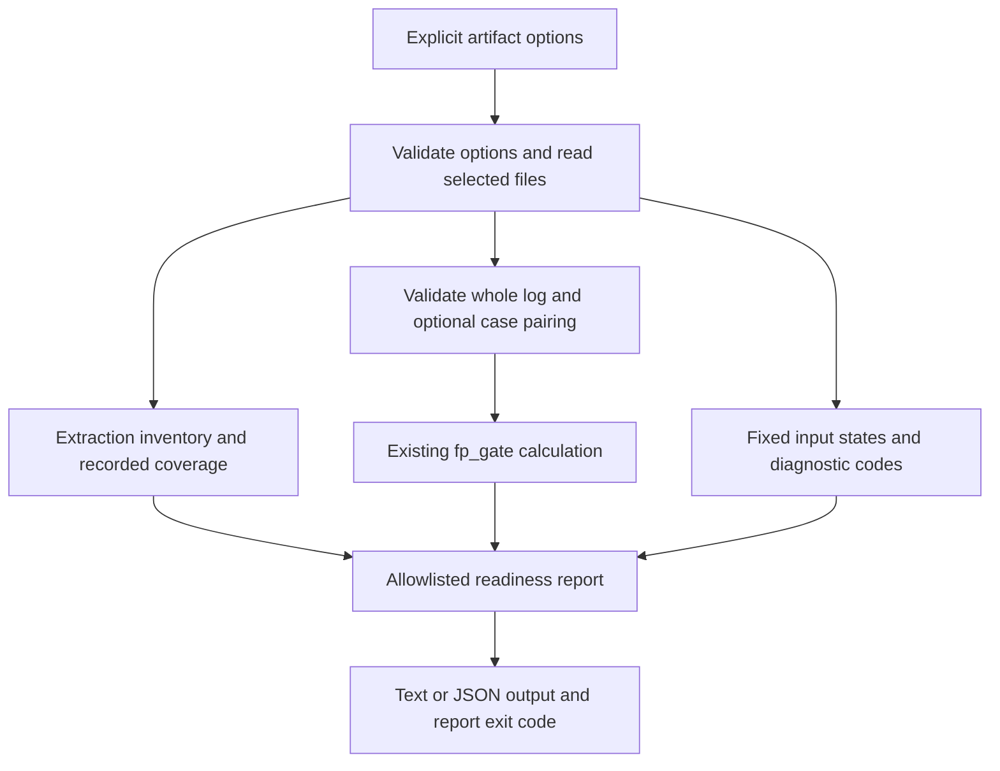

# Content-free Pipeline Readiness - Plan

## Goal Capsule

- **Objective:** Operators can see which pipeline inputs, coverage facts and quality-gate evidence are available without exposing document content.
- **Means:** A CLI report over explicitly selected saved artifacts, using the existing R9 calculation and separate aggregate output types (KTD1-KTD4).
- **Authority:** The fi-4 mandate and current stage instructions govern this work. The campaign authority is the chief repository's `docs/plans/2026-10-26-0705-feat-codex-drawdown-campaign-plan.md`, Goal Capsule and cited R9, R11, R15-R17, R19-R20; repository constraints and the sources below govern implementation details.
- **Authority limitation:** The chief file and `ops/drawdown/mandates/_common.md` are absent from this clone and the accessible workspace. Their contents were not independently verified. This plan uses the standing rules supplied with the mandate; the controller should reconcile the cited campaign sections at pickup.
- **Execution profile:** This stage commits the plan only. The later build stage implements fi-4 on `drawdown/fi-4` through the mandated LFG workflow. It commits locally; the controller scans, pushes and opens the PR, and the campaign gate owns merging. Never add a remote or seek credentials.
- **Stop conditions:** Stay within R7-R8. A missing real artifact produces an honest unavailable report; it does not require a login, service signup, human certification or work on another mandate item.

---

## Product Contract

### Summary

Add a content-free readiness command that reports available input artifacts, recorded extraction coverage and the R9 result supported by saved dispositions. The report explains missing or inconsistent evidence and works offline. Text and JSON output carry the same facts.

### Problem Frame

Operators currently have separate extraction files, polysemy commands and historical handoffs. An extraction file can contain useful output while saying nothing about omitted source material. A recorded quality result can also concern a different run from the extraction being inspected. Combining these into an unexplained green status would overstate what the evidence proves.

### Requirements

**Report behavior**

- R1. Provide one CLI command reporting input availability, extraction coverage and recorded R9 gate status from explicitly selected artifacts.
- R2. Keep stdout, stderr and logs content-free: allow only fixed field names, fixed statuses/reason codes, aggregate counts, finite numbers, booleans and nulls. Never emit source text, filenames or paths, corpus names, unit/case identifiers, terms, labels, IRIs, reviewer identities, rationales, arbitrary metadata keys or raw exceptions.
- R3. Distinguish unavailable, empty, incomplete and inconsistent evidence. Coverage must name its denominator and preserve unknown values; recorded flags or output counts cannot establish complete source coverage or freshly verified grounding.
- R4. Preserve the canonical Phase 9 R9 arithmetic and certification rules when computing over usable recorded dispositions. Identify that evidence's scope and assurance; never claim a fresh detector evaluation, signed certification or a combined pipeline pass.
- R5. Provide deterministic text and JSON representations with documented exit semantics. A bad selected artifact must leave independently usable sections visible, without accepting a valid prefix of a corrupt artifact.

**Compatibility and campaign boundaries**

- R6. Add tests for the new behavior and preserve existing behavior and tests; do not delete, weaken or skip existing checks to obtain a pass (campaign R15-R16 as supplied).
- R7. Inspect only the selected evidence files without modifying them or initializing pipeline state. No provider/model execution, network access, credential discovery, secret-file reads, schema migration, data rewrite, release, outside service, spend, security change, send or unbacked deletion is part of fi-4 (campaign R11, R15-R16 as supplied).
- R8. Keep this expansion on its single branch and within the mandate's ownership limits. The build hands local commits to the controller under campaign R17/R19; any essential user-only blocker follows R20 rather than silently expanding the work.

### Key Decisions

- **One expansion with guardrail review.** (session-settled: user-directed — chosen over holding every expansion for individual approval: the campaign authorizes expansions that meet its guardrails.) Governs R6, R8.
- **No wait for user availability.** (session-settled: user-directed — chosen over blocking this week's work on user decisions: build the agent-doable scope and report genuine blockers.) Governs R7-R8.

### Acceptance Examples

- AE1. **Covers R1-R3.** Given four emitted units with three recorded nonempty tag IRIs and two recorded verified-anchor flags, report fractions 3/4 and 2/4. Full-source coverage remains unknown; none of the units' content or paths appears.
- AE2. **Covers R3, R5.** Given an old artifact missing anchor flags, report the missing evidence separately. An empty unit array has a known count of zero and null coverage fractions.
- AE3. **Covers R4.** Given 70 valid recorded dispositions with zero false positives and no certification, report the canonical provisional result. A matching synthetic test certification can exercise the existing pass branch; production inspection never creates a certification.
- AE4. **Covers R4-R5.** Given an uncertified labeled set and a log missing one case, mark that gate evidence inconsistent. Do not compute a favorable bound from the subset or silently downgrade to log-only scope.
- AE5. **Covers R2, R5, R7.** Given a valid extraction and a malformed final JSONL record containing a sentinel, retain the extraction section, report a fixed gate-input error and exit 1. No sentinel, input path or exception text appears, and no files change.

### Scope Boundaries

The implementation reads the existing extraction JSON, disposition JSONL and optional polysemy labeled-set JSON formats. It adds report types, CLI rendering, tests and README usage.

The review viewer, U7 provider bake-off, archive/backup branches, signing stack, Rule 3, closedUnder writer, corpus-scoped signing and CORPUS-04 wiring remain outside fi-4. No frontend file is changed, so the campaign's frontend screenshot requirement does not apply to this scope.

#### Deferred to Follow-Up Work

The other mandate items retain ownership of signed decisions and CORPUS-04 work (fi-1), held-out Rule 3 improvement (fi-2), branch reconciliation (fi-3), and CI/Hypothesis work (fi-5). The measured-propositions plan retains its evaluator, held-out gate and workbench units.

#### Considered and Not Built

- A new source-coverage ledger or extraction writer change: the existing artifact cannot prove complete input coverage; explicitly reporting that limitation satisfies this report's purpose. Reconsider only under an item authorizing new pipeline evidence production.
- Live environment probes, a database reader, automatic artifact discovery or a repair command: each adds state or access beyond the selected artifacts. Missing evidence is visible without those mechanisms.
- A new receipt format, current-revision attestation or global ready badge: the selected files lack shared run provenance. This command reports independent recorded evidence rather than inventing that binding.
- A corpus-manifest option and measurement-store integration: neither supplies the missing exhaustive source denominator or R9 detector provenance. Additional artifact adapters require a separate demonstrated operator need.

---

## Planning Contract

### Verified Starting State

Static inspection on `2026-10-27` found a clean `drawdown/fi-4` at `99c3f6d`, with no git remotes. No repository `AGENTS.md` or `CLAUDE.md` was present. Tests and application commands were not run in this plan stage; historical pass counts are not a current baseline.

| Current evidence | Consequence |
|---|---|
| `src/folio_insights/cli.py` has no readiness command and uses module-bottom command registration. | Add one top-level command using the existing Click entry point. |
| `src/folio_insights/quality/output_formatter.py` writes unit rows, `total_units` and selected summary metadata, but no exhaustive source-coverage ledger. | Derive emitted-unit metrics and preserve unknown full-source coverage. |
| `src/folio_insights/models/knowledge_unit.py` defaults missing tags/anchor flags. | Check raw field presence before model defaults can erase unknowns. |
| `src/folio_insights/polysemy/fp_audit.py` exposes the pure `fp_gate` calculation; certification is currently self-asserted. | Reuse its calculation and disclose its assurance. |
| `src/folio_insights/polysemy/cli.py` loads credentials in its group callback and `gate` evaluates the detector. | Register at the CLI root and avoid that execution path. |
| `src/folio_insights/measurement/cli.py` has unavailable baseline/compare stubs; measurement completion is not gate acceptance. | Keep measurement status outside this report. |

The October 20 handoff's 12/82 result is historical. It is neither recomputed nor embedded as the new command's current result. The newer `docs/handoffs/2026-10-26-measured-propositions-drain.md` confirms additional pipeline work has landed since that handoff.

### Assumptions

These defaults fill details the short mandate leaves open; they are technical choices, not additional user-approved product requirements.

- A1. Explicit saved artifacts are the useful input boundary for an offline command; no default corpus or fixture is selected.
- A2. Coverage means recorded tagging and anchor evidence over emitted units. The report also states that complete original-input coverage is unknown.
- A3. Gate status means the existing polysemy R9 calculation over saved dispositions. It does not certify current-code quality or establish that extraction and gate inputs belong to the same run.
- A4. Exit status describes report generation, so a rendered failed gate remains useful data. Consumers inspect the gate section before making any acceptance decision.

### Key Technical Decisions

- KTD1. **Explicit readers and a separate output model.** Add `src/folio_insights/readiness.py` for parsing and aggregation and `src/folio_insights/readiness_cli.py` for Click/rendering. Read each selected file once, validate its whole contents, and project into a fixed-field report. Avoid Settings, corpus registries, store constructors and pipeline orchestrators; several existing constructors load configuration or initialize persistence. Implements R1-R3, R7 under A1.
- KTD2. **Define coverage only from recorded fields.** Use the coverage contract below. Do not serialize existing model dumps or infer missing fields from `KnowledgeUnit` defaults. This follows the source-content lesson in `docs/solutions/verifiable-source-anchoring.md` and the coverage lesson in `docs/solutions/heading-as-unit-fabrication.md`. Implements R2-R3 under A2.
- KTD3. **Validate evidence before calling the owning gate.** Parse dispositions with the existing schema and labeled sets with `load_labeled_set`; add adapter checks described below without changing the detector, certification rules or `fp_gate`. This avoids treating an arbitrary detector dictionary as a valid observation. Implements R4 under A3.
- KTD4. **Keep invocation success distinct from quality status.** Use the interface and exit contract below, a versioned JSON output envelope, and stable text labels. Do not include a report timestamp or caller-derived strings. Implements R2, R5 under A4.
- KTD5. **Prove the read boundary at the actual entry point.** Test through the root CLI, including a fresh-process guard, and verify unchanged artifact bytes and directory contents. `tests/api/test_read_side_effects.py` and `tests/validation/test_report_cli.py` supply relevant patterns. Implements R6-R7.

### Interface and Output Contract

The command is `folio-insights readiness` with optional `--extraction PATH`, `--dispositions PATH`, `--labeled-set PATH`, and `--format text|json`; text is the default. A labeled set requires dispositions. No arguments is valid and reports evidence not supplied.

| Contract | Required behavior |
|---|---|
| JSON envelope | Fixed schema version `folio-insights/readiness/v1`; separate `inputs`, `coverage` and `polysemy_r9` sections plus fixed diagnostic codes. |
| Input states | `not_supplied`, `available`, `unreadable`, `invalid`, `inconsistent`, indexed by fixed artifact roles rather than supplied names. |
| Exit 0 | Report rendered and all selected artifacts usable, including recorded fail/provisional results or omitted optional evidence. This is not a quality-gate pass. |
| Exit 1 | At least one selected artifact unreadable, invalid or inconsistent; render the remaining usable sections. |
| Exit 2 | Invalid CLI syntax or labeled-set-only combination; the combination check occurs before artifact reads. |
| Error output | Fixed artifact role and reason, without original exception messages, parser excerpts or filesystem paths. Avoid Click path-existence validation that echoes supplied paths. |
| Determinism | Identical artifact bytes and options produce identical output; sort fixed collections and reject nonfinite numeric output. |

### Coverage Contract

Require an extraction object with a `units` array of objects. A supplied `total_units` must be a nonnegative integer equal to that array's length; reject booleans as counts. Validate types of all consumed fields. Unknown extra fields are ignored and never copied. Malformed consumed fields invalidate the extraction section; absent optional fields remain unknown.

- **Input inventory:** derive emitted-unit count from the array; display `summary.documents_processed` only as a recorded document count. Count distinct nonempty `source_file` values internally without opening them; if any unit lacks that reference, the complete distinct-source count is unknown.
- **Recorded IRI tagging:** a unit is tagged when its recorded `folio_tags` contains at least one nonempty IRI string, following the existing writer's accounting convention. An empty list or only empty IRIs is a recorded negative. An absent list or absent IRI field is unknown. This is not ontology validation or semantic accuracy.
- **Recorded anchor flags:** count literal true, literal false and absent `anchor_verified` separately. No source reread, span validation or mint-eligibility claim occurs.
- **Fractions:** retain numerator, total emitted-unit denominator and unknown-unit count for each metric. A fraction is available only when the denominator is positive and no unit is unknown for that metric; otherwise it is null.
- **Full-source coverage:** always unknown with the fixed reason `source_coverage_not_recorded` for this adapter. Optional metadata such as `coverage_complete`, free-form summaries and model confidence cannot override it.

Do not add diagnostics for arbitrary `folio_tagger`, canary or LLM metadata in this version; those maps contain strings and have separate semantics. The availability and coverage fields above are the complete extraction projection.

### Recorded R9 Contract

Materialize the entire selected JSONL log before calculation; blank lines are permitted, malformed rows are not skipped. Every record must carry one of the existing detector decisions: `polysemy`, `homonymy`, `coincidence`, `uncertain`. A missing or unknown detector decision makes the log invalid, since `fp_gate` otherwise counts that record in N without treating it as a detector positive.

When a labeled set is selected, require exactly one record per case, unique matching `audit_label` values, no missing/extra cases, and matching term, disposition decision and rationale. Perform this check even without certification: the canonical gate's certification helper returns early when certification is absent. A mismatch makes that section inconsistent; do not fall back to log-only scope.

Call `fp_gate` only after these checks. Retain its threshold, N, false positives, upper bound, status, certification validity and invalid-disposition count. Legacy rejects with blank rationale remain loadable and are excluded/countable exactly as the owning gate specifies. Do not change their semantics in fi-4.

The output identifies `basis` as `recorded_log` or `recorded_labeled_set` and fixes `current_detector_evaluated` to false. For this checkout, valid certification has `certification_assurance: self_asserted`; no certification has assurance `none`. Map any certification problem to a fixed diagnostic, never its free text or certifier identity. If fi-1 changes this stack before implementation, recheck its public validation contract and report only the assurance actually established without accessing keys or networks.

An omitted log has unavailable status and null figures. An explicitly empty log retains the canonical N=0, upper-bound=1, fail result, with `insufficient_evidence`; displayed rate fractions with zero denominators are null. Without a labeled set a log cannot certify a benchmark pass. Keep the extraction section independent from this gate: neither file proves common corpus, run or detector revision.

### High-Level Technical Design

The interface table defines option combinations and exits; the coverage and R9 contracts define conditional states. There is no persistent state transition, new storage format or promotion operation.

---

## Implementation Units

### U1. Read extraction evidence and aggregate coverage

**Goal:** Produce content-free input and coverage sections with explicit unknowns.

**Requirements:** R1-R3, R5-R7; AE1-AE2. **Dependencies:** none.

**Files:** create `src/folio_insights/readiness.py` and `tests/readiness/test_extraction.py`.

**Approach:** Implement the report types and extraction adapter under KTD1-KTD2. Follow the existing formatter's actual shape, preserving raw field presence. Keep error projection separate from parsed content.

**Execution note:** Begin with synthetic examples that distinguish recorded zero/false from absent fields.

**Patterns to follow:** `quality/output_formatter.py`, `models/knowledge_unit.py`, and `tests/test_output.py`, all under their existing `src/folio_insights/` or `tests/` roots.

**Test scenarios:**

1. Covers AE1. Mixed tagged, proposed-only and untagged units produce the correct counts and fractions, without labels or IRIs.
2. Covers AE2. Empty units and missing legacy fields preserve zero versus unknown and null denominators.
3. Mismatched totals, non-object units, wrong boolean/numeric types and malformed consumed summary fields invalidate the section instead of dropping rows.
4. Missing/partial source references and document summaries remain unknown where necessary; neither filenames nor unrecognized metadata keys escape.
5. A supplied `coverage_complete: true` does not override unknown full-source coverage.

**Verification:** The adapter handles current formatter output and legacy omissions without source reads or pipeline imports.

### U2. Add recorded R9 evidence aggregation

**Goal:** Report the existing gate result only for structurally usable recorded evidence.

**Requirements:** R1-R4, R6-R7; AE3-AE4. **Dependencies:** U1.

**Files:** extend `src/folio_insights/readiness.py`; create `tests/readiness/test_polysemy.py`.

**Approach:** Implement KTD3 against the public disposition/labeled-set types and `fp_gate`. Keep the readiness adapter's evidence validation local; do not revise the gate or detector.

**Patterns to follow:** `src/folio_insights/polysemy/dispositions.py`, `src/folio_insights/polysemy/labeled_set.py`, `tests/polysemy/test_fp_gate.py`, and `tests/polysemy/test_review_fixes.py`.

**Test scenarios:**

1. Covers AE3. Synthetic evidence exercises fail, provisional and valid-certification pass, matching the owning gate's N, FP count, threshold and Wilson upper bound.
2. Digest mismatch, insufficient certification sample and absent certification never become a certified pass; no reviewer value or free-form problem is printed.
3. Covers AE4. Missing, duplicate, extra and term/decision/rationale-mismatched cases invalidate pairing, including an uncertified labeled set.
4. Missing/unknown detector decisions invalidate the entire log. Blank lines remain accepted; a malformed tail never yields prefix-only metrics.
5. Omitted log, empty log and blank-rationale rejects retain their distinct contracts and denominators.
6. No detector, embedding builder, reasoner, signing operation or provider is invoked.

**Verification:** Computation agrees with existing gate tests and its recorded-evidence scope cannot be mistaken for a fresh evaluation.

### U3. Expose the content-free CLI

**Goal:** Make the report usable by operators and automation through the existing command entry point.

**Requirements:** R1-R5, R7-R8; AE5. **Dependencies:** U1-U2.

**Files:** create `src/folio_insights/readiness_cli.py` and `tests/readiness/test_cli.py`; modify `src/folio_insights/cli.py` and `README.md`.

**Approach:** Register one top-level command under KTD4. Render only the report types from U1-U2; fixed human-readable explanations may accompany their reason codes. Document evidence scope, unknown coverage, all options and exit semantics with synthetic relative-path examples.

**Patterns to follow:** module-bottom registration in `src/folio_insights/cli.py`, structured/text separation in `src/folio_insights/validation/report.py`, and sanitized failures in `src/folio_insights/measurement/cli.py`.

**Test scenarios:**

1. Root help exposes the command; no arguments renders all evidence not supplied with exit 0.
2. Text and JSON agree on metrics and statuses; repeated invocations have identical output.
3. Covers AE5. One unusable artifact leaves independently usable sections visible with exit 1; no traceback or path is printed.
4. Labeled-set-only invocation exits 2 before file access. Wrong options/formats remain usage errors with content-free diagnostics.
5. A recorded failing/provisional gate renders with exit 0; the report contains no combined ready/pass flag.

**Verification:** CliRunner exercises the actual root command, and documented examples match the implemented parser and output.

### U4. Verify privacy, read-only behavior and regressions

**Goal:** Prove the complete command respects the content and execution boundaries.

**Requirements:** R2, R6-R8; AE5. **Dependencies:** U1-U3.

**Files:** create `tests/readiness/test_boundaries.py`; extend the new readiness test modules if needed. Existing test files remain intact.

**Approach:** Apply KTD5 to synthetic artifact trees. Guard settings/credential loading, source-file opens, stateful constructors, subprocess/model/provider use and network calls. Preserve the existing suite and compare environment failures against the baseline rather than weakening checks.

**Test scenarios:**

1. Sentinel values in paths, corpus/unit/case names, text, snippets, terms, IRIs, labels, reviewer fields, arbitrary metadata keys and invalid values never appear in either format, stderr or logs.
2. Missing files, permission/read errors and JSON/Pydantic failures produce only fixed role/reason diagnostics.
3. Input bytes, mtimes and directory entries remain unchanged across valid, empty, partial and invalid reports; nonexistent roots stay nonexistent.
4. A fresh-process root CLI invocation succeeds with model/provider/state initialization guarded against and creates no application artifacts. Keep Python bytecode outside the observed evidence tree or disabled in this test.
5. Existing CLI registration, extraction formatting and polysemy gate tests still pass without altered expectations.

**Verification:** Focused boundary tests and the applicable regression suite pass offline; any sandbox limitation has a precise controller-rerun receipt.

---

## Verification Contract

All runtime verification belongs to the build stage. First recheck the branch and relevant artifact producers against this plan's starting commit; fi-1 or measured-propositions work may have changed the interfaces.

| Check | Scope and acceptance |
|---|---|
| New tests | Pytest over `tests/readiness/` proves U1-U4, including malformed tails, absent fields, evidence mismatch and all output channels. |
| Focused regression | Pytest over `tests/test_cli.py`, `tests/test_output.py`, `tests/polysemy/test_fp_gate.py`, `tests/polysemy/test_dispositions_jsonl.py`, `tests/polysemy/test_labeled_set.py`, and `tests/polysemy/test_review_fixes.py`; existing expectations remain intact. |
| CLI integration | Actual root command and a fresh-process invocation exercise registration and prohibited side-effect guards using synthetic evidence only. |
| Repository quick suite | Use the existing pytest marker policy `not gate5 and not slow and not integration`; report actual pass/fail/skip counts and baseline failures. Never relabel environment errors as passes. |
| Sandbox limitations | Unix-socket restrictions may prevent existing asyncio tests from running. Preserve failures and have the controller run the unchanged checks in its supported environment; do not add socket workarounds in fi-4. |
| Public-safe diff | Only this plan during planning; implementation adds the named CLI/report/test/docs surface. No source excerpts, machine-local paths, credential material or generated private artifacts enter commits. |
| Frontend evidence | Not applicable while the viewer remains untouched; any frontend scope change requires the campaign's committed Playwright screenshot and a scope reassessment. |

The report's existence is not R9 improvement evidence. fi-2 owns held-out detector improvement; no historical gate result or synthetic adapter test satisfies that campaign objective.

---

## Definition of Done

- The plan stage ends with this plan committed locally on `drawdown/fi-4`, with no implementation or test execution claimed.
- The build delivers U1-U4 and their named tests, with no launch-blocking technical question remaining.
- Both output formats satisfy R2 on success and failure; unknown evidence, zero denominators and recorded gate status follow the stated contracts.
- The command performs no source-document, model, provider, settings, credential or stateful-store work.
- Applicable tests pass, or baseline/environment limits are reported with the checks still required by the controller. A blocked verification is not a merge-ready claim.
- Simplification and required reviews complete before the build's local handoff; no abandoned experimental implementation remains in the diff.
- The controller receives the branch and plan path for publication under R8. No migration, data rewrite, release, new service, frontend screenshot or user decision is required by this scope.

---

## Sources

- Campaign authority and common mandate: chief repository paths named in the Goal Capsule, unavailable in this sandbox; only the supplied standing-rule excerpt was available.
- Required local context: `docs/handoffs/2026-10-20-sweep-cloud-folio-insights.md`, `docs/plans/2026-10-20-feat-phase9-u6-polysemy-plan.md`, and `docs/handoffs/2026-10-09-drain-coordination.md`.
- Current adjacent scope: `docs/handoffs/2026-10-26-measured-propositions-drain.md` and the relevant measurement boundaries in `docs/plans/2026-10-26-0716-feat-measured-propositions-and-workbench-plan.md`.
- Relevant lessons: `docs/solutions/verifiable-source-anchoring.md`, `docs/solutions/heading-as-unit-fabrication.md`, `docs/solutions/sys-path-bridge-staleness.md`, and `docs/solutions/llm-path-unverified-iris.md`.
